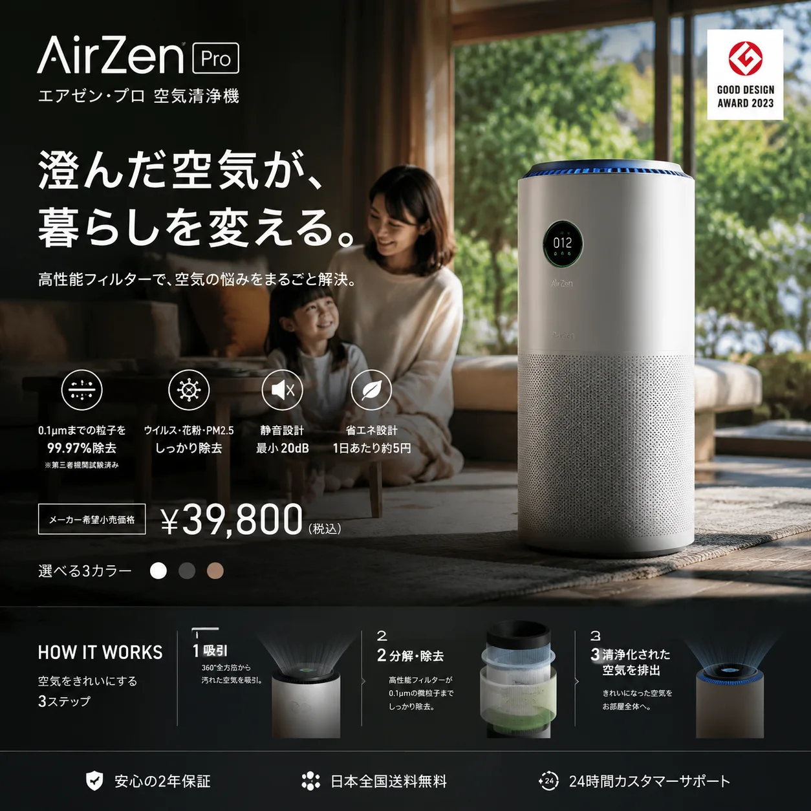

# Japanese-style futuristic product advertisement, ultra-detailed, filmic, cinematic lighting, premium

[← Back to the collection](../../README.md) · Category: [Poster Design](../../gallery/poster-design.md) · Model: `Vinano Studio` · ID: `vn-01213`

<a href="https://vinano.ai?utm_source=github&utm_medium=readme&utm_campaign=awesome-image-video-prompts-updating&utm_content=prompt-page-image"></a>

<sub>Preview generated with <a href="https://vinano.ai?utm_source=github&utm_medium=readme&utm_campaign=awesome-image-video-prompts-updating&utm_content=prompt-page-caption">vinano.ai</a></sub>

## Prompt

```text
Create a hyper-realistic Japanese-style futuristic product advertisement, ultra-detailed, filmic, cinematic lighting, premium clean layout.

The product is:

[DESCRIBE YOUR IDEA]

Scene:
Place the product in a real-world, emotionally impactful environment where its function is clearly visible.

Focus on:
– a strong central moment
– natural human interaction
– clear demonstration of the benefit

Include:
– product name
– headline
– subheadline
– feature icons, colors, shape, etc
– pricing
– “how it works” section

Preserve realistic proportions and depth for a confident, professional finish.
```

## Try it on vinano.ai

1. Copy the prompt above.
2. Open **[vinano.ai](https://vinano.ai?utm_source=github&utm_medium=readme&utm_campaign=awesome-image-video-prompts-updating&utm_content=prompt-page-try)**, paste it into the image generator and pick a model.
3. Swap any placeholders (brand, product, city, person…) for your own details, then generate.

More prompts like this: [Poster Design gallery](../../gallery/poster-design.md) · [all categories](../../README.md#contents)
