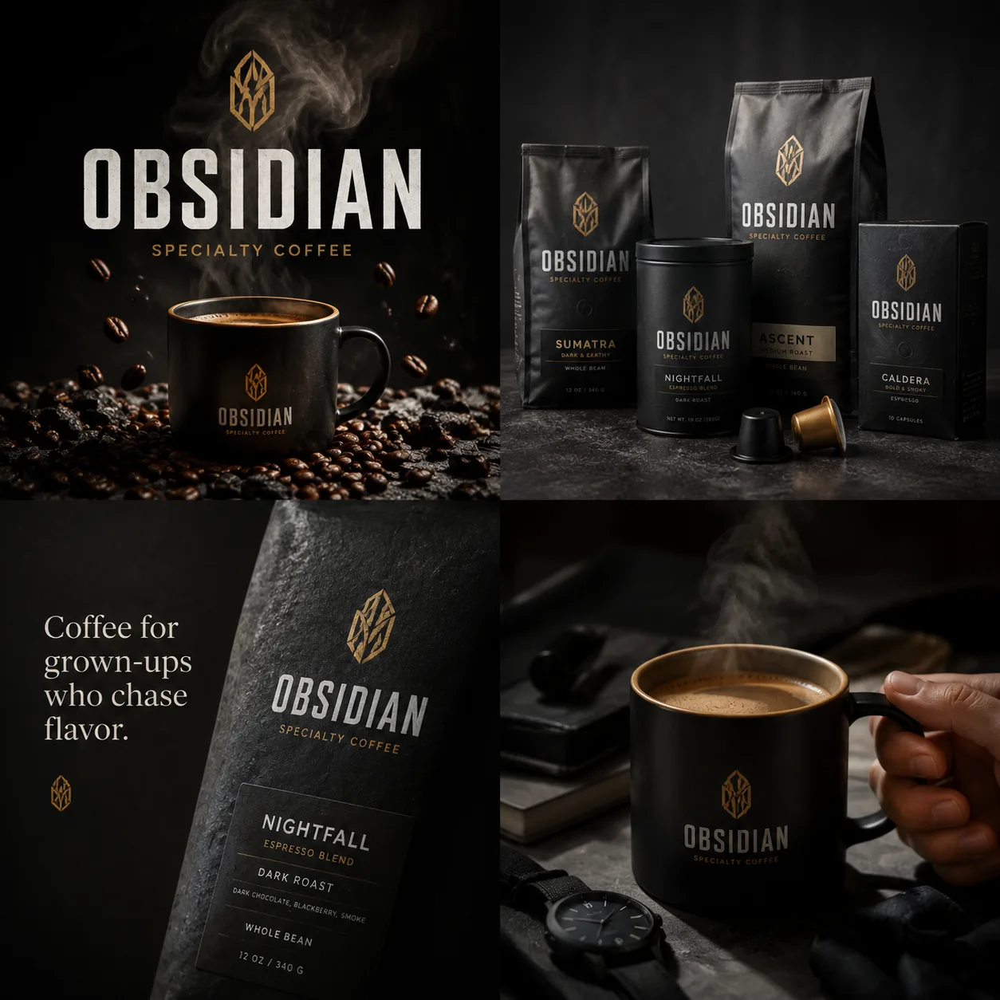

# Four connected premium realistic editorial images for OBSIDIAN coffee

[← Back to the collection](../../README.md) · Category: [Poster Design](../../gallery/poster-design.md) · Model: `Vinano Studio` · ID: `vn-01218`

<a href="https://vinano.ai?utm_source=github&utm_medium=readme&utm_campaign=awesome-image-video-prompts-updating&utm_content=prompt-page-image"></a>

<sub>Preview generated with <a href="https://vinano.ai?utm_source=github&utm_medium=readme&utm_campaign=awesome-image-video-prompts-updating&utm_content=prompt-page-caption">vinano.ai</a></sub>

## Prompt

```text
Create four connected premium realistic editorial images for OBSIDIAN coffee. Dark cinematic grown-up vibe like high-end sportswear or coffee campaigns. Dramatic but grounded studio lighting, realistic textures, crisp composition. Image 1: Hero poster ‘OBSIDIAN’ and premium coffee display steam and beans. Image 2: Product lineup - bags, cans, capsules. Image 3: Packaging close-up + tagline ‘Coffee for grown-ups who chase flavor.’ Image 4: Lifestyle steaming cup shot. Highly polished, sharp, realistic materials, consistent branding, no surreal effects Aim for an editorial, design-driven look with deliberate negative space.
```

## Try it on vinano.ai

1. Copy the prompt above.
2. Open **[vinano.ai](https://vinano.ai?utm_source=github&utm_medium=readme&utm_campaign=awesome-image-video-prompts-updating&utm_content=prompt-page-try)**, paste it into the image generator and pick a model.
3. Swap any placeholders (brand, product, city, person…) for your own details, then generate.

More prompts like this: [Poster Design gallery](../../gallery/poster-design.md) · [all categories](../../README.md#contents)
