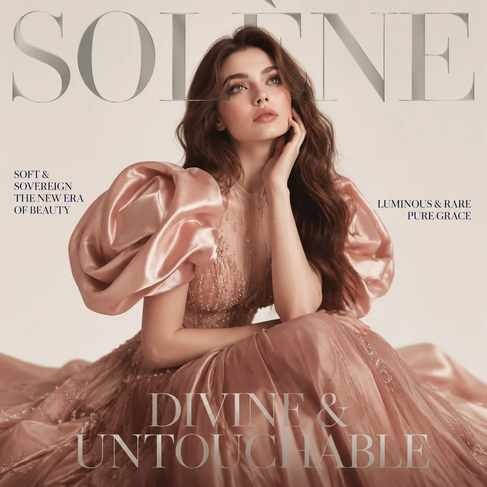

# Breathtaking luxury fashion magazine cover

[← Back to the collection](../../README.md) · Category: [Poster Design](../../gallery/poster-design.md) · Model: `Vinano Studio` · ID: `vn-01223`

<a href="https://vinano.ai?utm_source=github&utm_medium=readme&utm_campaign=awesome-image-video-prompts-updating&utm_content=prompt-page-image"></a>

<sub>Preview generated with <a href="https://vinano.ai?utm_source=github&utm_medium=readme&utm_campaign=awesome-image-video-prompts-updating&utm_content=prompt-page-caption">vinano.ai</a></sub>

## Prompt

```text
A breathtaking luxury fashion magazine cover. Large bold silver serif brand name "SOLÈNE" elegantly placed at the very top of the frame, slightly transparent and overlapping the model's hair — exactly like a high-end fashion magazine masthead. Clean cream-white background, seamless studio, soft warm-toned lighting.

A young, extremely cute and beautiful white woman soft angelic facial features, full lips, big dreamy green eyes long lashes, and long silky chocolate brown wavy hair cascading freely over both shoulders. She sits gracefully — upper body leaning slightly forward, one arm resting on her knee, the other hand delicately touching her jaw, her gaze looking slightly upward and off-camera a soft mysterious expression — elegant and effortless.

She wears a dramatic floor-length dusty rose blush satin ballgown exaggerated sculptural puff shoulders that billow outward like rose petals — the bodice is a sheer champagne silk mesh embroidered tiny pearl and crystal details, fitted through the waist and blooming into an enormous tiered skirt pooling around her. The fabric catches the light a soft luminous sheen.

Magazine text overlaid naturally into the composition — left side in deep charcoal navy small serif caps: "SOFT & SOVEREIGN / THE NEW ERA OF BEAUTY" — right side: "LUMINOUS & RARE / PURE GRACE" — bottom of frame in large elegant serif display font, slightly transparent: "DIVINE & UNTOUCHABLE"
Vertical 9:13 format. Ultra true-to-life photorealistic, 8K, no text overlays, cinematic color grading.

Aim for an editorial, design-driven look with deliberate negative space.
```

## Try it on vinano.ai

1. Copy the prompt above.
2. Open **[vinano.ai](https://vinano.ai?utm_source=github&utm_medium=readme&utm_campaign=awesome-image-video-prompts-updating&utm_content=prompt-page-try)**, paste it into the image generator and pick a model.
3. Swap any placeholders (brand, product, city, person…) for your own details, then generate.

More prompts like this: [Poster Design gallery](../../gallery/poster-design.md) · [all categories](../../README.md#contents)
