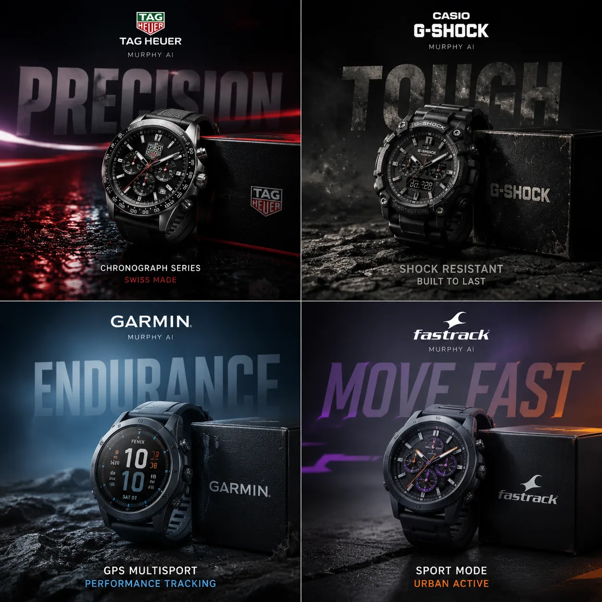

# TAG Heuer

[← Back to the collection](../../README.md) · Category: [Poster Design](../../gallery/poster-design.md) · Model: `Vinano Studio` · ID: `vn-01228`

<a href="https://vinano.ai?utm_source=github&utm_medium=readme&utm_campaign=awesome-image-video-prompts-updating&utm_content=prompt-page-image"></a>

<sub>Preview generated with <a href="https://vinano.ai?utm_source=github&utm_medium=readme&utm_campaign=awesome-image-video-prompts-updating&utm_content=prompt-page-caption">vinano.ai</a></sub>

## Prompt

```text
TAG Heuer — Track Surface (REAL, NOT FAKE)

High-end commercial watch advertisement, TAG Heuer chronograph, single watch leaning against its box, centered composition, slight front three-quarter angle

environment: real wet asphalt surface inspired by race track texture, subtle tire marks, light moisture, NOT full scene

background: soft dark depth slight motion blur light streak hints, minimal, not literal track

lighting: controlled studio lighting strong key for dial clarity, subtle red rim light for racing identity, crisp reflections on metal and glass

composition: tight grouping, grounded, realistic spacing

perspective typography (primary): large “PRECISION” in background, soft perspective, slightly diffused, low opacity, blending into depth

secondary typography:
“CHRONOGRAPH SERIES”
“SWISS MADE”

branding: logo top center, “MURPHY AI” beneath

surface: wet asphalt reflection, controlled, not exaggerated

color palette: black, steel, red accents

ultra-realistic materials (brushed metal, sapphire reflections, lume details)

1:1 square format

Casio G-Shock — Rugged Ground (LIKE YOUR CHARCOAL SHOT)

High-end commercial watch advertisement, G-Shock rugged watch, single watch leaning against its box, centered

environment: controlled rough stone / cracked surface dust particles, minimal debris (like your Nivea charcoal setup)

background: dark soft gradient slight haze, no literal landscape

lighting: directional studio lighting, strong highlights on edges, controlled shadow depth

composition: grounded, tight product grouping

perspective typography (primary): bold “TOUGH” in background, slightly broken texture, soft perspective depth, low opacity

secondary typography:
“SHOCK RESISTANT”
“BUILT TO LAST”

branding: logo top center, “MURPHY AI” beneath

surface: matte rough texture, minimal reflection

color palette: charcoal, black, muted tones

ultra-detailed rugged material finish

1:1 square format

Garmin — Outdoor Tech (CONTROLLED, NOT LANDSCAPE)

High-end commercial watch advertisement, Garmin GPS smartwatch, single watch leaning against its box, centered

environment: textured rock surface subtle moisture and fine dust, clean minimal outdoor feel (not full mountain scene)

background: deep cool gradient faint mist layers for depth

lighting: soft controlled lighting, cool rim highlights, clean display visibility

composition: tight, balanced, grounded

perspective typography (primary): “ENDURANCE” large in background, geometric, fading into depth soft haze

secondary typography:
“GPS MULTISPORT”
“PERFORMANCE TRACKING”

branding: logo top center, “MURPHY AI” beneath

surface: natural rock subtle reflection

color palette: blue-grey, black

ultra-clean product rendering

1:1 square format

Fastrack — Urban Surface (LIKE GARNIER WATER BUT DRY)

High-end commercial watch advertisement, Fastrack sports watch, single watch leaning against its box, centered

environment: dark smooth surface slight gloss and subtle texture, faint moisture or light reflection, urban tone

background: soft gradient slight haze, minimal depth

lighting: contrast studio lighting subtle colored accent reflections, controlled highlights

composition: tight and clean

perspective typography (primary): “MOVE FAST” large in background, soft perspective, slightly glowing edges, integrated subtly

secondary typography:
“SPORT MODE”
“URBAN ACTIVE”

branding: logo top center, “MURPHY AI” beneath

surface: controlled reflection, not mirror-like

color palette: black, grey, subtle accent color

ultra-detailed modern finish

Maintain consistent colour harmony and crisp focus across the whole frame.
```

## Try it on vinano.ai

1. Copy the prompt above.
2. Open **[vinano.ai](https://vinano.ai?utm_source=github&utm_medium=readme&utm_campaign=awesome-image-video-prompts-updating&utm_content=prompt-page-try)**, paste it into the image generator and pick a model.
3. Swap any placeholders (brand, product, city, person…) for your own details, then generate.

More prompts like this: [Poster Design gallery](../../gallery/poster-design.md) · [all categories](../../README.md#contents)
