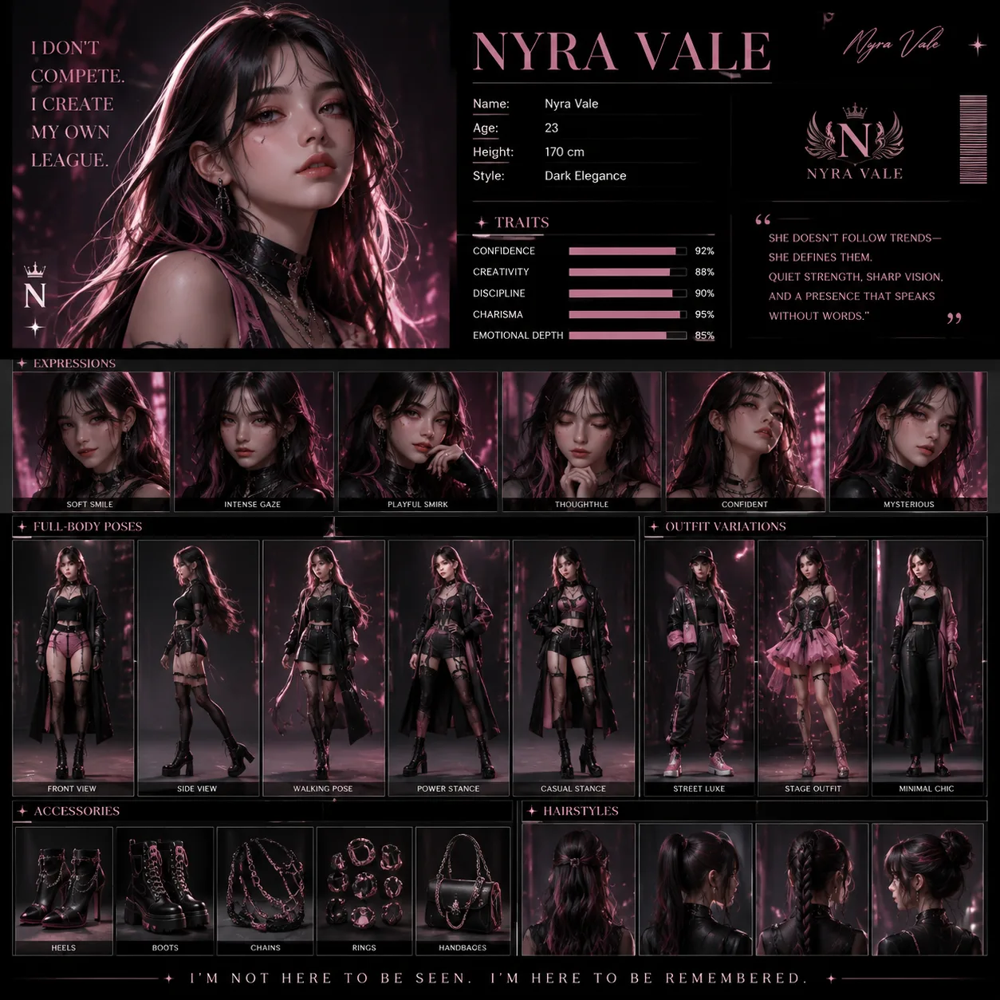

# High-resolution vertical character concept poster a luxury pink

[← Back to the collection](../../README.md) · Category: [Poster Design](../../gallery/poster-design.md) · Model: `Vinano Studio` · ID: `vn-01229`

<a href="https://vinano.ai?utm_source=github&utm_medium=readme&utm_campaign=awesome-image-video-prompts-updating&utm_content=prompt-page-image"></a>

<sub>Preview generated with <a href="https://vinano.ai?utm_source=github&utm_medium=readme&utm_campaign=awesome-image-video-prompts-updating&utm_content=prompt-page-caption">vinano.ai</a></sub>

## Prompt

```text
Create a high-resolution vertical character concept poster a luxury pink and white aesthetic, blending elegance edgy, modern fashion. The layout should feel like a premium magazine profile clean sections and perfect grid alignment.

Main subject: A unique young woman (not resembling any real person), long silky dark hair featuring subtle pink highlights. She has a confident, calm expression a slightly mysterious aura. She wears a black and pink fusion outfit (mix of streetwear and idol fashion) glossy textures, lace, and metallic accents. Lighting is soft but dramatic, neon pink glow against dark tones.

Top section:
Large hero portrait on one side. On the other side, include a sleek profile panel elegant English text:

Name: Nyra Vale
Age: 23
Height: 170 cm
Style: Dark Elegance

Short description:
“She doesn’t follow trends—she defines them. Quiet strength, sharp vision, and a presence that speaks without words.”

Add a Traits section stylish progress bars:

Confidence
Creativity
Discipline
Charisma
Emotional Depth

Middle section:
Grid of 5–6 small portraits showing different expressions (soft smile, intense gaze, playful smirk, thoughtful, confident).

Lower sections:

Full-body poses (front, side, walking pose, power stance, casual stance).
Outfit variations (street luxe, stage outfit, minimal chic).
Accessories panel (heels, boots, chains, rings, handbags, hairstyles).

Text tone:
Strong, meaningful, and confident—focused on individuality, self-worth, and silent power. Avoid filler text.

Style:
Ultra-detailed, 4K quality, glossy magazine finish, filmic, cinematic lighting, sharp focus, balanced contrast, modern editorial layout, perfectly aligned grid.

Maintain consistent colour harmony and crisp focus across the whole frame.
```

## Try it on vinano.ai

1. Copy the prompt above.
2. Open **[vinano.ai](https://vinano.ai?utm_source=github&utm_medium=readme&utm_campaign=awesome-image-video-prompts-updating&utm_content=prompt-page-try)**, paste it into the image generator and pick a model.
3. Swap any placeholders (brand, product, city, person…) for your own details, then generate.

More prompts like this: [Poster Design gallery](../../gallery/poster-design.md) · [all categories](../../README.md#contents)
