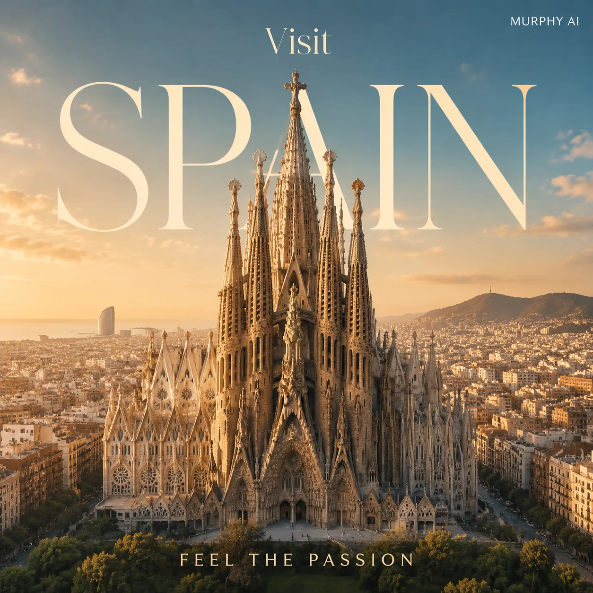

# Luxury tourism poster, Spain, iconic view of Sagrada Família

[← Back to the collection](../../README.md) · Category: [Poster Design](../../gallery/poster-design.md) · Model: `Vinano Studio` · ID: `vn-01242`

<a href="https://vinano.ai?utm_source=github&utm_medium=readme&utm_campaign=awesome-image-video-prompts-updating&utm_content=prompt-page-image"></a>

<sub>Preview generated with <a href="https://vinano.ai?utm_source=github&utm_medium=readme&utm_campaign=awesome-image-video-prompts-updating&utm_content=prompt-page-caption">vinano.ai</a></sub>

## Prompt

```text
Cinematic luxury tourism poster, Spain, iconic view of Sagrada Família in Barcelona rising prominently above the city, detailed organic architecture surrounding urban grid softly visible, clean and centered composition

camera angle: elevated wide perspective capturing full structure symmetry city depth behind

lighting: warm golden hour sunlight casting soft highlights across stone textures, gentle shadows, glowing atmosphere

typography: elegant high-fashion editorial serif font, large refined text "SPAIN" integrated across sky and upper architecture, subtly blending light and structure

text hierarchy:
small top text: "Visit"
main: "SPAIN"
small bottom line: "FEEL THE PASSION"

environment: clean Barcelona cityscape simplified for clarity, no clutter, focus on architecture

color palette: warm gold, sandstone beige, soft blue sky

atmosphere: light haze sun glow enhancing depth and warmth

branding: top right minimal text "MURPHY AI"

STRICT RULES:
— Sagrada Família must be the dominant focal point
— maintain elegance and warmth
— avoid overcrowded city details

render quality: ultra true-to-life photorealistic, cinematic warm Mediterranean grade, premium tourism campaign style

composition: balanced, symmetrical, editorial luxury layout

format: 1:1 square, ultra high resolution

Cinematic luxury tourism poster, Brazil, iconic aerial view of Christ the Redeemer statue overlooking Rio de Janeiro coastline and mountains visible, perfectly centered composition

camera angle: elevated aerial perspective behind or slightly above statue, revealing city and ocean depth

lighting: warm sunrise or sunset golden light vibrant yet controlled tones

typography: elegant editorial serif font, large refined text "BRAZIL" integrated across sky and horizon, softly blending clouds

text hierarchy:
small top text: "Visit"
main: "BRAZIL"
small bottom line: "FEEL THE ENERGY"

environment: lush mountains, coastline, cityscape simplified for clarity

color palette: green, blue, gold highlights

atmosphere: light haze, soft clouds catching sunlight

branding: top right minimal text "MURPHY AI"

STRICT RULES:
— Christ statue must be clear focal point
— avoid over-saturation
— keep composition clean

render quality: ultra true-to-life photorealistic, cinematic vibrant grade

composition: balanced, iconic, postcard-level framing

format: 1:1 square

Cinematic luxury tourism poster, United Arab Emirates, iconic centered view of Burj Khalifa dominating Dubai skyline, seen from elevated perspective surrounding skyscrapers and subtle desert tones

camera angle: wide symmetrical aerial framing emphasizing vertical dominance

lighting: warm golden sunset light reflecting across glass buildings, soft glow, controlled highlights

typography: elegant high-end serif font, large refined text "DUBAI" integrated into sky and skyline, partially blending architecture

text hierarchy:
small top text: "Visit"
main: "DUBAI"
small bottom line: "FEEL THE POWER"

environment: ultra modern skyline, crisp composition, no clutter

color palette: gold, warm amber, deep shadows

atmosphere: light haze, glowing skyline diffusion

branding: top right minimal text "MURPHY AI"

STRICT RULES:
— Burj Khalifa must be dominant focal point
— clean luxury aesthetic
— no distractions

render quality: ultra true-to-life photorealistic, cinematic warm grade

composition: symmetrical, powerful, iconic skyline shot

format: 1:1 square

Render with rich micro-detail while keeping the layout uncluttered and intentional.
```

## Try it on vinano.ai

1. Copy the prompt above.
2. Open **[vinano.ai](https://vinano.ai?utm_source=github&utm_medium=readme&utm_campaign=awesome-image-video-prompts-updating&utm_content=prompt-page-try)**, paste it into the image generator and pick a model.
3. Swap any placeholders (brand, product, city, person…) for your own details, then generate.

More prompts like this: [Poster Design gallery](../../gallery/poster-design.md) · [all categories](../../README.md#contents)
