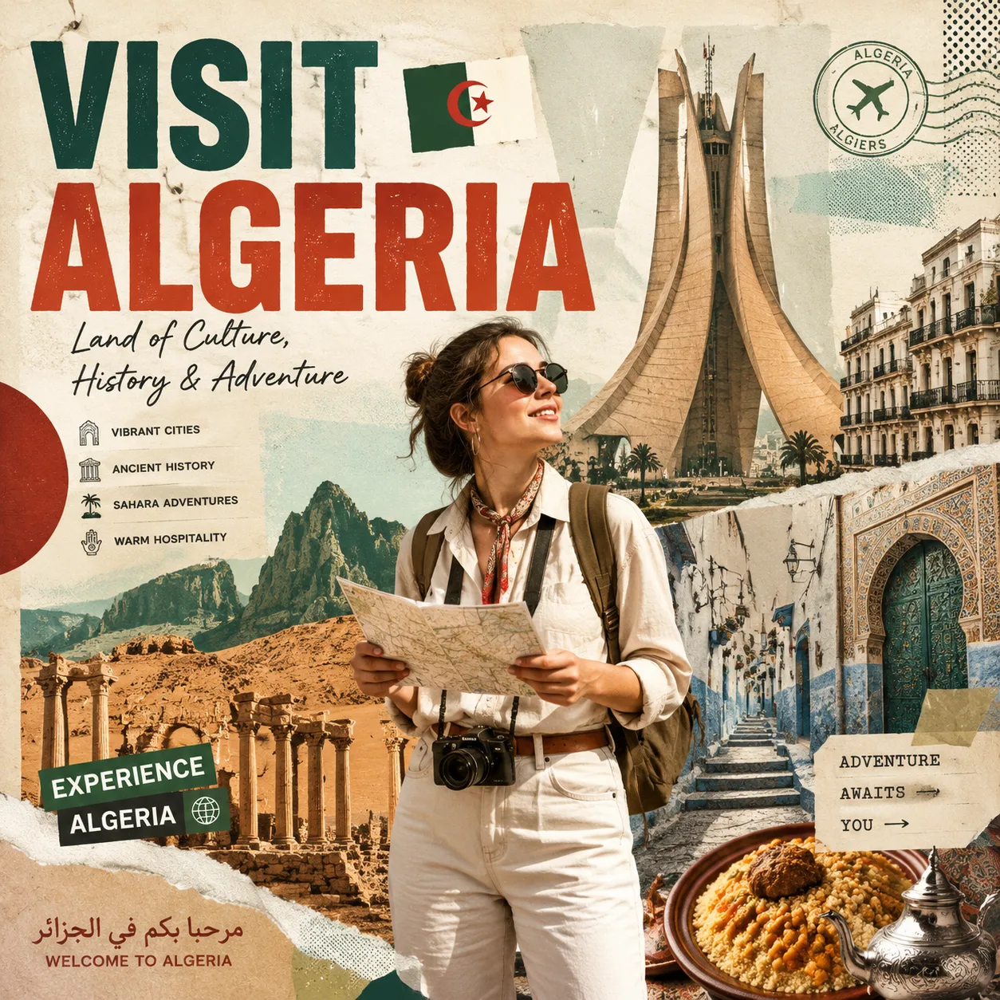

# Stylized travel poster / graphic collage for ALGERIA

[← Back to the collection](../../README.md) · Category: [Poster Design](../../gallery/poster-design.md) · Model: `Vinano Studio` · ID: `vn-01249`

<a href="https://vinano.ai?utm_source=github&utm_medium=readme&utm_campaign=awesome-image-video-prompts-updating&utm_content=prompt-page-image"></a>

<sub>Preview generated with <a href="https://vinano.ai?utm_source=github&utm_medium=readme&utm_campaign=awesome-image-video-prompts-updating&utm_content=prompt-page-caption">vinano.ai</a></sub>

## Prompt

```text
Create a stylized travel poster / graphic collage for [ALGERIA]. The main subject should be a stylish international tourist visiting [ALGERIA], clearly presented as a traveler and not a local resident. Show the tourist wearing modern travel fashion, details such as a camera, backpack, sunglasses, map, or suitcase, exploring the culture and atmosphere of [ALGERIA]. Place the tourist in a dynamic composition surrounded by iconic architecture, streets, landscapes, landmarks, transportation, food, signage, and cultural elements associated [ALGERIA]. Blend realistic character detail a graphic collage background made of layered paper textures, torn poster edges, sticker elements, halftone dots, editorial typography, and bold geometric shapes. Include authentic visual motifs from [ALGERIA], but keep the tourist’s appearance and styling globally fashionable and clearly foreign to the setting. Add a large readable headline: “VISIT [ALGERIA]”. Modern, artistic, premium editorial travel poster aesthetic, balanced layout, print-worthy composition. Aim for an editorial, design-driven look with deliberate negative space.
```

## Try it on vinano.ai

1. Copy the prompt above.
2. Open **[vinano.ai](https://vinano.ai?utm_source=github&utm_medium=readme&utm_campaign=awesome-image-video-prompts-updating&utm_content=prompt-page-try)**, paste it into the image generator and pick a model.
3. Swap any placeholders (brand, product, city, person…) for your own details, then generate.

More prompts like this: [Poster Design gallery](../../gallery/poster-design.md) · [all categories](../../README.md#contents)
