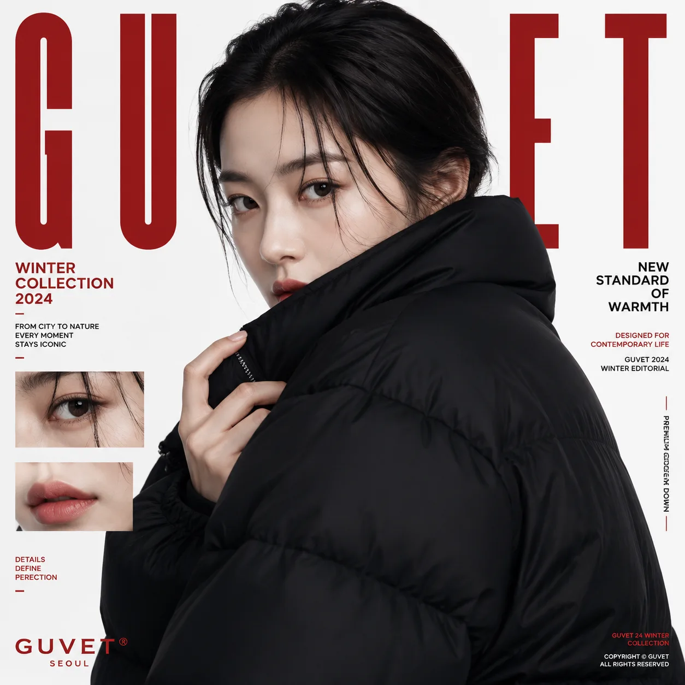

# Bold fashion editorial poster featuring a young woman model

[← Back to the collection](../../README.md) · Category: [Poster Design](../../gallery/poster-design.md) · Model: `Vinano Studio` · ID: `vn-01260`

<a href="https://vinano.ai?utm_source=github&utm_medium=readme&utm_campaign=awesome-image-video-prompts-updating&utm_content=prompt-page-image"></a>

<sub>Preview generated with <a href="https://vinano.ai?utm_source=github&utm_medium=readme&utm_campaign=awesome-image-video-prompts-updating&utm_content=prompt-page-caption">vinano.ai</a></sub>

## Prompt

```text
A bold fashion editorial poster featuring a young woman model in a close-up half-body portrait, wrapped in an oversized black puffer jacket a high padded collar partially covering the lower face, styled in a minimal, sleek, modern luxury streetwear aesthetic. The model turns her upper body slightly away from the camera while looking back over her shoulder toward the viewer, creating a tense and magnetic pose, one hand raised delicately near the jacket zipper and collar, fingers lightly touching the fabric as if adjusting it, giving a controlled, elegant, and intentional gesture that contrasts softly the heavy oversized jacket, while her shoulders are slightly hunched into the coat to create a protective, stylish, and intimate silhouette. Her facial expression is calm, serious, and subtly mysterious direct eye contact, slightly parted lips, relaxed brows, and a smooth yet intense gaze, conveying a quiet, emotionally reserved, high-fashion attitude that feels soft, cold, elegant, and untouchable. The overall mood is moody, refined minimalist, premium, and polished a quiet luxury winter editorial feel. The outfit consists of an oversized matte black down puffer jacket dramatic volume, a high collar, and a clean zipper line, no additional accessories, maintaining a monochrome modern Korean magazine vibe. The poster design features a clean graphic magazine cover style a white background, oversized red vertical typography behind the subject spelling “GUVET” or similar bold letterforms, a sharp editorial layout, red and black color scheme, modern sans-serif text, small microtext blocks, inset cropped detail frames showing close-up facial features, and subtle fashion publication branding elements at the bottom. The lighting is soft studio lighting clean skin texture, crisp contrast, smooth shadows, high detail on the eyes and lips, refined print-magazine finishing, ultra sharp focus, and a luxury commercial fashion poster aesthetic in high resolution a premium composition. Maintain consistent colour harmony and crisp focus across the whole frame.
```

## Try it on vinano.ai

1. Copy the prompt above.
2. Open **[vinano.ai](https://vinano.ai?utm_source=github&utm_medium=readme&utm_campaign=awesome-image-video-prompts-updating&utm_content=prompt-page-try)**, paste it into the image generator and pick a model.
3. Swap any placeholders (brand, product, city, person…) for your own details, then generate.

More prompts like this: [Poster Design gallery](../../gallery/poster-design.md) · [all categories](../../README.md#contents)
