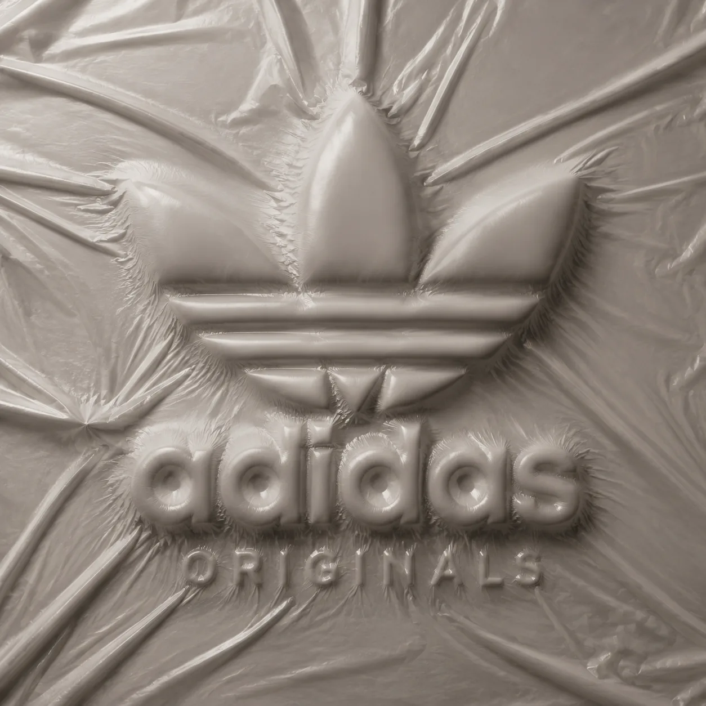

# Logo completely wrapped in a single layer of elastic

[← Back to the collection](../../README.md) · Category: [Poster Design](../../gallery/poster-design.md) · Model: `Vinano Studio` · ID: `vn-01261`

<a href="https://vinano.ai?utm_source=github&utm_medium=readme&utm_campaign=awesome-image-video-prompts-updating&utm_content=prompt-page-image"></a>

<sub>Preview generated with <a href="https://vinano.ai?utm_source=github&utm_medium=readme&utm_campaign=awesome-image-video-prompts-updating&utm_content=prompt-page-caption">vinano.ai</a></sub>

## Prompt

```text
logo completely wrapped in a single layer of elastic plastic or shrink wrap. The shapes of the logo should be visible only through the relief under the film, the logo surfaces themselves are not visible.

Brand Analysis System:

Logo geometry: Determine the full visual brand identifier [ADIDAS ORIGINAL] according to the official catalog: an icon, a text element, or a combination thereof. Keep the exact spatial relationship between the icon and the text.
Color system: Use one monochrome tone [ADIDAS ORIGINAL] for all elements of the scene — background, film, wrapped object. Variations are achieved only through light and shadow.
The nature of the film: Based on the selected color [ADIDAS ORIGINAL], determine the behavior of the material: bright saturated colors create a dense glossy or latex film visible tension lines; neutral — matte stretch film; dark - translucent vacuum film; light — matte food film.

Stage 1: Stage and Surface

The whole scene is monochromatic, the [ADIDAS ORIGINAL] color covers every surface without exception.
The background is made of the same film material, which is freely assembled and crumpled around the logo. Natural tension lines are created, the folds diverge from the peaks of the relief.
There are no floor lines, walls, or horizons — the stage is completely immersed in a solid plastic material.

Stage 2: Applying the logo

Each element of the logo is voluminous, rounded, like a balloon, visual depth.
The logo is fixed on the background and is completely covered a single layer of film, tightly stretched over the tops of the elements, creating visible tension lines.
Free folds are formed in the hollows between the letters, geometric elements of the icon and around the perimeter of the logo.
The logo remains fully readable, the icon is recognizable, but not a single surface of the logo itself is visible.
The physics of the film is precise: tight tension at high points, diverging stress lines, small raised areas between elements, shadows in the gaps.

Stage 3: Lighting

The main light source is soft, diffused, from the top left, emphasizing the relief of the film.
For glossy films, there are subtle highlights along the stretched areas, for matte films, there is only diffused light.
Global lighting preserves details in deep folds without smoothing out the overall relief.

Technical specifications

Only the [ADIDAS ORIGINAL] color, variations through light and shadow.
There are no exposed logo surfaces and unnecessary text.
The film is realistic: the tension, the folds, the physics of plastic, not fabric.
The film grain corresponds to ISO 400.
Mood: the product is packed and ready for opening, the shape is known, but not yet touched.

Render with rich micro-detail while keeping the layout uncluttered and intentional.
```

## Try it on vinano.ai

1. Copy the prompt above.
2. Open **[vinano.ai](https://vinano.ai?utm_source=github&utm_medium=readme&utm_campaign=awesome-image-video-prompts-updating&utm_content=prompt-page-try)**, paste it into the image generator and pick a model.
3. Swap any placeholders (brand, product, city, person…) for your own details, then generate.

More prompts like this: [Poster Design gallery](../../gallery/poster-design.md) · [all categories](../../README.md#contents)
