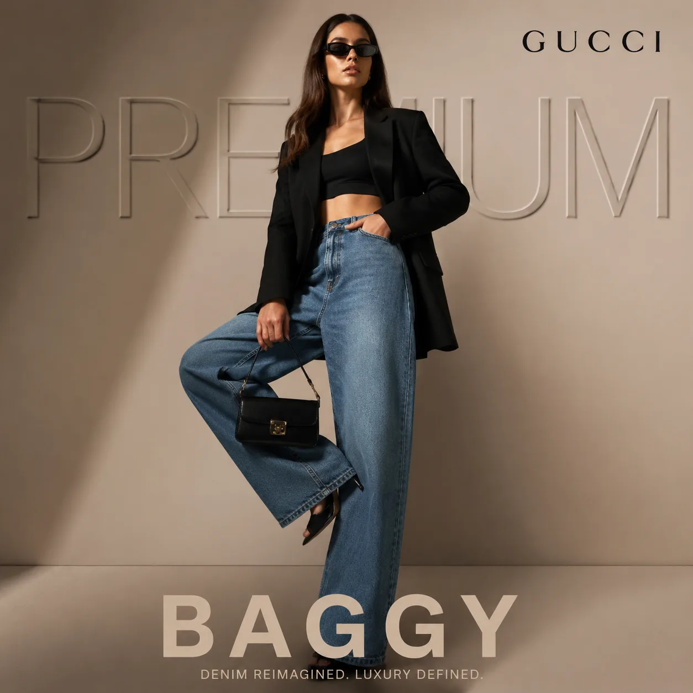

# Poster Design prompt #1265

[← Back to the collection](../../README.md) · Category: [Poster Design](../../gallery/poster-design.md) · Model: `Vinano Studio` · ID: `vn-01265`

<a href="https://vinano.ai?utm_source=github&utm_medium=readme&utm_campaign=awesome-image-video-prompts-updating&utm_content=prompt-page-image"></a>

<sub>Preview generated with <a href="https://vinano.ai?utm_source=github&utm_medium=readme&utm_campaign=awesome-image-video-prompts-updating&utm_content=prompt-page-caption">vinano.ai</a></sub>

## Prompt

```text
full body female model in confident fashion pose (one leg slightly raised, relaxed luxury stance), wearing oversized black blazer, fitted black crop top, high-waisted baggy blue denim jeans, black heels, slim sunglasses, holding a small black handbag, clean long hair, sharp facial features
minimal luxury studio background, soft beige gradient wall, smooth shadows, editorial lighting, high-end fashion campaign style
large embossed “PREMIUM” text in background, subtle 3D depth, tone-on-tone color blending wall, elegant and soft
keep “BAGGY” text bold and minimal near bottom, modern premium sans-serif font
add “GUCCI” logo top right corner, clean spacing, luxury typography
ultra realistic, sharp focus, premium color grading, soft highlights, depth of field, magazine-quality, crisp composition, no clutter

Maintain consistent colour harmony and crisp focus across the whole frame.
```

## Try it on vinano.ai

1. Copy the prompt above.
2. Open **[vinano.ai](https://vinano.ai?utm_source=github&utm_medium=readme&utm_campaign=awesome-image-video-prompts-updating&utm_content=prompt-page-try)**, paste it into the image generator and pick a model.
3. Swap any placeholders (brand, product, city, person…) for your own details, then generate.

More prompts like this: [Poster Design gallery](../../gallery/poster-design.md) · [all categories](../../README.md#contents)
