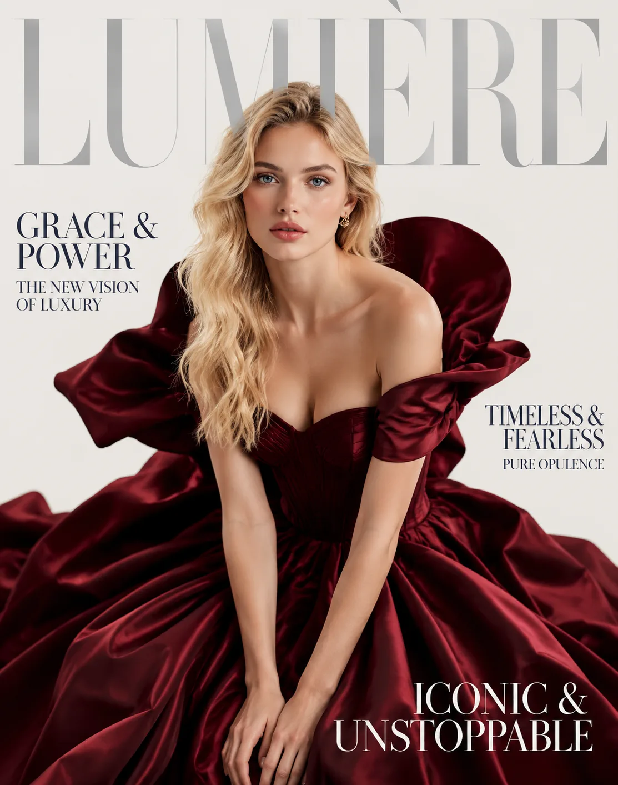

# Luxury high-fashion magazine cover

[← Back to the collection](../../README.md) · Category: [Poster Design](../../gallery/poster-design.md) · Model: `Vinano Studio` · ID: `vn-01316`

<a href="https://vinano.ai?utm_source=github&utm_medium=readme&utm_campaign=awesome-image-video-prompts-updating&utm_content=prompt-page-image"></a>

<sub>Preview generated with <a href="https://vinano.ai?utm_source=github&utm_medium=readme&utm_campaign=awesome-image-video-prompts-updating&utm_content=prompt-page-caption">vinano.ai</a></sub>

## Prompt

```text
A luxury high-fashion magazine cover. Magazine name at the very top in massive elegant serif font reads "LUMIÈRE" — the letters are large, slightly transparent/ghost-style overlapping the model's head just like ELLE magazine, in soft platinum silver color blending into the background.
Character: A young beautiful white woman, early 20s, soft feminine features, big blue eyes, naturally full lips, flawless porcelain skin, subtle makeup — rosy cheeks, nude lips, defined brows. Her hair is platinum blonde, long and wavy, loosely flowing over one shoulder. She looks directly into the camera a soft yet powerful gaze. Slight tilt of the head, naturally elegant posture.
Outfit: She is wearing a dramatic deep burgundy wine-red ballgown — structured corset top off-shoulder neckline, voluminous layered satin skirt billowing around her dramatically. Behind her shoulders, large sculptural fabric rises like rose petals — same architectural drama as reference. She leans slightly forward, both hands resting gently on her knees.
Background: Pure soft warm white/ivory background — completely clean, minimal, high-end studio editorial. Soft diffused light, no harsh shadows.
Typography — placed EXACTLY like ELLE magazine reference:
Top: "LUMIÈRE" massive serif, platinum/silver, overlapping model's head slightly
Left mid: "GRACE & POWER" bold serif, then smaller below "THE NEW VISION OF LUXURY"
Right mid: "TIMELESS & FEARLESS" bold, then "PURE OPULENCE" smaller below
Bottom right large: "ICONIC & UNSTOPPABLE" elegant large serif
All text in deep charcoal/dark navy. Font style: classic high fashion serif — same weight, spacing, and elegance as ELLE. Text naturally integrated into the composition, NOT floating randomly.
Ultra true-to-life photorealistic, 8K, real magazine cover quality, perfect typography placement, vertical 9:13 format.

Maintain consistent colour harmony and crisp focus across the whole frame.
```

## Try it on vinano.ai

1. Copy the prompt above.
2. Open **[vinano.ai](https://vinano.ai?utm_source=github&utm_medium=readme&utm_campaign=awesome-image-video-prompts-updating&utm_content=prompt-page-try)**, paste it into the image generator and pick a model.
3. Swap any placeholders (brand, product, city, person…) for your own details, then generate.

More prompts like this: [Poster Design gallery](../../gallery/poster-design.md) · [all categories](../../README.md#contents)
