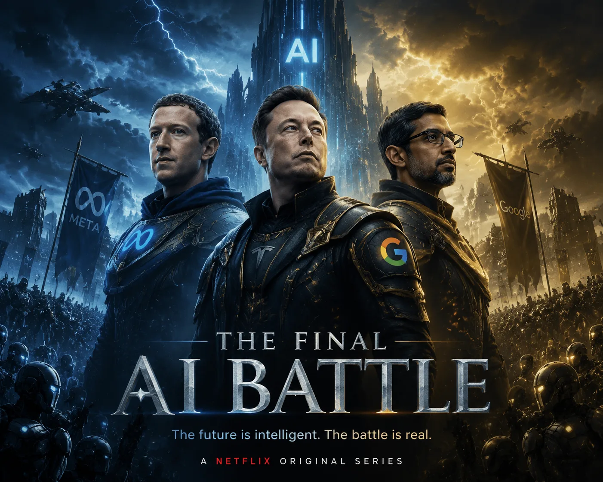

# Epic sci-fi fantasy movie poster featuring three powerful tech

[← Back to the collection](../../README.md) · Category: [Poster Design](../../gallery/poster-design.md) · Model: `Vinano Studio` · ID: `vn-01318`

<a href="https://vinano.ai?utm_source=github&utm_medium=readme&utm_campaign=awesome-image-video-prompts-updating&utm_content=prompt-page-image"></a>

<sub>Preview generated with <a href="https://vinano.ai?utm_source=github&utm_medium=readme&utm_campaign=awesome-image-video-prompts-updating&utm_content=prompt-page-caption">vinano.ai</a></sub>

## Prompt

```text
A cinematic epic sci-fi fantasy movie poster featuring three powerful tech leaders standing together as rival kings of artificial intelligence, dramatic futuristic battlefield, dark stormy sky, glowing AI energy, towering digital fortress in the background, armies of advanced robots below, intense blue and golden lighting contrast, ultra-detailed armor-inspired futuristic outfits, heroic serious expressions, high-budget streaming series poster style, dramatic composition, sharp facial details, atmospheric smoke, lightning, sparks, cinematic depth, professional poster typography the title “THE FINAL AI BATTLE”, subtitle “The future is intelligent. The battle is real.”, 4:3 aspect ratio Aim for an editorial, design-driven look with deliberate negative space.
```

## Try it on vinano.ai

1. Copy the prompt above.
2. Open **[vinano.ai](https://vinano.ai?utm_source=github&utm_medium=readme&utm_campaign=awesome-image-video-prompts-updating&utm_content=prompt-page-try)**, paste it into the image generator and pick a model.
3. Swap any placeholders (brand, product, city, person…) for your own details, then generate.

More prompts like this: [Poster Design gallery](../../gallery/poster-design.md) · [all categories](../../README.md#contents)
