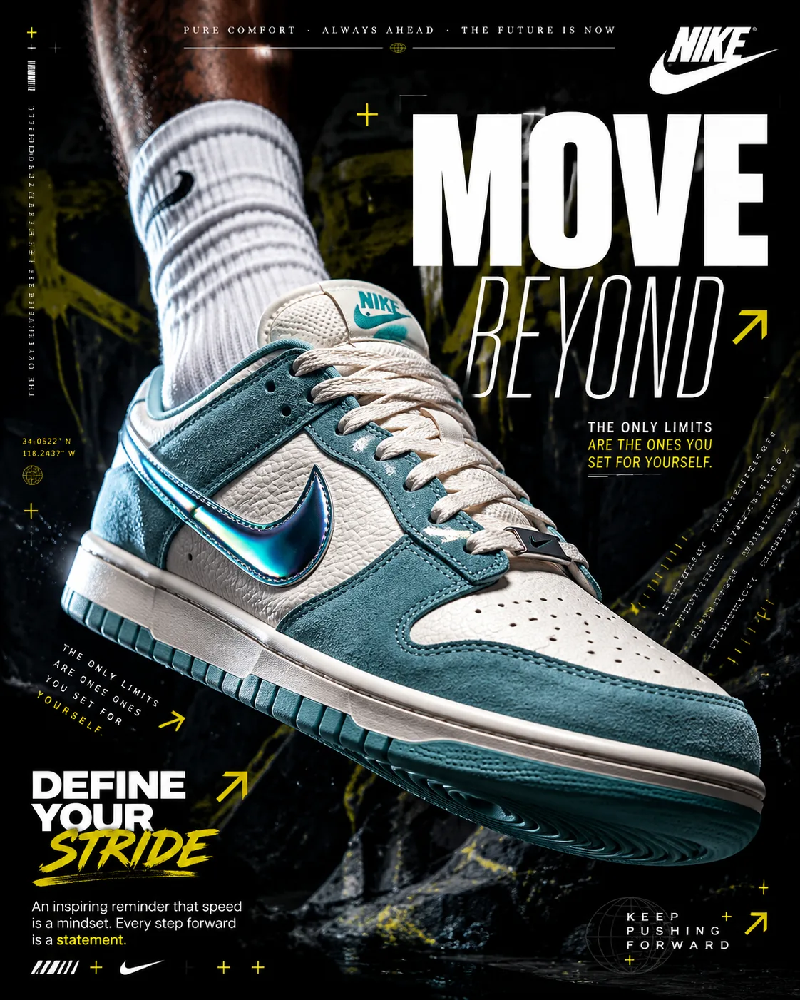

# Hyperrealistic Nike sneaker advertisement shot in a dark, moody

[← Back to the collection](../../README.md) · Category: [Poster Design](../../gallery/poster-design.md) · Model: `Vinano Studio` · ID: `vn-01336`

<a href="https://vinano.ai?utm_source=github&utm_medium=readme&utm_campaign=awesome-image-video-prompts-updating&utm_content=prompt-page-image"></a>

<sub>Preview generated with <a href="https://vinano.ai?utm_source=github&utm_medium=readme&utm_campaign=awesome-image-video-prompts-updating&utm_content=prompt-page-caption">vinano.ai</a></sub>

## Prompt

```text
A hyperrealistic Nike sneaker advertisement shot in a dark, moody editorial style. A male leg wearing crisp white athletic crew socks subtle Nike logo detail is suspended mid-air against a near-black charcoal background, angled diagonally toward the camera at a bold 45-degree perspective. The sneaker — a Nike low-top silhouette featuring a clean two-tone colorway of glacier teal suede panels and off-white tumbled leather, an iridescent chrome Swoosh catching ambient light — dominates the lower two-thirds of the frame.
The composition uses shallow depth of field sharp focus on the shoe and soft blur on the upper leg. The background is layered subtle urban texture - faint graffiti strokes in electric yellow and muted olive, barely visible through a heavy dark vignette. Multiple rows of ultra-small all-caps typographic text orbit the sneaker at different angles, reading phrases like "THE ONLY LIMITS ARE THE ONES YOU SET FOR YOURSELF" - evoking motion, speed, and energy. Some text runs vertically, some at 30-degree angles, giving the composition a chaotic yet intentional graphic design feeling.
At the upper right, the bold Nike wordmark and Swoosh logo appear in clean white against the dark background. At the top center, a thin horizontal navigation-style text bar reads: "PURE COMFORT · ALWAYS AHEAD · THE FUTURE IS NOW" in spaced all-caps serif font. A large, commanding headline is placed center-right in contrasting weight typography - "MOVE" in massive ultra-bold white letters followed by "BEYOND" in lighter weight, creating dramatic type hierarchy.
Small yellow plus (+) symbols and diagonal arrows (↗) are scattered throughout the composition as accent details, adding a contemporary graphic zine aesthetic. Bottom left features a bold brand slogan lockup: "DEFINE YOUR STRIDE" in large bold sans-serif white text a thin subline: "An inspiring reminder that speed is a mindset. Every step forward is a statement." The overall lighting is dramatic and directional - a single cold key light from the left, causing the Swoosh to shimmer and the white leather to glow against the darkness. true-to-life photorealistic. Commercial photography quality. High contrast. 4K resolution, 3:4 vertical format optimized for social media.

Render with rich micro-detail while keeping the layout uncluttered and intentional.
```

## Try it on vinano.ai

1. Copy the prompt above.
2. Open **[vinano.ai](https://vinano.ai?utm_source=github&utm_medium=readme&utm_campaign=awesome-image-video-prompts-updating&utm_content=prompt-page-try)**, paste it into the image generator and pick a model.
3. Swap any placeholders (brand, product, city, person…) for your own details, then generate.

More prompts like this: [Poster Design gallery](../../gallery/poster-design.md) · [all categories](../../README.md#contents)
