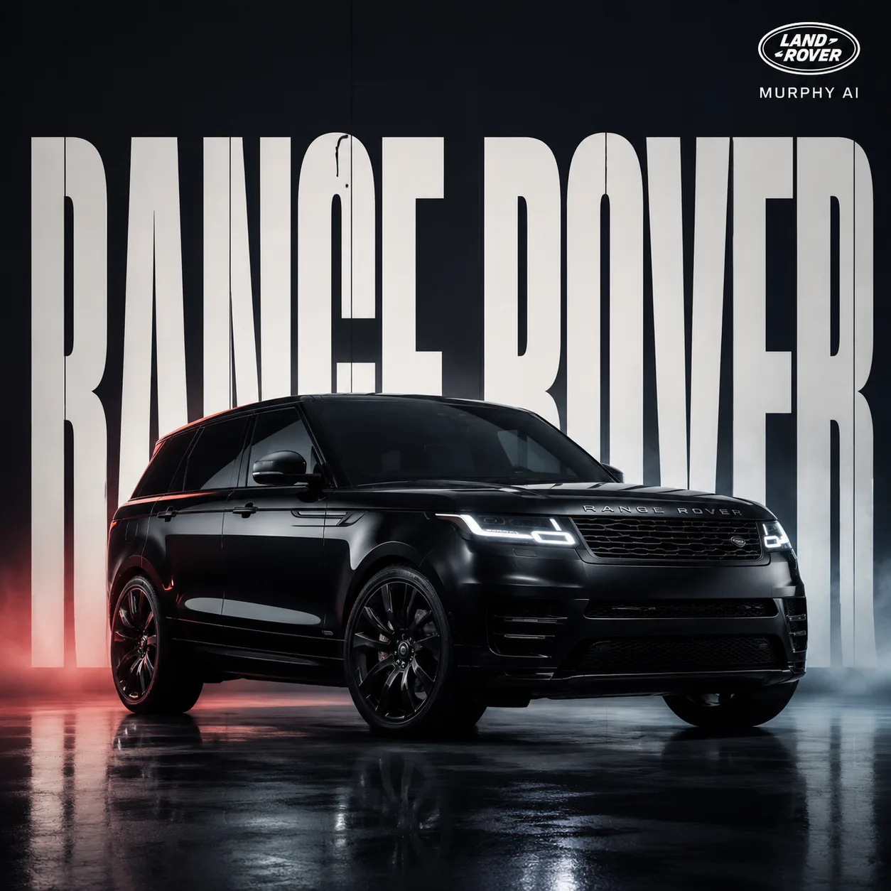

# Automotive billboard poster, CAR MODEL + VARIANT in PAINT

[← Back to the collection](../../README.md) · Category: [Poster Design](../../gallery/poster-design.md) · Model: `Vinano Studio` · ID: `vn-01346`

<a href="https://vinano.ai?utm_source=github&utm_medium=readme&utm_campaign=awesome-image-video-prompts-updating&utm_content=prompt-page-image"></a>

<sub>Preview generated with <a href="https://vinano.ai?utm_source=github&utm_medium=readme&utm_campaign=awesome-image-video-prompts-updating&utm_content=prompt-page-caption">vinano.ai</a></sub>

## Prompt

```text
Cinematic automotive billboard poster, [CAR MODEL + VARIANT] in [PAINT COLOR + FINISH], parked center-frame, dominant stance, [CAMERA ANGLE — e.g. low angle / front three-quarter / elevated SUV angle], ultra controlled composition

dramatic studio lighting setup [PRIMARY LIGHT COLOR/TONE] key light, [RIM LIGHT COLOR] rim lighting defining silhouette, high contrast shadow falloff, precise specular highlights across body panels

massive billboard-style typography composition, bold condensed sans-serif white text "[BRAND NAME]" filling entire background wall behind the car, perfectly centered and spanning edge-to-edge, thin vertical dark lines slicing through each letter evenly, consistent spacing, no distortion

environment designed to match brand mood: [ENVIRONMENT DESCRIPTION — e.g. minimal concrete / desert haze / forest stone / industrial steel], seamlessly fading into deep gradient background, zero clutter

ground surface: [SURFACE TYPE — wet asphalt / gloss studio floor / textured terrain] subtle realistic reflections, controlled diffusion, no noise

atmosphere: [FOG / HAZE / PARTICLES — optional but controlled], only at ground level for depth

top right corner: [BRAND LOGO DESCRIPTION], small and elegant, paired minimal uppercase text "[YOUR SIGNATURE — e.g. MURPHY AI]" aligned cleanly

STRICT RULES:
— no extra taglines
— no performance specs
— no additional typography
— no random elements
— maintain premium minimal billboard aesthetic

render quality: hyper-detailed photorealism, ultra sharp reflections, realistic paint microtexture, cinematic color grade matching environment

composition: perfectly balanced, symmetrical, professional automotive advertising layout

format: 1:1 square, ultra high resolution, print-ready billboard finish

Preserve realistic proportions and depth for a confident, professional finish.
```

## Try it on vinano.ai

1. Copy the prompt above.
2. Open **[vinano.ai](https://vinano.ai?utm_source=github&utm_medium=readme&utm_campaign=awesome-image-video-prompts-updating&utm_content=prompt-page-try)**, paste it into the image generator and pick a model.
3. Swap any placeholders (brand, product, city, person…) for your own details, then generate.

More prompts like this: [Poster Design gallery](../../gallery/poster-design.md) · [all categories](../../README.md#contents)
