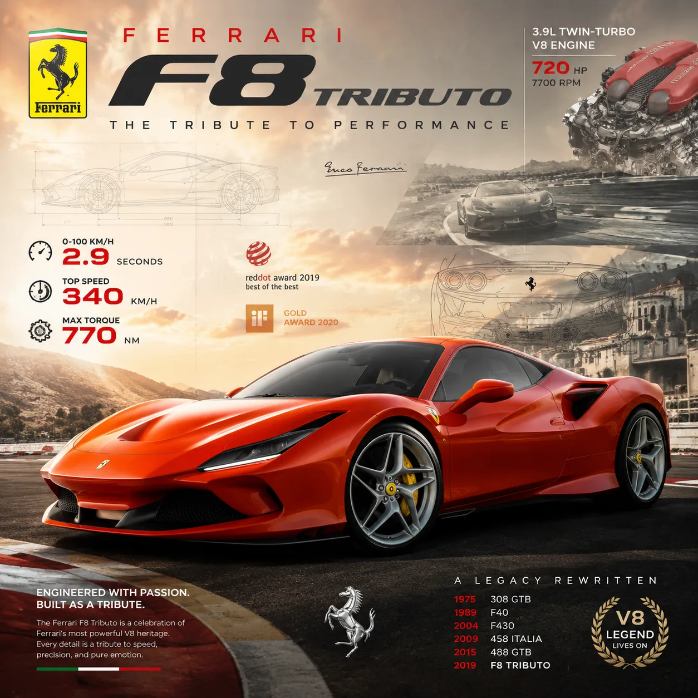

# Epic premium automotive poster of CAR MODEL

[← Back to the collection](../../README.md) · Category: [Poster Design](../../gallery/poster-design.md) · Model: `Vinano Studio` · ID: `vn-01357`

<a href="https://vinano.ai?utm_source=github&utm_medium=readme&utm_campaign=awesome-image-video-prompts-updating&utm_content=prompt-page-image"></a>

<sub>Preview generated with <a href="https://vinano.ai?utm_source=github&utm_medium=readme&utm_campaign=awesome-image-video-prompts-updating&utm_content=prompt-page-caption">vinano.ai</a></sub>

## Prompt

```text
Create an epic premium automotive poster of
[CAR MODEL].

Place the car as the heroic central subject in a dynamic three-quarter side profile, visually dominant and impossible to ignore.

Show the full beauty of the vehicle aggressive stance, perfect proportions, premium wheels, signature headlights, aerodynamic lines, spoilers, performance details, and luxury design language.

Add bold premium typography the brand name, model name, performance stats, horsepower, acceleration, top speed, engine specs, and iconic achievements beautifully integrated into the composition.

Include subtle background elements inspired by the car’s heritage: faded blueprint lines, racing legacy, silhouette overlays, iconic tracks, engineering details, speed graphics, and collector-poster aesthetics.

Use strong visual contrast, bright premium colors (avoid dark black-heavy backgrounds), filmic, cinematic lighting, ultra-detailed reflections, glossy paint finish, luxury magazine quality, modern graphic design, and scroll-stopping masterpiece energy.

crisp composition, high-end automotive advertisement style, collector poster aesthetic, highly detailed, visually powerful, premium masterpiece.

Preserve realistic proportions and depth for a confident, professional finish.
```

## Try it on vinano.ai

1. Copy the prompt above.
2. Open **[vinano.ai](https://vinano.ai?utm_source=github&utm_medium=readme&utm_campaign=awesome-image-video-prompts-updating&utm_content=prompt-page-try)**, paste it into the image generator and pick a model.
3. Swap any placeholders (brand, product, city, person…) for your own details, then generate.

More prompts like this: [Poster Design gallery](../../gallery/poster-design.md) · [all categories](../../README.md#contents)
