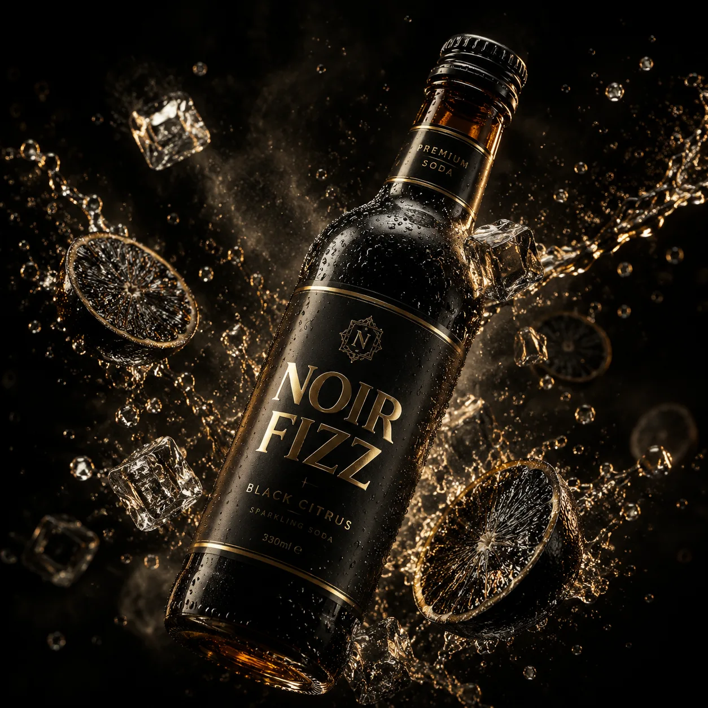

# Ultra-cinematic product photography of a matte black luxury soda

[← Back to the collection](../../README.md) · Category: [Poster Design](../../gallery/poster-design.md) · Model: `Vinano Studio` · ID: `vn-01367`

<a href="https://vinano.ai?utm_source=github&utm_medium=readme&utm_campaign=awesome-image-video-prompts-updating&utm_content=prompt-page-image"></a>

<sub>Preview generated with <a href="https://vinano.ai?utm_source=github&utm_medium=readme&utm_campaign=awesome-image-video-prompts-updating&utm_content=prompt-page-caption">vinano.ai</a></sub>

## Prompt

```text
Ultra-cinematic product photography of a matte black luxury soda bottle labeled “NOIR FIZZ”, floating mid-air at a sharp diagonal angle; carbonated bubbles and liquid soda waves frozen in motion, shattered ice cubes and glossy black citrus slices suspended; dramatic low-key lighting strong rim lights, metallic highlights, deep shadows; black and gold color palette, volumetric mist, macro textures, hyper-realistic glass, 8K, premium commercial ad style. Render with rich micro-detail while keeping the layout uncluttered and intentional.
```

## Try it on vinano.ai

1. Copy the prompt above.
2. Open **[vinano.ai](https://vinano.ai?utm_source=github&utm_medium=readme&utm_campaign=awesome-image-video-prompts-updating&utm_content=prompt-page-try)**, paste it into the image generator and pick a model.
3. Swap any placeholders (brand, product, city, person…) for your own details, then generate.

More prompts like this: [Poster Design gallery](../../gallery/poster-design.md) · [all categories](../../README.md#contents)
