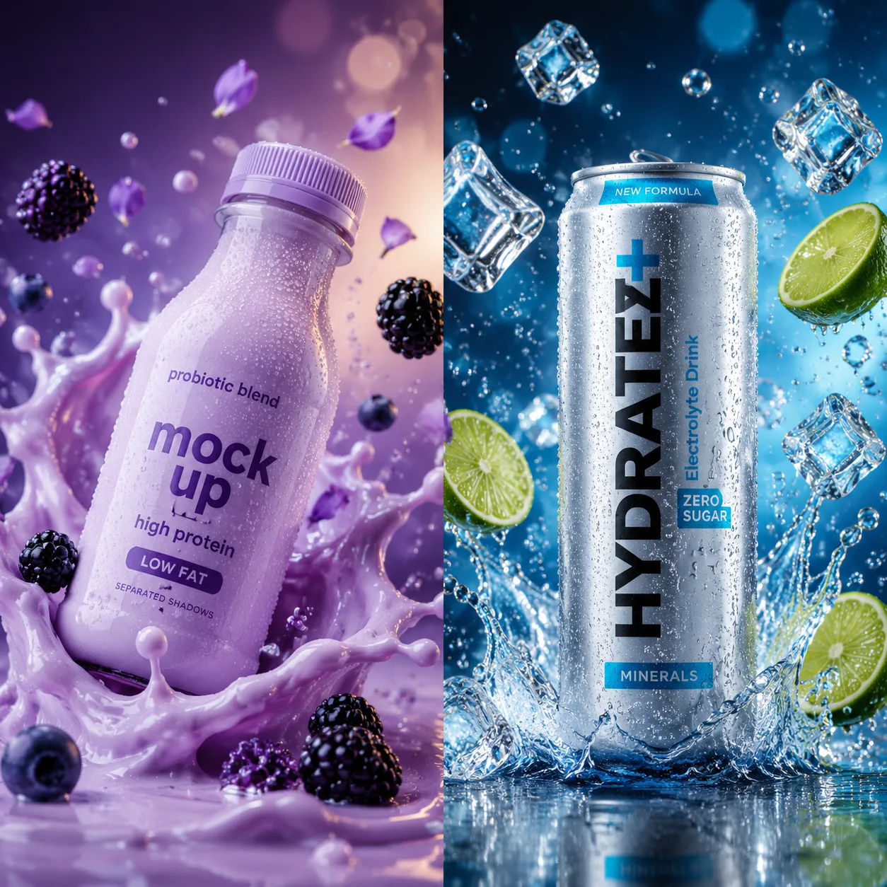

# AI-edited commercial product photography

[← Back to the collection](../../README.md) · Category: [Poster Design](../../gallery/poster-design.md) · Model: `Vinano Studio` · ID: `vn-01388`

<a href="https://vinano.ai?utm_source=github&utm_medium=readme&utm_campaign=awesome-image-video-prompts-updating&utm_content=prompt-page-image"></a>

<sub>Preview generated with <a href="https://vinano.ai?utm_source=github&utm_medium=readme&utm_campaign=awesome-image-video-prompts-updating&utm_content=prompt-page-caption">vinano.ai</a></sub>

## Prompt

```text
{
 "master_prompt": {
 "global_settings": {
 "resolution": "8K ultra-high-definition",
 "aspect_ratio": "3:4 vertical",
 "style": "hyper-realistic AI-edited commercial product photography",
 "sharpness": "extreme clarity, micro-detail visibility",
 "lighting_quality": "cinematic studio lighting controlled highlights and shadows",
 "motion_freeze": "high-speed capture, frozen splashes and particles",
 "noise": "none",
 "artifacts": "none"
 },

 "module_1_image_1_style": {
 "subject": {
 "type": "functional yogurt smoothie bottle",
 "material": "frosted plastic",
 "color": "soft pastel lavender",
 "surface_details": "dense condensation droplets covering the entire bottle",
 "label_text_visible": ["probiotic blend",
 "mock up",
 "high protein",
 "LOW FAT",
 "SEPARATED SHADOWS"]
 },
 "pose_and_orientation": {
 "position": "slightly tilted forward",
 "angle": "three-quarter view",
 "motion_feel": "energetic, mid-impact splash moment"
 },
 "liquid_and_motion": {
 "liquid_color": "light purple yogurt smoothie",
 "texture": "thick, creamy, glossy",
 "motion": "smooth splash wrapping around the bottle upward arcs"
 },
 "floating_elements": {
 "berries": "blackberries and blueberries floating at varying depths",
 "lavender_petals": "soft purple petals suspended mid-air",
 "droplets": "yogurt droplets and micro splashes frozen in motion"
 },
 "background": {
 "color_gradient": "deep violet fading into soft peach highlights",
 "bokeh": "subtle glowing circular light orbs"
 },
 "surface_and_reflection": {
 "base": "matte surface creamy liquid pooling",
 "shadow_style": "clean, separated soft shadow beneath bottle"
 }
 },

 "module_2_image_2_style": {
 "subject": {
 "type": "sparkling electrolyte drink can",
 "material": "brushed aluminum",
 "color": "icy silver neon cyan accents",
 "surface_details": "intense cold condensation crystal-clear droplets",
 "branding_text_visible": ["HYDRATE+",
 "Electrolyte Drink",
 "ZERO SUGAR",
 "NEW FORMULA",
 " MINERALS"]
 },
 "pose_and_orientation": {
 "position": "upright and centered",
 "angle": "straight-on front view",
 "presence": "strong hero product stance"
 },
 "liquid_and_motion": {
 "liquid_color": "clear carbonated liquid bubbles",
 "motion": "explosive splash bursting outward from the base",
 "droplet_behavior": "sharp, glass-like droplets flying outward"
 },
 "floating_elements": {
 "ice_cubes": "transparent ice cubes spinning in mid-air",
 "lime_slices": "fresh lime slices visible pulp",
 "bubbles": "carbonation bubbles rising around the can"
 },
 "background": {
 "color_palette": "cool blues, cyan highlights, metallic silver tones",
 "atmosphere": "fresh, high-energy, ultra-refreshing"
 },
 "surface_and_reflection": {
 "base": "wet reflective surface splash crown",
 "reflection_quality": "crisp reflections controlled specular highlights"
 }
 }
 }
}

Keep edges clean and the overall composition balanced for a polished, gallery-ready result.
```

## Try it on vinano.ai

1. Copy the prompt above.
2. Open **[vinano.ai](https://vinano.ai?utm_source=github&utm_medium=readme&utm_campaign=awesome-image-video-prompts-updating&utm_content=prompt-page-try)**, paste it into the image generator and pick a model.
3. Swap any placeholders (brand, product, city, person…) for your own details, then generate.

More prompts like this: [Poster Design gallery](../../gallery/poster-design.md) · [all categories](../../README.md#contents)
