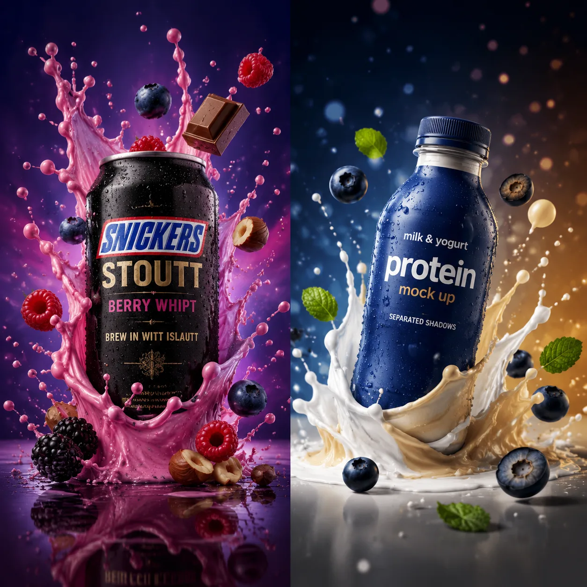

# Master prompt

[← Back to the collection](../../README.md) · Category: [Poster Design](../../gallery/poster-design.md) · Model: `Vinano Studio` · ID: `vn-01391`

<a href="https://vinano.ai?utm_source=github&utm_medium=readme&utm_campaign=awesome-image-video-prompts-updating&utm_content=prompt-page-image"></a>

<sub>Preview generated with <a href="https://vinano.ai?utm_source=github&utm_medium=readme&utm_campaign=awesome-image-video-prompts-updating&utm_content=prompt-page-caption">vinano.ai</a></sub>

## Prompt

```text
{
 "master_prompt": {
 "global_settings": {
 "resolution": "8K ultra-high-definition",
 "aspect_ratio": "3:4 vertical",
 "style": "hyper-realistic AI-edited commercial product photography",
 "sharpness": "extreme clarity, micro-detail visibility",
 "lighting_quality": "cinematic studio lighting controlled highlights and shadows",
 "motion_freeze": "high-speed capture, frozen splashes and particles",
 "noise": "none",
 "artifacts": "none"
 },

 "module_1_image_1_style": {
 "subject": {
 "type": "beverage can",
 "material": "matte black metal",
 "surface_details": "fine condensation droplets evenly distributed",
 "branding_text_visible": ["SNICKERS",
 "STOUTT",
 "BERRY WHIPT",
 "BREW IN WITT ISLAUTT"]
 },
 "pose_and_orientation": {
 "position": "upright, centered",
 "angle": "slight forward-facing perspective",
 "scale": "dominant foreground subject"
 },
 "liquid_and_motion": {
 "liquid_color": "glossy pink",
 "liquid_texture": "thick, creamy, whipped consistency",
 "motion": "explosive upward splash wrapping around the can",
 "splash_shape": "curved arcs sharp liquid peaks and droplets"
 },
 "floating_elements": {
 "berries": ["raspberries",
 "blackberries",
 "blueberries"],
 "chocolate_pieces": "rectangular chocolate chunks sharp edges",
 "nuts": "round and halved nuts scattered near base and mid-air",
 "distribution": "suspended at various depths around the can"
 },
 "background": {
 "color_gradient": "purple to blue",
 "light_effects": "soft radial glow behind can",
 "particles": "small pink droplets and specks floating"
 },
 "surface_and_reflection": {
 "base": "glossy reflective surface",
 "reflection_quality": "clear mirrored reflection slight ripple distortion"
 }
 },

 "module_2_image_2_style": {
 "subject": {
 "type": "plastic protein drink bottle",
 "color": "deep matte blue",
 "surface_details": "condensation droplets across entire bottle",
 "label_text_visible": ["milk & yogurt",
 "mock up",
 "protein",
 "SEPARATED SHADOWS"]
 },
 "pose_and_orientation": {
 "position": "slightly tilted to the right",
 "angle": "three-quarter view",
 "motion_feel": "dynamic, leaning into splash"
 },
 "liquid_and_motion": {
 "liquid_color": "white and light beige milk mixture",
 "texture": "smooth, creamy, fluid",
 "motion": "swirling splash rising around bottle base and sides"
 },
 "floating_elements": {
 "blueberries": "whole and halved blueberries at different depths",
 "mint_leaves": "small green leaves visible veins",
 "droplets": "milk droplets and spheres suspended mid-air"
 },
 "background": {
 "color_gradient": "dark blue to warm amber",
 "bokeh": "soft circular light particles scattered throughout"
 },
 "surface_and_reflection": {
 "base": "matte ground light liquid pooling",
 "shadow_style": "soft separated shadow under bottle"
 }
 },

Aim for an editorial, design-driven look with deliberate negative space.
```

## Try it on vinano.ai

1. Copy the prompt above.
2. Open **[vinano.ai](https://vinano.ai?utm_source=github&utm_medium=readme&utm_campaign=awesome-image-video-prompts-updating&utm_content=prompt-page-try)**, paste it into the image generator and pick a model.
3. Swap any placeholders (brand, product, city, person…) for your own details, then generate.

More prompts like this: [Poster Design gallery](../../gallery/poster-design.md) · [all categories](../../README.md#contents)
