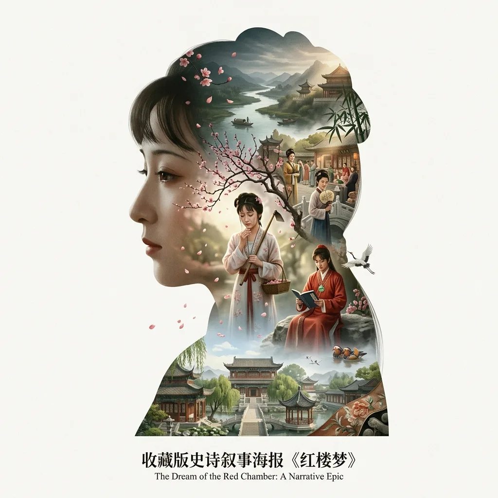

# 根据 红楼梦 自动生成一张 收藏版史

[← Back to the collection](../../README.md) · Category: [Poster Design](../../gallery/poster-design.md) · Model: `Vinano Image Pro` · ID: `vn-01392`

<a href="https://vinano.ai?utm_source=github&utm_medium=readme&utm_campaign=awesome-image-video-prompts-updating&utm_content=prompt-page-image"></a>

<sub>Preview generated with <a href="https://vinano.ai?utm_source=github&utm_medium=readme&utm_campaign=awesome-image-video-prompts-updating&utm_content=prompt-page-caption">vinano.ai</a></sub>

## Prompt

```text
根据[红楼梦]自动生成一张 收藏版史诗叙事海报，

巨大优雅的{林黛玉}人物侧脸剪影作为外轮廓，剪影内部自动生长出最契合该主题的完整世界观、标志性场景、角色关系、象征符号、关键建筑、生物、道具与氛围。

整体不是普通拼贴，而是高级的剪影轮廓填充式叙事合成，带有双重曝光式联想，但强化为电影级叙事表达与空间调度。

电影海报风格 + 东方现实主义美学融合，强调真实物理光影、镜头语言、空间纵深与叙事层级。

光影采用电影级侧逆光与局部暖光点缀，冷暖对比克制真实，加入体积光与轻雾增强空间感。

材质表现为真实质感（建筑、丝绸、肌肤、石材），避免纯绘画笔触感，

保留柔和空气透视，但优化为电影级景深与焦点控制。

轻微胶片颗粒，边缘飞白与刷痕改为电影式柔和融合过渡，

大面积留白，版式克制高级，安静、宏大、克制、宿命感强的东方电影叙事。

所有元素必须强绑定主题，一眼识别，不要杂乱，不要硬拼贴，不要模板化背景，不要廉价奇幻素材。

保持配色统一、主体清晰，细节丰富但不杂乱。
```

## Try it on vinano.ai

1. Copy the prompt above.
2. Open **[vinano.ai](https://vinano.ai?utm_source=github&utm_medium=readme&utm_campaign=awesome-image-video-prompts-updating&utm_content=prompt-page-try)**, paste it into the image generator and pick a model.
3. Swap any placeholders (brand, product, city, person…) for your own details, then generate.

More prompts like this: [Poster Design gallery](../../gallery/poster-design.md) · [all categories](../../README.md#contents)
