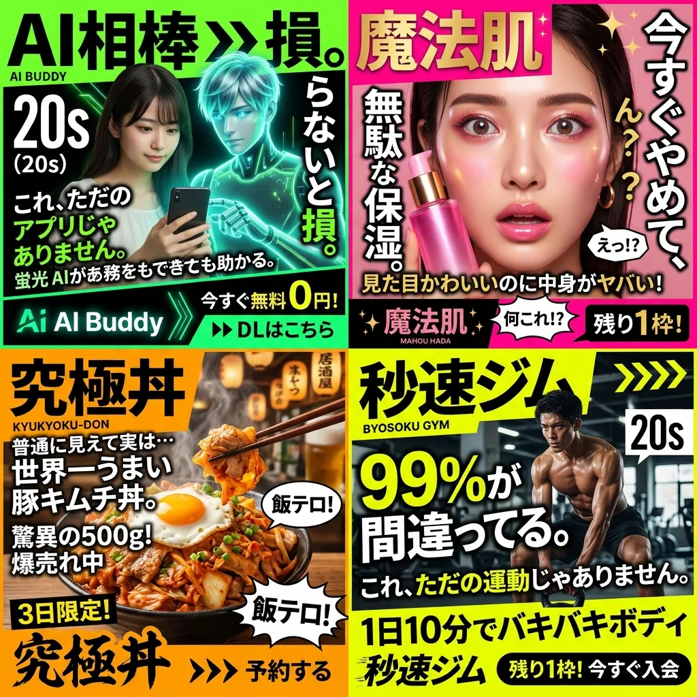

# 日本語の架空広告をテーマに、SNSで

[← Back to the collection](../../README.md) · Category: [Poster Design](../../gallery/poster-design.md) · Model: `Vinano Image Pro` · ID: `vn-01403`

<a href="https://vinano.ai?utm_source=github&utm_medium=readme&utm_campaign=awesome-image-video-prompts-updating&utm_content=prompt-page-image"></a>

<sub>Preview generated with <a href="https://vinano.ai?utm_source=github&utm_medium=readme&utm_campaign=awesome-image-video-prompts-updating&utm_content=prompt-page-caption">vinano.ai</a></sub>

## Prompt

```text
日本語の架空広告をテーマに、SNSでバズることを目的としたインパクトの強いビジュアルを作成してください。 1:1の正方形キャンバスに、4種類の広告を「2×2グリッド」で配置してください。

ジャンル： ①テック（AI・アプリ） ②美容・コスメ ③飲食 ④フィットネス すべて日本語コピー入り・架空ブランドで作成。

【バズるための演出要件】
・一瞬で目を引く強烈なキャッチコピー
 ・感情を動かす要素（驚き・共感・焦り・欲望）
・コントラストの強い配色（ネオン、ビビッドカラー、黒×蛍光など）
 ・大胆なレイアウト（はみ出し・斜め配置・大きすぎる文字）
・サムネ映えする構図（中央強調・顔アップ・視線誘導）
 ・SNS広告っぽい“あざとさ”（矢印・強調枠・吹き出し）

【デザインスタイル】
・2025年トレンドのSNS広告風
・TikTok / Instagram広告風
・視認性最優先（スマホで見ても読める）
・写真風 or 高品質イラスト
・CTA入り（例：今だけ無料・限定・残り3日など）

【ランダムバズ要素】
以下の①〜③から、それぞれ1つずつランダムに選び、必ずキャッチコピーに反映すること。
 ①禁断ワード系（いずれか1つ）
・知らないと損
・99%が間違ってる
・今すぐやめて
②ギャップ演出（いずれか1つ）
・見た目かわいいのに中身がヤバい
・普通に見えて実は…
・これ、○○じゃありません
③数字・限定（いずれか1つ）
・3日限定
・残り1枠
・無料→0円

【重要】
・4つそれぞれ明確に違う雰囲気にする
・グリッドは崩さない
・文字は読みやすく配置する
・“スクロールを止める違和感”を意図的に入れる

出力：4広告が1枚にまとまった高インパクトビジュアル

保持配色统一、主体清晰，细节丰富但不杂乱。
```

## Try it on vinano.ai

1. Copy the prompt above.
2. Open **[vinano.ai](https://vinano.ai?utm_source=github&utm_medium=readme&utm_campaign=awesome-image-video-prompts-updating&utm_content=prompt-page-try)**, paste it into the image generator and pick a model.
3. Swap any placeholders (brand, product, city, person…) for your own details, then generate.

More prompts like this: [Poster Design gallery](../../gallery/poster-design.md) · [all categories](../../README.md#contents)
