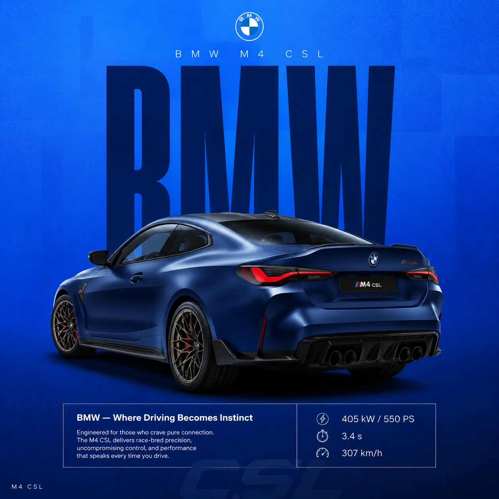

# 4:5 vertical social poster, ultra high resolution, 8K SCENE

[← Back to the collection](../../README.md) · Category: [Poster Design](../../gallery/poster-design.md) · Model: `Vinano Studio` · ID: `vn-01435`

<a href="https://vinano.ai?utm_source=github&utm_medium=readme&utm_campaign=awesome-image-video-prompts-updating&utm_content=prompt-page-image"></a>

<sub>Preview generated with <a href="https://vinano.ai?utm_source=github&utm_medium=readme&utm_campaign=awesome-image-video-prompts-updating&utm_content=prompt-page-caption">vinano.ai</a></sub>

## Prompt

```text
4:5 vertical social poster, ultra high resolution, 8K

SCENE / BACKGROUND:
Flat racing yellow subtle gradient (light → deep amber)
Grain texture 2–3%
Soft rectangular overlays at 3% opacity

PRODUCT:
Porsche 911 GT3 RS
Gloss yellow carbon details
Rear 3/4 angle, slightly elevated
Wing dominant

Position:
Right of center

TYPOGRAPHY:
“PORSCHE”
Ultra tall, condensed, stretched
Deep charcoal

Secondary:
“PORSCHE 911 GT3 RS”

EDITORIAL:
“Porsche — Where Precision Meets Passion”

Focus:
engineering, obsession, track DNA

FADED TEXT:
“GT3 RS” at 3–5%

SPECS:
386 kW / 525 PS
3.2 s
296 km/h

LIGHTING:
Clean studio, sharp highlights

MOOD:
Precision.
Iconic.
Timeless performance.

FORMAT:
4:5 vertical social poster, ultra high resolution, 8K, print-quality sharpness

SCENE / BACKGROUND:
Flat, high-saturation BMW blue background

Gradient:
Top → slightly lighter electric blue
Bottom → deep navy blue

Surface:
- Subtle grain texture (2–3%)
- Faint rectangular overlays (2–4% opacity)
- Clean, graphic — no realism

Shadow:
Soft contact shadow under car

PRODUCT (CAR):
BMW M4 CSL

Color:
Matte frozen blue / deep metallic navy

Angle:
Rear 3/4 perspective (IMPORTANT — match Porsche angle for consistency)
Slightly elevated camera

Position:
Slightly right of center

Details:
- Carbon roof visible
- Aggressive diffuser
- Sharp reflections
- Subtle brake detail

COMPOSITION:
IDENTICAL to Porsche:
Top → branding
Middle → giant type
Center → car overlap
Bottom → editorial + specs

TYPOGRAPHY:

PRIMARY:
“BMW”

Style:
Ultra condensed bold sans serif
Tall vertical scaling (same as Porsche)

Color:
Deep navy / near black

Behavior:
Static (NO distortion — unlike previous version)
Acts as structural backdrop

SECONDARY HEADER:
“BMW M4 CSL”
Thin, wide tracking

LOGO AREA:
BMW roundel centered above

EDITORIAL BLOCK:

Headline:
“BMW — Where Driving Becomes Instinct”

Body:
Focus on:
- driver connection
- control
- performance precision

Boxed layout, same structure as Porsche

FADED TEXT:
“CSL” large, 3–5% opacity behind box

BOTTOM LEFT:
“M4 CSL”

BOTTOM RIGHT SPECS:

405 kW / 550 PS
3.4 s
307 km/h

LIGHTING:
Clean studio lighting
Sharp but controlled highlights

COLOR GRADING:
Deep blues, high contrast, clean blacks

CAMERA:
50mm, slightly elevated rear 3/4

MOOD:
Performance.
Precision.
Driver focus.

Render with rich micro-detail while keeping the layout uncluttered and intentional.
```

## Try it on vinano.ai

1. Copy the prompt above.
2. Open **[vinano.ai](https://vinano.ai?utm_source=github&utm_medium=readme&utm_campaign=awesome-image-video-prompts-updating&utm_content=prompt-page-try)**, paste it into the image generator and pick a model.
3. Swap any placeholders (brand, product, city, person…) for your own details, then generate.

More prompts like this: [Poster Design gallery](../../gallery/poster-design.md) · [all categories](../../README.md#contents)
