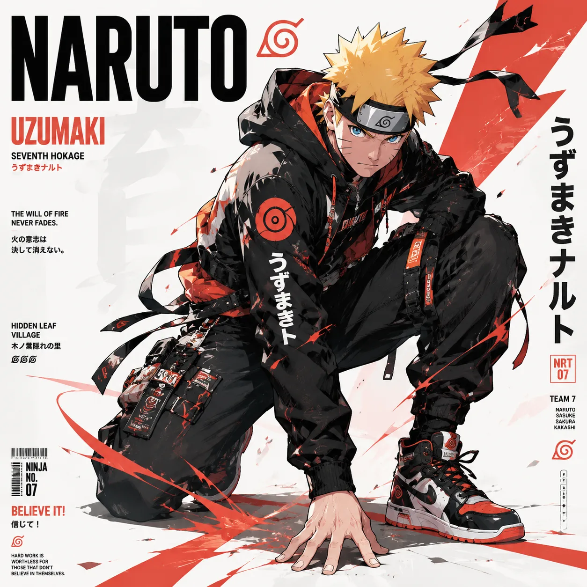

# Anime, Poster

[← Back to the collection](../../README.md) · Category: [Poster Design](../../gallery/poster-design.md) · Model: `Vinano Studio` · ID: `vn-01458`

<a href="https://vinano.ai?utm_source=github&utm_medium=readme&utm_campaign=awesome-image-video-prompts-updating&utm_content=prompt-page-image"></a>

<sub>Preview generated with <a href="https://vinano.ai?utm_source=github&utm_medium=readme&utm_campaign=awesome-image-video-prompts-updating&utm_content=prompt-page-caption">vinano.ai</a></sub>

## Prompt

```text
Create a stylized illustration of [character_name] from [franchise].

Character Analysis:

Derive the character’s core personality archetype based on canon portrayal (e.g., heroic, calm, mysterious, aggressive).
Identify the signature color from the original design and use it as the primary visual accent.

Pose & Body Language:

Generate an iconic pose that reflects the personality archetype:
Energetic / Heroic: dynamic action, wide stance, explosive movement
Calm / Confident: balanced, relaxed posture, minimal motion
Dark / Mysterious: low stance, subtle movement, sharp or hidden gaze
Aggressive / Intense: forward-leaning attack stance, visible tension, clenched fists

Facial Expression:

Match expression precisely to the character’s personality and emotional tone.

Art Style:

Anime × streetwear × graphic poster hybrid
Clean lineart, semi-flat shading, high contrast
Modern, minimal, and visually striking

Composition:

Vertical format ({aspect_ratio})
Off-center subject placement
Strong diagonal visual flow
Layered depth for a dynamic poster feel

Outfit Design:

Reimagine the original costume as modern streetwear / techwear
Preserve recognizable identity elements of the character

Color Palette:

Dominant clean white background
Use signature color as the primary accent
Add one secondary accent (complementary or analogous tone)
Keep palette minimal, bold, and high-contrast

Background:

Abstract geometric poster layout
Use negative space effectively
Integrate subtle accents the character’s color theme

Effects:

Energy strokes, paint lines, and motion accents
Effects should follow the character’s energy and color identity

Lighting:

Sharp directional lighting
Crisp shadows
Subtle glow the signature color

Rendering Quality:

Ultra-clean vector-style finish
Poster-quality composition
4K resolution, high detail

Emphasise material texture and natural light so the final frame feels tactile and premium.
```

## Try it on vinano.ai

1. Copy the prompt above.
2. Open **[vinano.ai](https://vinano.ai?utm_source=github&utm_medium=readme&utm_campaign=awesome-image-video-prompts-updating&utm_content=prompt-page-try)**, paste it into the image generator and pick a model.
3. Swap any placeholders (brand, product, city, person…) for your own details, then generate.

More prompts like this: [Poster Design gallery](../../gallery/poster-design.md) · [all categories](../../README.md#contents)
