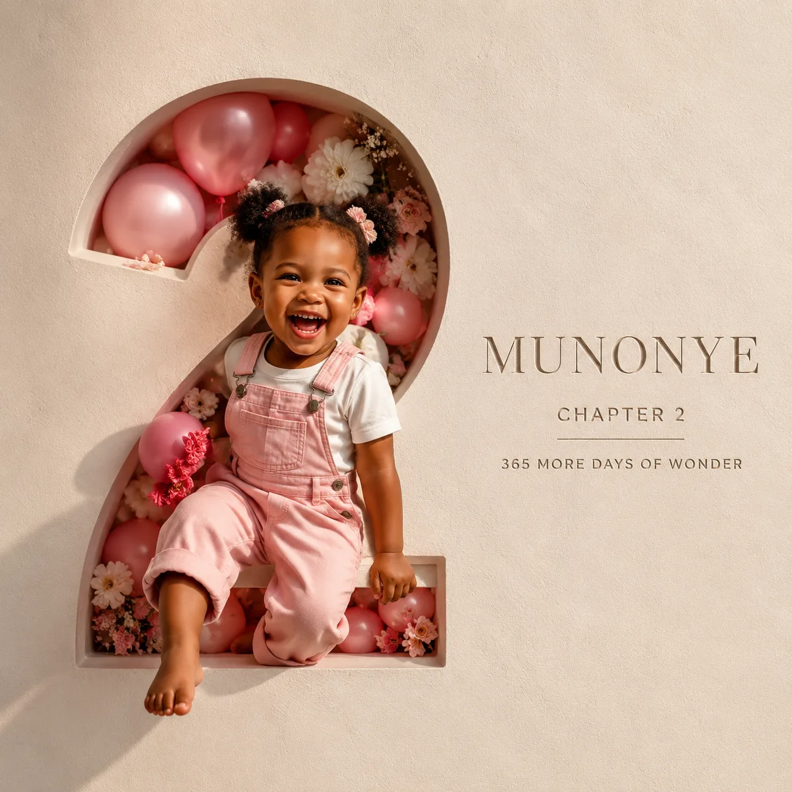

# Realistic, Poster

[← Back to the collection](../../README.md) · Category: [Poster Design](../../gallery/poster-design.md) · Model: `Vinano Studio` · ID: `vn-01478`

<a href="https://vinano.ai?utm_source=github&utm_medium=readme&utm_campaign=awesome-image-video-prompts-updating&utm_content=prompt-page-image"></a>

<sub>Preview generated with <a href="https://vinano.ai?utm_source=github&utm_medium=readme&utm_campaign=awesome-image-video-prompts-updating&utm_content=prompt-page-caption">vinano.ai</a></sub>

## Prompt

```text
Professional luxury birthday poster, 3:4 ratio. Entire frame filled a premium off white luxury paper textured wall. Large number “2” precisely carved in the wall visible depth and realistic inner shadows. Inside the number: soft pink and pink balloons, subtle white flowers, elegant bouquet arrangement, premium celebration styling. A happy 2 year old child preserved reference facial features, wearing a milky white T shirt and pink denim overalls, laughing naturally. Face, shoulder, one hand and one foot extend outside the number creating a realistic 3D effect. Warm cinematic sunlight from one side, soft rim light, true-to-life photorealistic skin, premium studio photography, ultra realistic, sharp focus. Typography on wall: MUNONYE, CHAPTER 2, 365 MORE DAYS OF WONDER. Clean refined minimalist layout, luxury magazine cover aesthetic, high end art direction, realistic shadows, natural colors, no tree shadows, no fake lighting, no AI artifacts. Preserve realistic proportions and depth for a confident, professional finish.
```

## Try it on vinano.ai

1. Copy the prompt above.
2. Open **[vinano.ai](https://vinano.ai?utm_source=github&utm_medium=readme&utm_campaign=awesome-image-video-prompts-updating&utm_content=prompt-page-try)**, paste it into the image generator and pick a model.
3. Swap any placeholders (brand, product, city, person…) for your own details, then generate.

More prompts like this: [Poster Design gallery](../../gallery/poster-design.md) · [all categories](../../README.md#contents)
