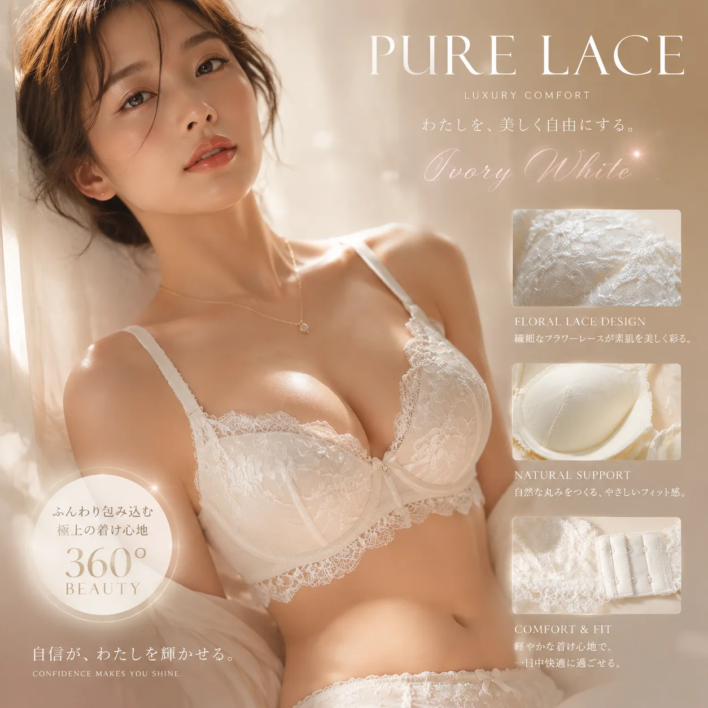

# Realistic, Poster

[← Back to the collection](../../README.md) · Category: [Poster Design](../../gallery/poster-design.md) · Model: `Vinano Studio` · ID: `vn-01501`

<a href="https://vinano.ai?utm_source=github&utm_medium=readme&utm_campaign=awesome-image-video-prompts-updating&utm_content=prompt-page-image"></a>

<sub>Preview generated with <a href="https://vinano.ai?utm_source=github&utm_medium=readme&utm_campaign=awesome-image-video-prompts-updating&utm_content=prompt-page-caption">vinano.ai</a></sub>

## Prompt

```text
Create a hyper-realistic luxury lingerie e-commerce detail-page visual inspired by premium Japanese beauty-fashion brands.

IMPORTANT:
Generate ONLY ONE SINGLE VERTICAL IMAGE.
Do NOT create multiple posters.
Do NOT create collages.

STYLE:
Luxury glossy beauty-commercial realism.
Soft dreamy fashion aesthetics.
Premium feminine branding.

MAIN CONCEPT:
A glowing soft-beauty lingerie campaign focused on:
radiant feminine elegance,
luxury comfort,
soft body glow,
and dreamy romantic styling.

MODEL:
Adult female model glowing skin texture.
Soft cinematic makeup.
Elegant emotional beauty.
Luxury fashion styling.

PRODUCT:
Luxury ivory-white lace lingerie:
soft reflective fabric,
light floral lace details,
premium smooth texture,
and natural support fit.

VISUAL STRUCTURE:

cinematic beauty hero shot

dreamy close-up details

luxury typography overlays

premium spacing hierarchy

soft glowing beauty atmosphere

BACKGROUND:
Minimal ivory-beauty studio dreamy sunlight diffusion and floating light particles.

COLOR PALETTE:
Ivory white,
soft pearl,
light champagne,
warm blush glow,
cream beige.

MOOD:
Dreamy.
Luxury.
Elegant.
Soft romantic beauty.

QUALITY:
Ultra realistic HDR.
8K cinematic realism.
Looks like a real premium Japanese lingerie e-commerce detail-page campaign.

Render with rich micro-detail while keeping the layout uncluttered and intentional.
```

## Try it on vinano.ai

1. Copy the prompt above.
2. Open **[vinano.ai](https://vinano.ai?utm_source=github&utm_medium=readme&utm_campaign=awesome-image-video-prompts-updating&utm_content=prompt-page-try)**, paste it into the image generator and pick a model.
3. Swap any placeholders (brand, product, city, person…) for your own details, then generate.

More prompts like this: [Poster Design gallery](../../gallery/poster-design.md) · [all categories](../../README.md#contents)
