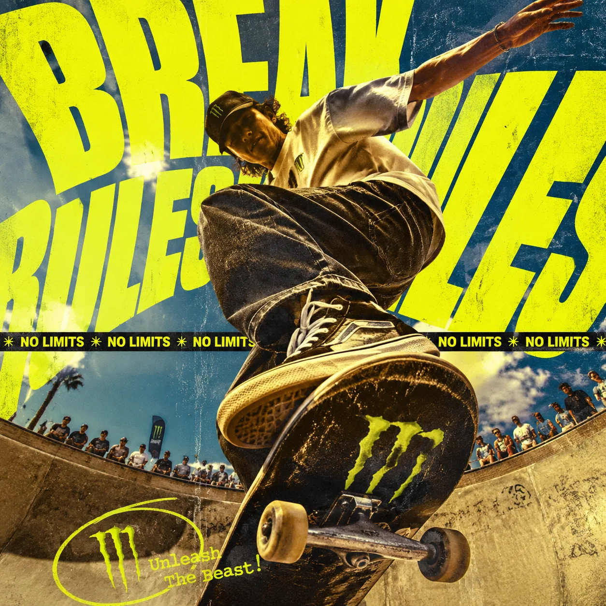

# Poster, Ai Art

[← Back to the collection](../../README.md) · Category: [Poster Design](../../gallery/poster-design.md) · Model: `Vinano Studio` · ID: `vn-01510`

<a href="https://vinano.ai?utm_source=github&utm_medium=readme&utm_campaign=awesome-image-video-prompts-updating&utm_content=prompt-page-image"></a>

<sub>Preview generated with <a href="https://vinano.ai?utm_source=github&utm_medium=readme&utm_campaign=awesome-image-video-prompts-updating&utm_content=prompt-page-caption">vinano.ai</a></sub>

## Prompt

```text
Create a 9:16 poster in the "Neon Kinetic Typographic Poster" style.

Main subject: [SUBJECT].
Action: [SUBJECT_ACTION].
Prop or product: [PRODUCT_OR_PROP].
Location: [LOCATION].
Background elements: [BACKGROUND_ELEMENTS].
Wardrobe or styling: [WARDROBE_STYLE].

Use an extreme low-angle wide-angle camera perspective, as if the camera is near the ground looking upward. The subject should feel large, energetic, and close to the viewer.

Add oversized warped neon yellow typography the main text "[MAIN_TEXT]". The letters should be ultra-bold, condensed, stretched, slanted, and partially cropped by the canvas edges. The typography should wrap around the composition and sit behind or partially around the subject.

Add a thin repeated uppercase text band reading "[SECONDARY_TEXT]", separated by "[ACCENT_SYMBOL]" symbols. The secondary text should run horizontally across the image like a campaign graphic stripe.

Use electric neon yellow graphics, warm sunlit photographic tones, blue sky contrast, visible film grain, analog print texture, hard shadows, and an energetic youth-culture campaign poster mood.

Avoid clean corporate design, small typography, flat illustration, pastel colors, luxury minimalism, and symmetrical static layout.

--- VARIABLES ---

[ACCENT_SYMBOL] — small separator icon such as diamond, dot, slash, star, or warning mark
[BACKGROUND_ELEMENTS] — sky, hills, architecture, crowd, stage lights, roads, rocks, grass, clouds, dust, or other secondary scenery
[LOCATION] — outdoor environment or contextual scene
[MAIN_TEXT] — large repeated headline word or phrase
[PRODUCT_OR_PROP] — object held, worn, used, or displayed by the subject
[SECONDARY_TEXT] — small repeating line of text
[SUBJECT] — main human figure or object
[SUBJECT_ACTION] — dynamic action performed by the subject
[WARDROBE_STYLE] — streetwear, outdoor fashion, sportswear, festival outfit, or editorial styling

--- NEGATIVE PROMPT ---

Avoid small typography, clean corporate layout, symmetrical centered poster design, flat vector illustration, pastel palette, luxury minimalism, soft studio lighting, plain white background, low contrast, overly polished 3D render, generic stock photo, tiny subject, unreadable clutter, and text that covers the subject's key action or product.

Emphasise material texture and natural light so the final frame feels tactile and premium.
```

## Try it on vinano.ai

1. Copy the prompt above.
2. Open **[vinano.ai](https://vinano.ai?utm_source=github&utm_medium=readme&utm_campaign=awesome-image-video-prompts-updating&utm_content=prompt-page-try)**, paste it into the image generator and pick a model.
3. Swap any placeholders (brand, product, city, person…) for your own details, then generate.

More prompts like this: [Poster Design gallery](../../gallery/poster-design.md) · [all categories](../../README.md#contents)
