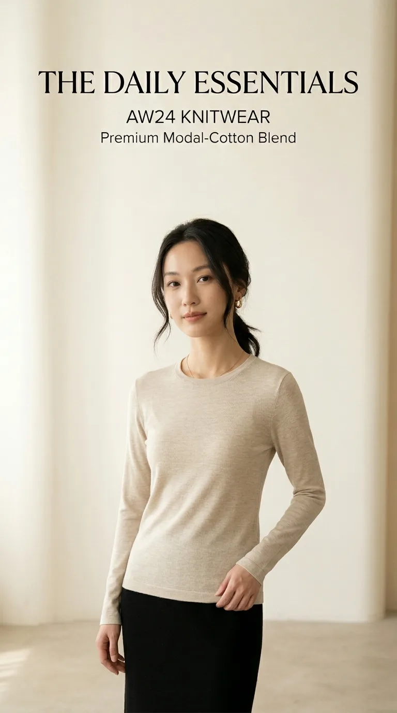

# Poster Design prompt #1544

[← Back to the collection](../../README.md) · Category: [Poster Design](../../gallery/poster-design.md) · Model: `Vinano Image Pro` · ID: `vn-01544`

<a href="https://vinano.ai?utm_source=github&utm_medium=readme&utm_campaign=awesome-image-video-prompts-updating&utm_content=prompt-page-image"></a>

<sub>Preview generated with <a href="https://vinano.ai?utm_source=github&utm_medium=readme&utm_campaign=awesome-image-video-prompts-updating&utm_content=prompt-page-caption">vinano.ai</a></sub>

## Prompt

```text
9：16竖版高端极简时尚产品海报。柔和摄影棚自然日光，温暖米白渐变背景（奶油色、燕麦色），画面极致干净。精致亚洲女性模特（25-30岁），自然裸妆，肤感干净，长发自然垂落或低马尾，姿态放松克制，全身或三分之二身构图，手自然垂放或轻触腰侧，强调衣身线条。服装必须严格匹配上传的产品参考图：高品质打底衫，奶油白/燕麦色/浅驼色/雾灰色，高支棉或莫代尔微弹针织面料，触感柔软，修身但不紧绷，圆领或小高领，长袖，设计极简 在保证细节的同时保持版式克制、留白得当。
```

## Try it on vinano.ai

1. Copy the prompt above.
2. Open **[vinano.ai](https://vinano.ai?utm_source=github&utm_medium=readme&utm_campaign=awesome-image-video-prompts-updating&utm_content=prompt-page-try)**, paste it into the image generator and pick a model.
3. Swap any placeholders (brand, product, city, person…) for your own details, then generate.

More prompts like this: [Poster Design gallery](../../gallery/poster-design.md) · [all categories](../../README.md#contents)
