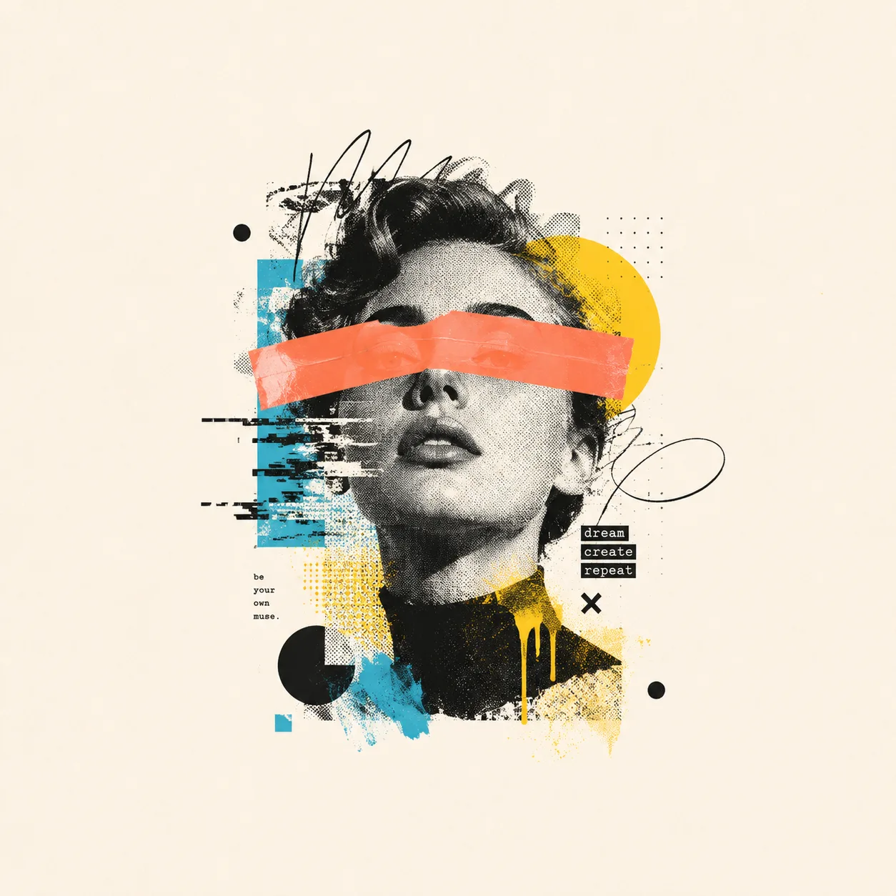

# Poster, Vintage

[← Back to the collection](../../README.md) · Category: [Poster Design](../../gallery/poster-design.md) · Model: `Vinano Studio` · ID: `vn-01546`

<a href="https://vinano.ai?utm_source=github&utm_medium=readme&utm_campaign=awesome-image-video-prompts-updating&utm_content=prompt-page-image"></a>

<sub>Preview generated with <a href="https://vinano.ai?utm_source=github&utm_medium=readme&utm_campaign=awesome-image-video-prompts-updating&utm_content=prompt-page-caption">vinano.ai</a></sub>

## Prompt

```text
[PERSON \ BRAND] visualized as the central masterpiece of a surreal avant-garde collage, style of modern mixed media editorial illustration. The subject is composed of high-contrast black and white stippled halftone textures blended vibrant neo-expressionist elements. Overlay details include bold geometric shapes, cyan and yellow risograph patterns, abstract graffiti scribbles, and digital glitch artifacts. A thick strip of pink or orange tape or a color block obscures part of the form for a deconstructed look. The texture is grainy, mimicking vintage poster paper. The composition is strictly centered a very wide, clean, off-white cream paper background, ensuring the entire subject is fully contained within the frame generous negative space on all sides, zero cropping, minimal chic aesthetic. Keep edges clean and the overall composition balanced for a polished, gallery-ready result.
```

## Try it on vinano.ai

1. Copy the prompt above.
2. Open **[vinano.ai](https://vinano.ai?utm_source=github&utm_medium=readme&utm_campaign=awesome-image-video-prompts-updating&utm_content=prompt-page-try)**, paste it into the image generator and pick a model.
3. Swap any placeholders (brand, product, city, person…) for your own details, then generate.

More prompts like this: [Poster Design gallery](../../gallery/poster-design.md) · [all categories](../../README.md#contents)
