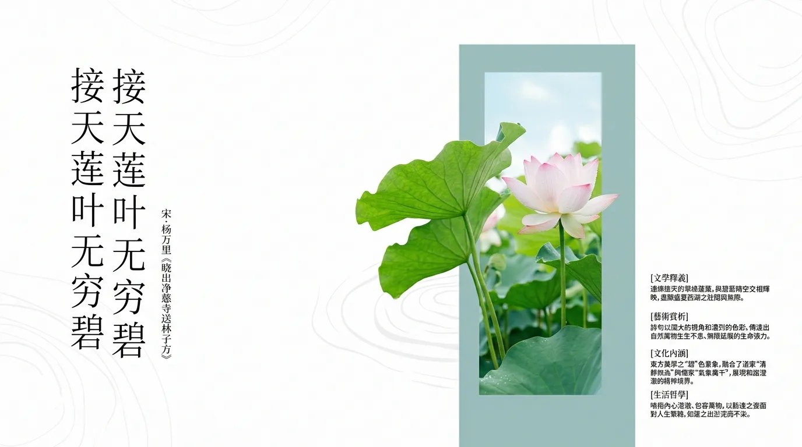

# 设计一张具有高级商业审美的极简海报

[← Back to the collection](../../README.md) · Category: [Poster Design](../../gallery/poster-design.md) · Model: `Vinano Image Pro` · ID: `vn-01560`

<a href="https://vinano.ai?utm_source=github&utm_medium=readme&utm_campaign=awesome-image-video-prompts-updating&utm_content=prompt-page-image"></a>

<sub>Preview generated with <a href="https://vinano.ai?utm_source=github&utm_medium=readme&utm_campaign=awesome-image-video-prompts-updating&utm_content=prompt-page-caption">vinano.ai</a></sub>

## Prompt

```text
设计一张具有高级商业审美的极简海报，核心视觉语言是“真实物象穿越几何情绪窗口”。画面中设置一个窄长的低饱和色块，作为视觉锚点和空间容器，色块颜色根据主题选择柔和浅色，如雾蓝、浅青、米白、淡粉、暖灰或浅金。将【核心物象】以真实摄影质感或精细写实方式置入色块之中，但不要完全困在色块内，要让主体局部越界、破框、延伸到留白区域，形成自然生长感和空间穿透感。背景保持极简，使用大面积白色或浅灰留白，加入几乎透明的文化纹样、线性图形、地形线、水波线、光影轮廓或抽象符号，作为若隐若现的视觉细节。整体排版要像高端地产、奢侈品、美学杂志或节气海报，文字细长、克制、字距舒展，标题可竖排，辅助信息用小字号规整排列。画面需要有东方留白、现代秩序、自然生命力、轻奢品质感。避免杂乱、避免高饱和、避免厚重阴影、避免廉价模板感。

本次主题：接天莲叶无穷碧
主视觉元素：顶级日系摄影风格，ins滤镜质感，电影级光影、明亮通透
其他要求：画面至少4个不同层级 不同逻辑和不同呈现方案的知识点

用途：[诗词鉴赏]
背景：[白色]

比例 [16:9]

整体保持边缘干净、构图均衡，呈现可直接使用的精致成品感。
```

## Try it on vinano.ai

1. Copy the prompt above.
2. Open **[vinano.ai](https://vinano.ai?utm_source=github&utm_medium=readme&utm_campaign=awesome-image-video-prompts-updating&utm_content=prompt-page-try)**, paste it into the image generator and pick a model.
3. Swap any placeholders (brand, product, city, person…) for your own details, then generate.

More prompts like this: [Poster Design gallery](../../gallery/poster-design.md) · [all categories](../../README.md#contents)
