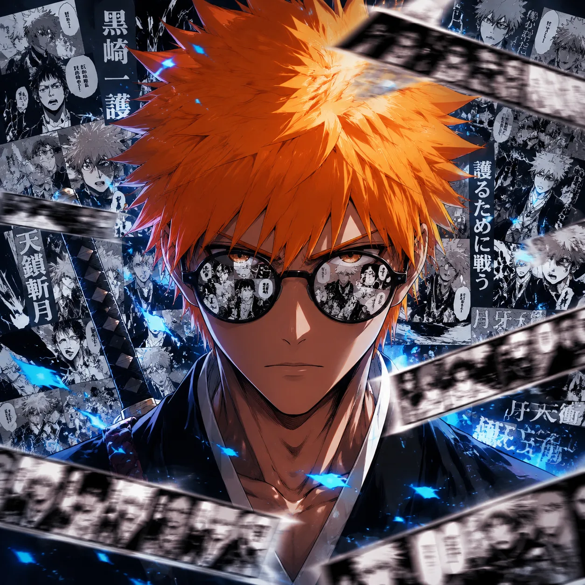

# Anime, Portrait

[← Back to the collection](../../README.md) · Category: [Poster Design](../../gallery/poster-design.md) · Model: `Vinano Studio` · ID: `vn-01586`

<a href="https://vinano.ai?utm_source=github&utm_medium=readme&utm_campaign=awesome-image-video-prompts-updating&utm_content=prompt-page-image"></a>

<sub>Preview generated with <a href="https://vinano.ai?utm_source=github&utm_medium=readme&utm_campaign=awesome-image-video-prompts-updating&utm_content=prompt-page-caption">vinano.ai</a></sub>

## Prompt

```text
超高细节二次元热血漫画风角色海报，少年死神角色正面半身特写，橙色炸毛短发，琥珀色眼睛，佩戴黑色圆框复古墨镜，冷峻严肃表情，正中央对称构图，镜头直视观众，强烈压迫感。

眼镜镜片中倒映大量黑白漫画分镜与角色画面，背景也由密集的日漫漫画页拼贴组成，形成“角色记忆 / 名场面回顾”的视觉效果。前景漂浮多条高速运动的漫画分镜条带，带有动态模糊与景深虚化效果，穿插画面上下，营造速度感与空间层次。

画面中散落蓝色灵压粒子 / 荧光能量碎片，形成冷暖撞色（橙发 vs 蓝色粒子）。整体采用《BLEACH》式热血少年漫画美学，融合现代潮流海报设计与高级动漫商业视觉。

anime key visual, BLEACH style, manga collage poster, cinematic anime lighting, reflective glasses, manga panels reflection, dynamic motion blur, orange spiky hair, intense stare, ultra detailed anime illustration, shonen jump aesthetic, layered composition, high contrast shading, cel shading, glowing blue particles, dramatic close-up portrait, symmetrical composition, manga montage background, Japanese comic aesthetic, premium anime poster

Maintain consistent colour harmony and crisp focus across the whole frame.
```

## Try it on vinano.ai

1. Copy the prompt above.
2. Open **[vinano.ai](https://vinano.ai?utm_source=github&utm_medium=readme&utm_campaign=awesome-image-video-prompts-updating&utm_content=prompt-page-try)**, paste it into the image generator and pick a model.
3. Swap any placeholders (brand, product, city, person…) for your own details, then generate.

More prompts like this: [Poster Design gallery](../../gallery/poster-design.md) · [all categories](../../README.md#contents)
