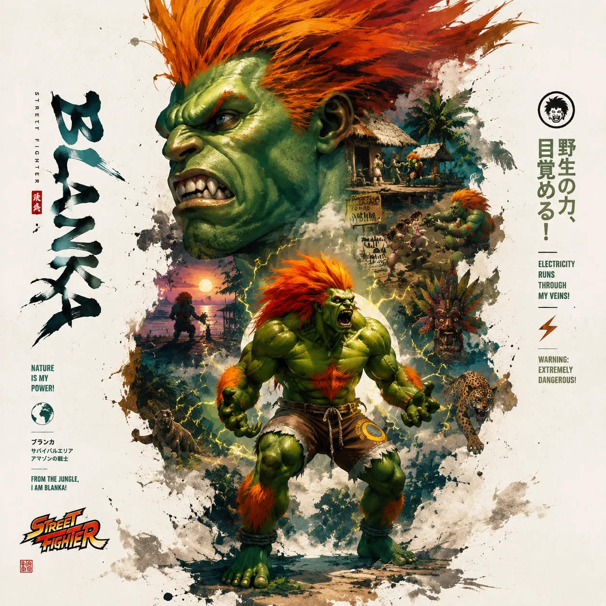

# Poster, Character

[← Back to the collection](../../README.md) · Category: [Poster Design](../../gallery/poster-design.md) · Model: `Vinano Studio` · ID: `vn-01623`

<a href="https://vinano.ai?utm_source=github&utm_medium=readme&utm_campaign=awesome-image-video-prompts-updating&utm_content=prompt-page-image"></a>

<sub>Preview generated with <a href="https://vinano.ai?utm_source=github&utm_medium=readme&utm_campaign=awesome-image-video-prompts-updating&utm_content=prompt-page-caption">vinano.ai</a></sub>

## Prompt

```text
Create a propaganda poster themed around the character “BLANKA” a consistent and hierarchical main visual composition.
Poster structure:
Top (top half): Use the character’s head, facial features, mask, or half-body silhouette as the main large-sized visual element, forming an easily recognizable iconic image.
Middle to bottom: Place the full-length character as the second subject, a stable standing pose or light movement, serving as the center of the visual composition.
Visual style:
Use double exposure and narrative collage techniques in and around the character’s large silhouette.
Combine various elements such as:
layered scenes
additional images
small character interactions
supporting elements
environmental backgrounds
all arranged in layers of clouds, ink, and white negative space.
Additional composition:
Place supporting elements on the left and right to create narrative tension and spatial variation.
Add a vertical flowing visual line connecting:
main character
internal collage elements
large silhouette at the top
to reinforce visual continuity.
 Aesthetics:
Maintain the use of large amounts of negative space.
The edges are processed the effects of:
ink diffusion
soft blur
visual fragmentation
to create a poetic and “breathing” Eastern aesthetic. Add more pop and striking colors
Overall style:
Consistent, premium, and refined.
Focus on:
visual layering
narrative
key visual impact
visual language of serial posters
Size: A4

Maintain consistent colour harmony and crisp focus across the whole frame.
```

## Try it on vinano.ai

1. Copy the prompt above.
2. Open **[vinano.ai](https://vinano.ai?utm_source=github&utm_medium=readme&utm_campaign=awesome-image-video-prompts-updating&utm_content=prompt-page-try)**, paste it into the image generator and pick a model.
3. Swap any placeholders (brand, product, city, person…) for your own details, then generate.

More prompts like this: [Poster Design gallery](../../gallery/poster-design.md) · [all categories](../../README.md#contents)
