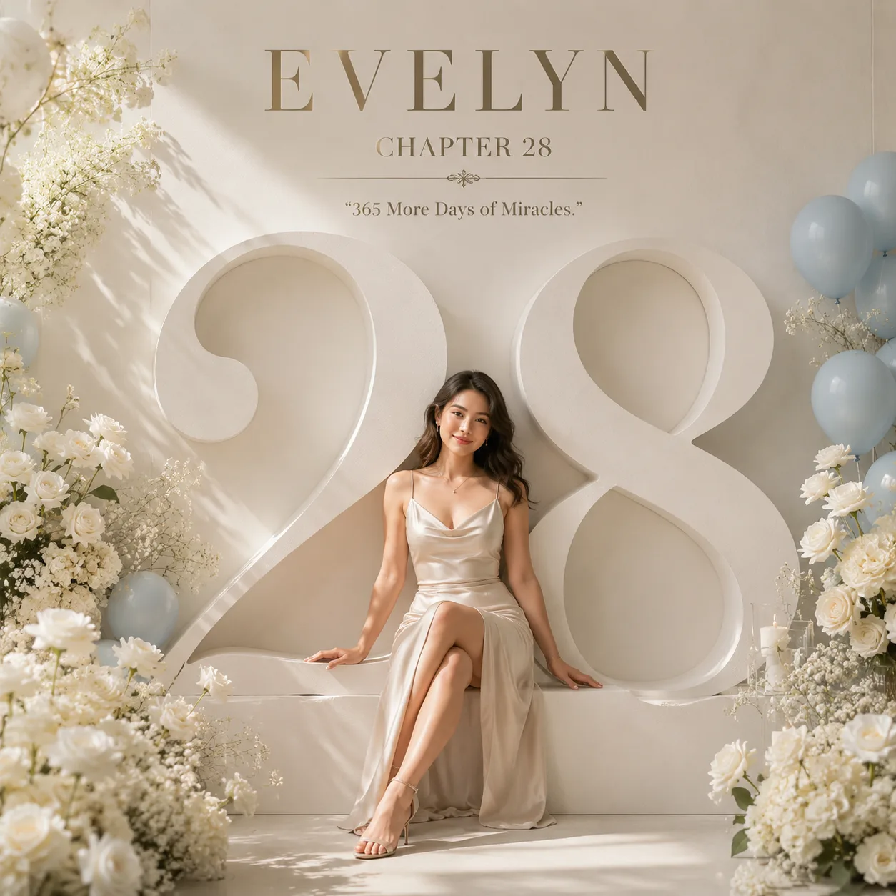

# Realistic, Portrait

[← Back to the collection](../../README.md) · Category: [Poster Design](../../gallery/poster-design.md) · Model: `Vinano Studio` · ID: `vn-01628`

<a href="https://vinano.ai?utm_source=github&utm_medium=readme&utm_campaign=awesome-image-video-prompts-updating&utm_content=prompt-page-image"></a>

<sub>Preview generated with <a href="https://vinano.ai?utm_source=github&utm_medium=readme&utm_campaign=awesome-image-video-prompts-updating&utm_content=prompt-page-caption">vinano.ai</a></sub>

## Prompt

```text
Create a luxury refined minimalist birthday milestone poster featuring a giant 3D number “[Age]” carved into a premium ivory-white wall. A stylish person is naturally sitting, leaning, or hanging from the number, posing confidently. Elegant floral arrangements white roses, baby's breath, hydrangeas, and pastel blue balloons frame the composition. Soft natural sunlight, premium editorial photography, modern celebration aesthetic, clean luxury design, subtle shadows, sophisticated typography. At the top, display the name “[Name]” in elegant serif font, followed by “CHAPTER [Age]” and the quote “365 More Days of Miracles.” Neutral beige and white color palette, high-end event styling, dreamy atmosphere, true-to-life photorealistic, magazine-quality portrait, ultra-detailed textures, luxury birthday photoshoot, Instagram-worthy, shallow depth of field, soft, diffused lighting, 8K masterpiece, professional fashion photography. Keep edges clean and the overall composition balanced for a polished, gallery-ready result.
```

## Try it on vinano.ai

1. Copy the prompt above.
2. Open **[vinano.ai](https://vinano.ai?utm_source=github&utm_medium=readme&utm_campaign=awesome-image-video-prompts-updating&utm_content=prompt-page-try)**, paste it into the image generator and pick a model.
3. Swap any placeholders (brand, product, city, person…) for your own details, then generate.

More prompts like this: [Poster Design gallery](../../gallery/poster-design.md) · [all categories](../../README.md#contents)
