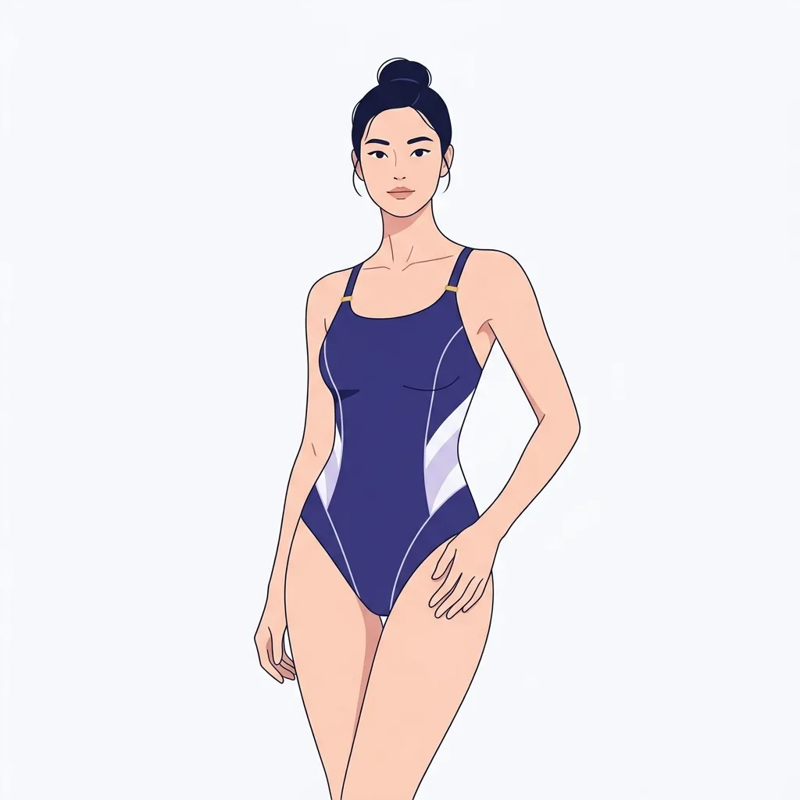

# Poster Design prompt #1636

[← Back to the collection](../../README.md) · Category: [Poster Design](../../gallery/poster-design.md) · Model: `Vinano Image Pro` · ID: `vn-01636`

<a href="https://vinano.ai?utm_source=github&utm_medium=readme&utm_campaign=awesome-image-video-prompts-updating&utm_content=prompt-page-image"></a>

<sub>Preview generated with <a href="https://vinano.ai?utm_source=github&utm_medium=readme&utm_campaign=awesome-image-video-prompts-updating&utm_content=prompt-page-caption">vinano.ai</a></sub>

## Prompt

```text
主体内容：一位穿着极简连体泳装的东方成年女性人物插画
主体气质：自信、健康、现代、利落
画面用途：极简人物插画
主色调：深靛蓝、冷白、浅紫
点缀色：金色
几何元素强度：无
几何元素类型：无
画幅比例：4:5
补充要求：突出肩颈、腰腹、胯部与腿部线条，姿态自然稳定，背景极简留白，不做商业海报

在保证细节的同时保持版式克制、留白得当。
```

## Try it on vinano.ai

1. Copy the prompt above.
2. Open **[vinano.ai](https://vinano.ai?utm_source=github&utm_medium=readme&utm_campaign=awesome-image-video-prompts-updating&utm_content=prompt-page-try)**, paste it into the image generator and pick a model.
3. Swap any placeholders (brand, product, city, person…) for your own details, then generate.

More prompts like this: [Poster Design gallery](../../gallery/poster-design.md) · [all categories](../../README.md#contents)
