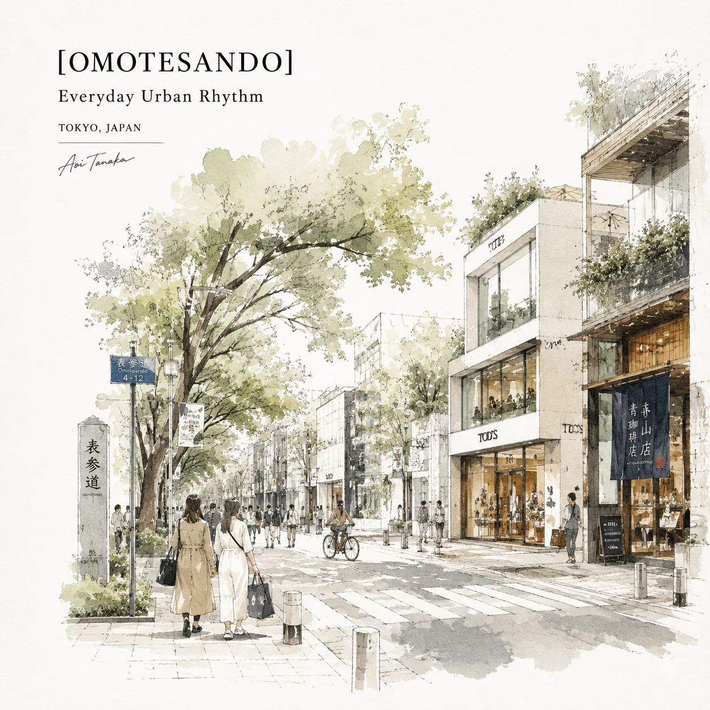

# Realistic, Poster

[← Back to the collection](../../README.md) · Category: [Poster Design](../../gallery/poster-design.md) · Model: `Vinano Studio` · ID: `vn-01645`

<a href="https://vinano.ai?utm_source=github&utm_medium=readme&utm_campaign=awesome-image-video-prompts-updating&utm_content=prompt-page-image"></a>

<sub>Preview generated with <a href="https://vinano.ai?utm_source=github&utm_medium=readme&utm_campaign=awesome-image-video-prompts-updating&utm_content=prompt-page-caption">vinano.ai</a></sub>

## Prompt

```text
refined minimalist ultra-high-resolution travel sketch poster of Omotesando, Tokyo, on clean white sketchbook paper subtle paper grain texture. Style: refined pen drawing + loose watercolor sketch. Delicate black ink linework, airy watercolor washes, elegant urban details. Show a calm everyday Omotesando street scene — the iconic zelkova tree-lined avenue, chic boutiques and flagship stores, small stylish cafés, people walking shopping bags, bicycles, crosswalks, low-rise modern architecture mixed traditional touches, subtle Japanese signage (Japanese characters on shop signs), fashionable Tokyo pedestrians, soft morning light filtering through the trees. Spacious editorial composition generous negative space. Mood: calm, modern, sophisticated, poetic. Typography: "[OMOTESANDO]" "Everyday Urban Rhythm" Premium travel sketch aesthetic, minimal and stylish, ultra-realistic watercolor + ink travel journal style, ultra-high-resolution, 9:16. Emphasise material texture and natural light so the final frame feels tactile and premium.
```

## Try it on vinano.ai

1. Copy the prompt above.
2. Open **[vinano.ai](https://vinano.ai?utm_source=github&utm_medium=readme&utm_campaign=awesome-image-video-prompts-updating&utm_content=prompt-page-try)**, paste it into the image generator and pick a model.
3. Swap any placeholders (brand, product, city, person…) for your own details, then generate.

More prompts like this: [Poster Design gallery](../../gallery/poster-design.md) · [all categories](../../README.md#contents)
