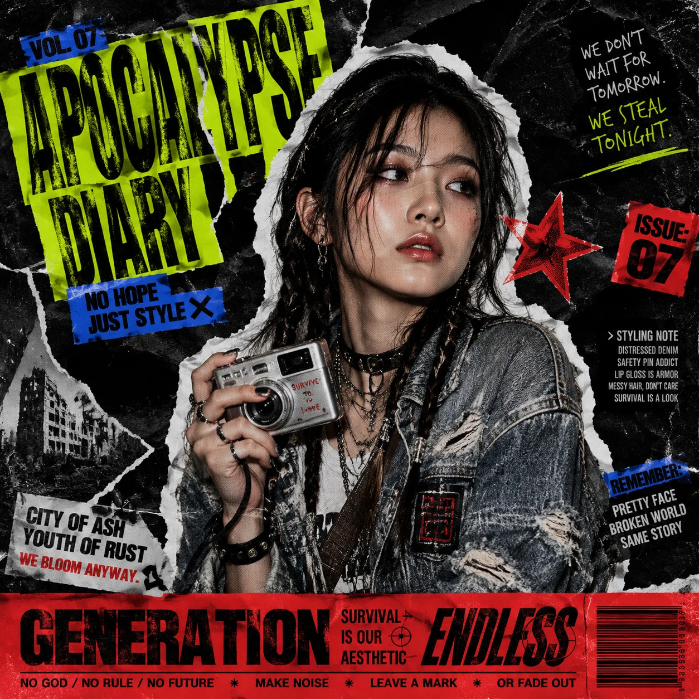

# Portrait, Poster

[← Back to the collection](../../README.md) · Category: [Poster Design](../../gallery/poster-design.md) · Model: `Vinano Studio` · ID: `vn-01661`

<a href="https://vinano.ai?utm_source=github&utm_medium=readme&utm_campaign=awesome-image-video-prompts-updating&utm_content=prompt-page-image"></a>

<sub>Preview generated with <a href="https://vinano.ai?utm_source=github&utm_medium=readme&utm_campaign=awesome-image-video-prompts-updating&utm_content=prompt-page-caption">vinano.ai</a></sub>

## Prompt

```text
Create a 9:16 K-pop apocalypse ransom zine poster featuring [SUBJECT] [SUBJECT_ACTION], styled in [WARDROBE_STYLE], [PRODUCT_OR_PROP]. Use a dark crumpled black paper background [BACKGROUND_ELEMENTS]. Place the subject as a large central portrait cutout a thick irregular torn white paper border. Add oversized warped display typography reading "[MAIN_TEXT]" as a tilted collage layer, plus smaller sticker blocks and side editorial captions reading "[SECONDARY_TEXT]". Use acid lime, electric blue, alert red, paper white, and ink black. Add [ACCENT_SYMBOL] near the portrait. Finish a saturated bottom masthead strip, rough photocopy grain, halftone speckles, scan noise, uneven paper shadows, and DIY magazine collage energy. Do not include watermarks, usernames, creator IDs, QR codes, platform logos, app marks, copied publication logos, or exact source text.

--- VARIABLES ---

[ACCENT_SYMBOL] — red star, diagonal sticker block, torn label, arrow tab, barcode stripe, or paper shard
[BACKGROUND_ELEMENTS] — crumpled black paper, distressed denim texture, torn white paper edges, photocopy grain, halftone noise, tape marks, and rough scanned shadows
[MAIN_TEXT] — oversized warped headline or sticker headline
[PRODUCT_OR_PROP] — compact camera, wired earbuds, lip gloss, denim jacket, cassette, charm bag, safety pin accessory, or styling prop
[SECONDARY_TEXT] — short editorial caption, mock issue line, styling note, lyric-like fragment, or repeated microcopy
[SUBJECT] — main subject, performer, model, musician, dancer, stylist, or youth-culture character
[SUBJECT_ACTION] — looking off-frame, posing attitude, holding a prop, leaning into the camera, or standing in a cutout portrait pose
[WARDROBE_STYLE] — post-apocalyptic K-pop styling, distressed denim, glossy makeup, messy hair, bright accessory accents, layered streetwear

--- NEGATIVE PROMPT ---

refined minimalist design, clean corporate layout, smooth gradients, luxury editorial polish, pastel lifestyle palette, glossy 3D typography, elegant serif masthead, empty whitespace, platform watermark, username, QR code, creator ID, app logo, copied publication logo, exact source text, exact source name

Keep edges clean and the overall composition balanced for a polished, gallery-ready result.
```

## Try it on vinano.ai

1. Copy the prompt above.
2. Open **[vinano.ai](https://vinano.ai?utm_source=github&utm_medium=readme&utm_campaign=awesome-image-video-prompts-updating&utm_content=prompt-page-try)**, paste it into the image generator and pick a model.
3. Swap any placeholders (brand, product, city, person…) for your own details, then generate.

More prompts like this: [Poster Design gallery](../../gallery/poster-design.md) · [all categories](../../README.md#contents)
