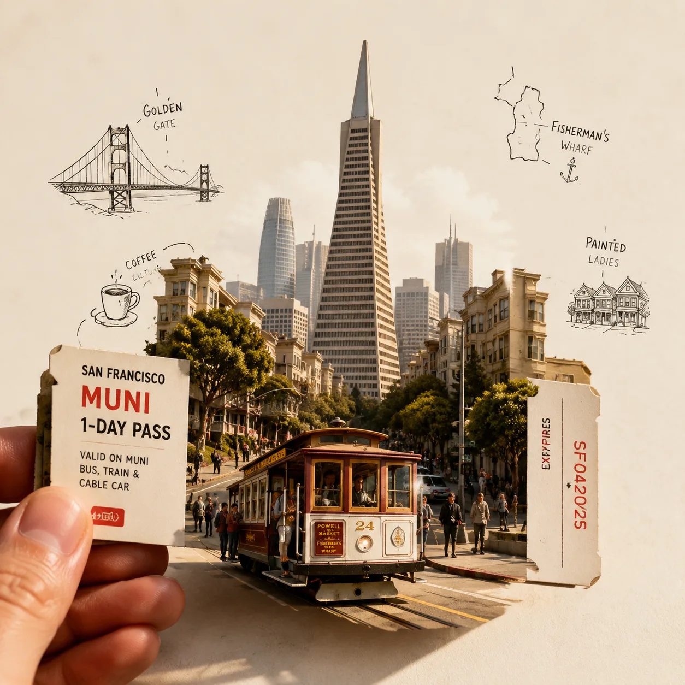

# Realistic, Poster

[← Back to the collection](../../README.md) · Category: [Poster Design](../../gallery/poster-design.md) · Model: `Vinano Studio` · ID: `vn-01670`

<a href="https://vinano.ai?utm_source=github&utm_medium=readme&utm_campaign=awesome-image-video-prompts-updating&utm_content=prompt-page-image"></a>

<sub>Preview generated with <a href="https://vinano.ai?utm_source=github&utm_medium=readme&utm_campaign=awesome-image-video-prompts-updating&utm_content=prompt-page-caption">vinano.ai</a></sub>

## Prompt

```text
Create a highly detailed, premium travel-art illustration featuring a hand holding a [CITY-SPECIFIC TICKET/PASS] in the foreground. The ticket acts as a portal to [CITY NAME], a realistic miniature city scene emerging from the ticket.

A signature transportation element ([CITY VEHICLE]) breaks out of the ticket frame in 3D perspective, extending toward the viewer. Behind the ticket, one iconic landmark ([HERO LANDMARK]) rises prominently and realistically, becoming the main architectural focal point.

Surrounding the scene are only 3–4 clean hand-drawn doodle elements representing the city's identity, such as district names, local symbols, or famous locations. Use minimal doodles, lots of negative space, and avoid clutter.

Include tiny realistic people interacting the scene, such as commuters, tourists, street vendors, cyclists, or photographers, scaled appropriately to create a miniature-world effect.

Style: true-to-life photorealistic travel photography combined elegant black-ink sketchbook doodles. crisp composition, premium editorial design, soft warm lighting, shallow depth of field, realistic textures, subtle shadows, Instagram-worthy travel artwork.

Composition hierarchy:

1. Emerging vehicle
2. Hero landmark
3. Ticket/pass
4. Minimal doodle elements

Avoid: crowded layouts, excessive text, too many landmarks, busy backgrounds, duplicated symbols, excessive arrows, stickers, or decorative icons.

Aspect ratio: 1:1 square.
Quality: ultra-detailed, cinematic, sharp focus, professional travel poster aesthetic.

Emphasise material texture and natural light so the final frame feels tactile and premium.
```

## Try it on vinano.ai

1. Copy the prompt above.
2. Open **[vinano.ai](https://vinano.ai?utm_source=github&utm_medium=readme&utm_campaign=awesome-image-video-prompts-updating&utm_content=prompt-page-try)**, paste it into the image generator and pick a model.
3. Swap any placeholders (brand, product, city, person…) for your own details, then generate.

More prompts like this: [Poster Design gallery](../../gallery/poster-design.md) · [all categories](../../README.md#contents)
