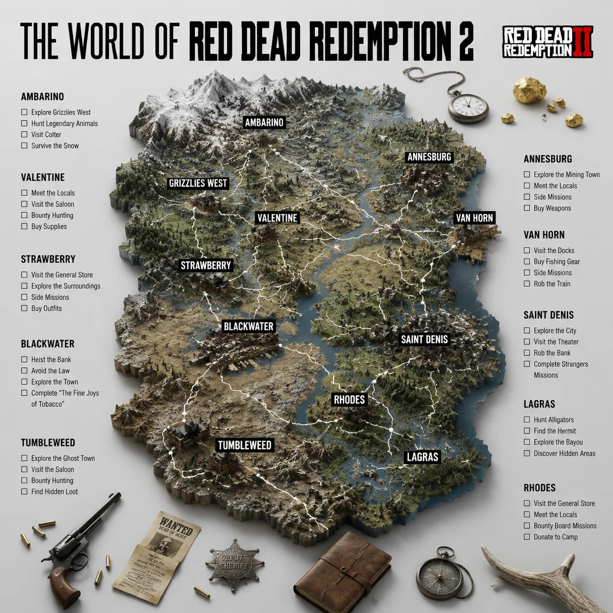

# Realistic, Landscape

[← Back to the collection](../../README.md) · Category: [Poster Design](../../gallery/poster-design.md) · Model: `Vinano Studio` · ID: `vn-01674`

<a href="https://vinano.ai?utm_source=github&utm_medium=readme&utm_campaign=awesome-image-video-prompts-updating&utm_content=prompt-page-image"></a>

<sub>Preview generated with <a href="https://vinano.ai?utm_source=github&utm_medium=readme&utm_campaign=awesome-image-video-prompts-updating&utm_content=prompt-page-caption">vinano.ai</a></sub>

## Prompt

```text
A hyper-realistic 3D game guide infographic poster for [GAME]. The in-game world of [GAME] is rendered as a raised, textured terrain map floating on a clean light gray surface — the map shape and landscape must reflect the actual geography and visual aesthetic of [GAME] (urban, western, fantasy, island etc). Iconic in-game locations from [GAME] are placed as miniature 3D sculpted models at their correct in-game positions across the map — each one highly detailed, true-to-life photorealistic and instantly recognizable to fans. Roads or paths connect key locations as white lines across the terrain. Around the map, floating 3D decorative props and items iconic to [GAME] are scattered on the light gray surface. The official logo of [GAME] is shown as a small detailed object in the upper right corner. Each major location has a bold black label on the map, and beside the map, each location has a neat checklist of its most iconic moments or activities associated that place, in clean sans-serif typography. A large bold title at the top reads: “THE WORLD OF GAME” in black uppercase typography [GAME] in heavy bold. The overall aesthetic is premium editorial — soft studio lighting, true-to-life photorealistic 3D render, white/light gray background, clean layout, 4:5 aspect ratio Preserve realistic proportions and depth for a confident, professional finish.
```

## Try it on vinano.ai

1. Copy the prompt above.
2. Open **[vinano.ai](https://vinano.ai?utm_source=github&utm_medium=readme&utm_campaign=awesome-image-video-prompts-updating&utm_content=prompt-page-try)**, paste it into the image generator and pick a model.
3. Swap any placeholders (brand, product, city, person…) for your own details, then generate.

More prompts like this: [Poster Design gallery](../../gallery/poster-design.md) · [all categories](../../README.md#contents)
