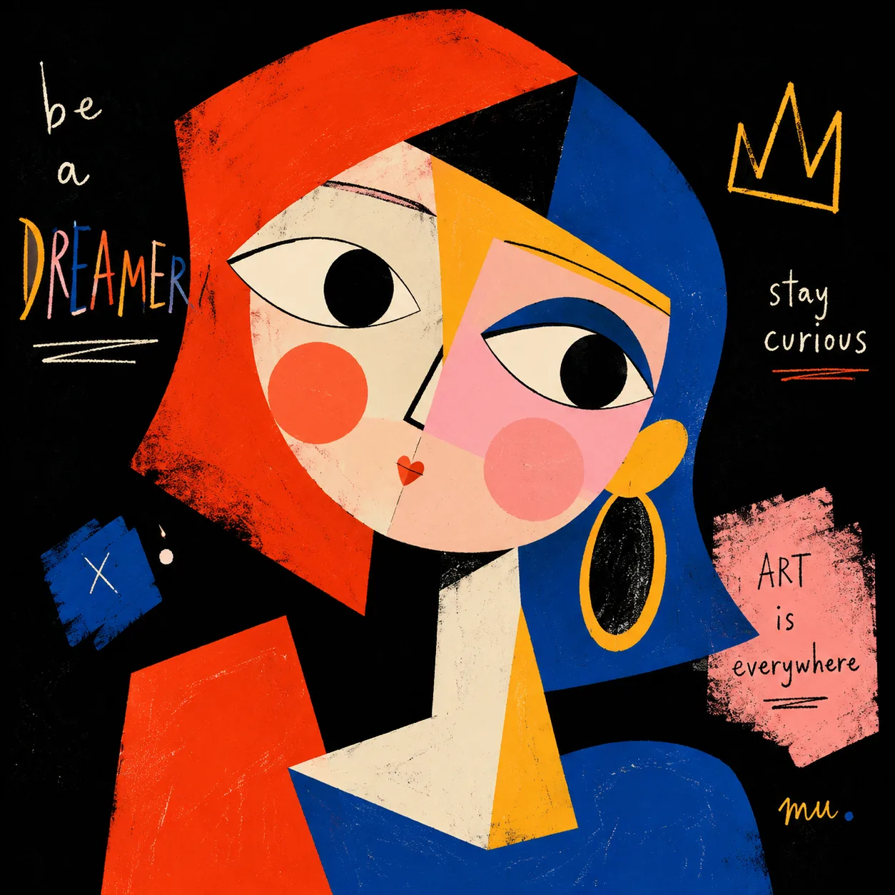

# Realistic, Portrait

[← Back to the collection](../../README.md) · Category: [Poster Design](../../gallery/poster-design.md) · Model: `Vinano Studio` · ID: `vn-01679`

<a href="https://vinano.ai?utm_source=github&utm_medium=readme&utm_campaign=awesome-image-video-prompts-updating&utm_content=prompt-page-image"></a>

<sub>Preview generated with <a href="https://vinano.ai?utm_source=github&utm_medium=readme&utm_campaign=awesome-image-video-prompts-updating&utm_content=prompt-page-caption">vinano.ai</a></sub>

## Prompt

```text
Create a cute neo-expressionist cubist minimal vector portrait illustration, Picasso meets kawaii minimalism, inspired by stylized fashion editorials and playful modern art. Ultra-simplified exaggerated facial features oversized abstract eyes, flat cartoon eye shapes, minimal black dots or single curved strokes, no realistic iris details, no eyelashes, extremely reduced facial detail. Tiny abstract nose drawn one short angular line. Small single-stroke lips, tiny soft geometric mouth shape, minimal expression marks, no realistic mouth anatomy. Rounded cheeks, dreamy innocent expression, playful asymmetrical proportions, elongated elegant neck, simplified geometric facial planes, stylized angular hair shapes, subtle caricature aesthetics, childlike artistic distortion. Use clean scalable vector shapes, flat color blocking, bold primitive contour lines, sharp Bézier curves, abstract polygon composition, minimal linework, naive handmade drawing quality, expressive empty space, icon-like facial abstraction, no realistic rendering, 2D primitive facial symbols. Add subtle oil pastel grain overlays, rough handmade brush accents, raw scribbled handwritten marks, visible pigment texture, silkscreen poster feeling. Vibrant limited color palette against deep matte black background. Luxury editorial gallery poster composition, contemporary fashion illustration, artsy modern cubist poster, stylish and adorable, premium print-ready vector artwork. Maintain consistent colour harmony and crisp focus across the whole frame.
```

## Try it on vinano.ai

1. Copy the prompt above.
2. Open **[vinano.ai](https://vinano.ai?utm_source=github&utm_medium=readme&utm_campaign=awesome-image-video-prompts-updating&utm_content=prompt-page-try)**, paste it into the image generator and pick a model.
3. Swap any placeholders (brand, product, city, person…) for your own details, then generate.

More prompts like this: [Poster Design gallery](../../gallery/poster-design.md) · [all categories](../../README.md#contents)
