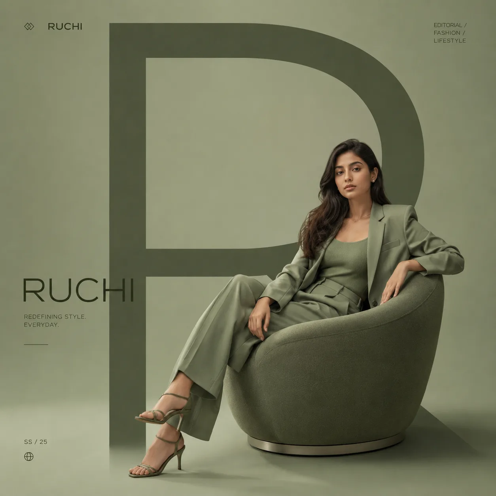

# Realistic, Poster

[← Back to the collection](../../README.md) · Category: [Poster Design](../../gallery/poster-design.md) · Model: `Vinano Studio` · ID: `vn-01686`

<a href="https://vinano.ai?utm_source=github&utm_medium=readme&utm_campaign=awesome-image-video-prompts-updating&utm_content=prompt-page-image"></a>

<sub>Preview generated with <a href="https://vinano.ai?utm_source=github&utm_medium=readme&utm_campaign=awesome-image-video-prompts-updating&utm_content=prompt-page-caption">vinano.ai</a></sub>

## Prompt

```text
Create a premium modern editorial branding poster for [RUCHI].

TOPIC:
[EDITORIAL / FASHION / LIFESTYLE THEME]

STYLE & ART DIRECTION:

Contemporary refined minimalist editorial design

Monochromatic branding aesthetic

Clean luxury composition

Modern creative-agency visual identity

Soft studio photography style

Oversized abstract typography integration

Minimal geometric branding

High-end lifestyle campaign aesthetic

Scandinavian-inspired visual simplicity

Modern art-direction poster design

MAIN SUBJECT:

A stylish realistic young woman seated prominently in a designer chair

Fashion-forward outfit matching the monochromatic palette

Relaxed confident pose

Contemporary editorial styling

Premium realistic studio photography

Modern expressive fashion aesthetic

Strong personality and visual identity

Soft realistic shadows beneath the subject and furniture

Large designer furniture piece integrated as part of the composition

LAYOUT & COMPOSITION:

Same exact refined minimalist composition and visual structure as the reference design

Large oversized abstract letter "R" or typography shape dominating the background

Subject placed asymmetrically in the foreground

Spacious negative space

Minimal branding details in the corners

Strong visual balance between typography and subject

Editorial magazine-inspired hierarchy

Clean modern alignment

Minimal clutter and highly refined spacing

TEXT & TYPOGRAPHY:

Oversized geometric typography

Minimal branding text

Thin modern sans-serif fonts

Abstract letterform integration

Small editorial metadata text

Luxury contemporary typography hierarchy

DEPTH & LIGHTING:

Soft cinematic studio lighting

Gentle monochromatic shadows

Smooth gradient lighting

Premium editorial depth

Soft realistic reflections

Contemporary luxury atmosphere

EXTRA DESIGN DETAILS:

Minimal grain texture

Clean modern gradients

Abstract geometric branding

Soft monochromatic transitions

Designer furniture aesthetic

Minimal art-poster mood

COLOR PALETTE:

Green color

Tonal monochromatic variations

Soft neutral highlights

Clean editorial contrast

QUALITY:

Ultra realistic editorial photography

Premium branding poster

Behance-quality modern composition

Contemporary fashion campaign quality

Same exact visual identity and layout as the reference.Same Face as Reference Image.

8K Ultra high resolution.

Render with rich micro-detail while keeping the layout uncluttered and intentional.
```

## Try it on vinano.ai

1. Copy the prompt above.
2. Open **[vinano.ai](https://vinano.ai?utm_source=github&utm_medium=readme&utm_campaign=awesome-image-video-prompts-updating&utm_content=prompt-page-try)**, paste it into the image generator and pick a model.
3. Swap any placeholders (brand, product, city, person…) for your own details, then generate.

More prompts like this: [Poster Design gallery](../../gallery/poster-design.md) · [all categories](../../README.md#contents)
