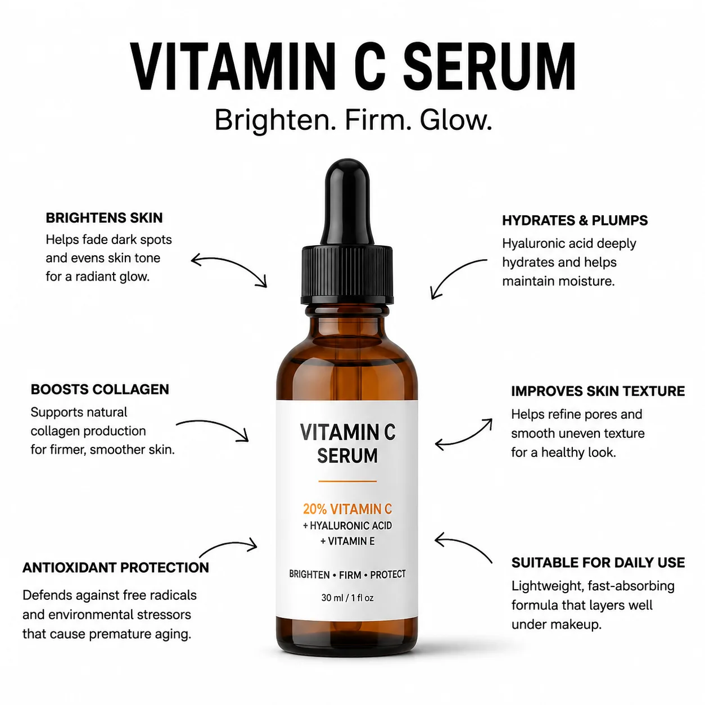

# Poster, Infographic

[← Back to the collection](../../README.md) · Category: [Poster Design](../../gallery/poster-design.md) · Model: `Vinano Studio` · ID: `vn-01689`

<a href="https://vinano.ai?utm_source=github&utm_medium=readme&utm_campaign=awesome-image-video-prompts-updating&utm_content=prompt-page-image"></a>

<sub>Preview generated with <a href="https://vinano.ai?utm_source=github&utm_medium=readme&utm_campaign=awesome-image-video-prompts-updating&utm_content=prompt-page-caption">vinano.ai</a></sub>

## Prompt

```text
[product], clean skincare infographic poster, centered product packshot on pure white seamless background, soft diffused studio lighting, subtle shadow under the bottle, minimal modern layout, bold headline at top [headline], smaller subheading under it [size_or_tagline], 4 to 6 short callout texts around the product [callout_1] [callout_2] [callout_3] [callout_4] [callout_5] [callout_6], curved hand drawn style arrows pointing to the product, balanced spacing, high legibility black typography, simple sans serif font, editorial product education design, sharp focus, high resolution, 8k, 1:1, no watermark, no extra logos Preserve realistic proportions and depth for a confident, professional finish.
```

## Try it on vinano.ai

1. Copy the prompt above.
2. Open **[vinano.ai](https://vinano.ai?utm_source=github&utm_medium=readme&utm_campaign=awesome-image-video-prompts-updating&utm_content=prompt-page-try)**, paste it into the image generator and pick a model.
3. Swap any placeholders (brand, product, city, person…) for your own details, then generate.

More prompts like this: [Poster Design gallery](../../gallery/poster-design.md) · [all categories](../../README.md#contents)
