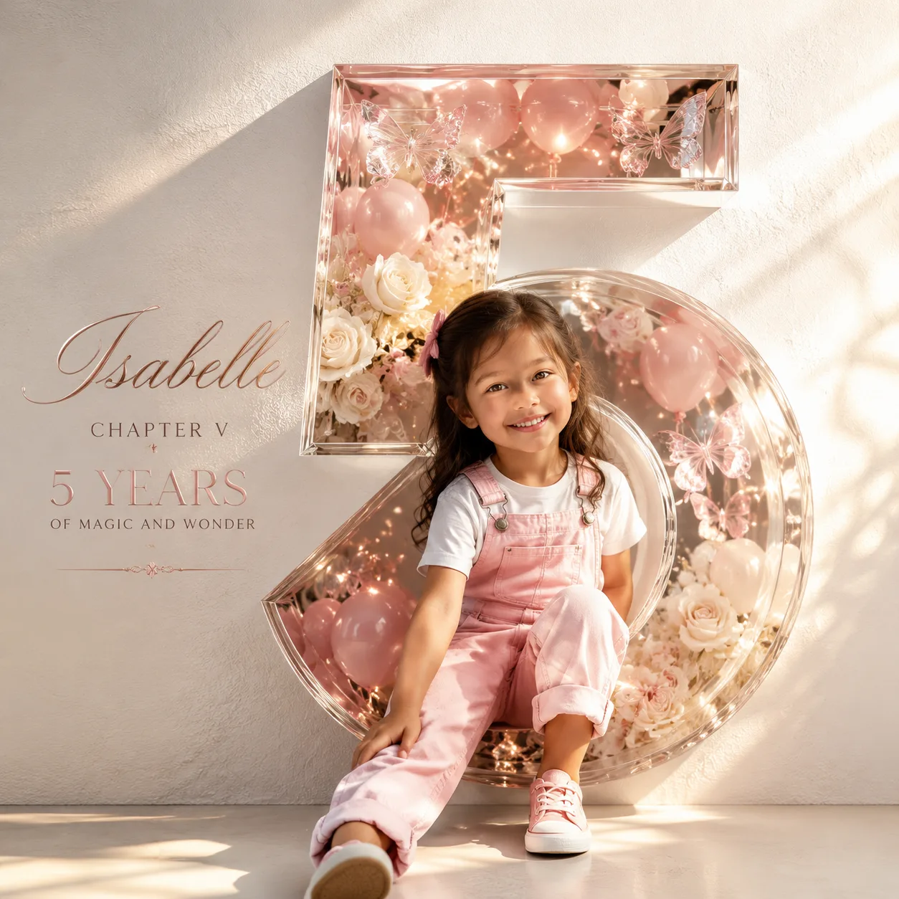

# Realistic, Portrait

[← Back to the collection](../../README.md) · Category: [Poster Design](../../gallery/poster-design.md) · Model: `Vinano Studio` · ID: `vn-01693`

<a href="https://vinano.ai?utm_source=github&utm_medium=readme&utm_campaign=awesome-image-video-prompts-updating&utm_content=prompt-page-image"></a>

<sub>Preview generated with <a href="https://vinano.ai?utm_source=github&utm_medium=readme&utm_campaign=awesome-image-video-prompts-updating&utm_content=prompt-page-caption">vinano.ai</a></sub>

## Prompt

```text
Professional luxury birthday poster, 3:4 portrait composition, ultra high-end studio photography aesthetic, premium off-white textured paper wall background subtle grain and depth.
A giant luxury crystal-glass number [Age] is precisely carved into the wall realistic thickness, beveled edges, transparent glass material, sparkling reflections, crystal highlights, light refractions, and deep inner shadows creating dramatic 3D depth.
Inside the number: elegant pastel pink balloons, premium white roses, luxury flower bouquets, soft floating sparkles, delicate crystal butterflies, dreamy magical atmosphere, clean minimal styling, high-end editorial design.
A happy [Age]-year-old child EXACT facial identity preserved from the uploaded reference image. Identical facial features, identical eyes, nose, lips, face shape, skin tone, hairstyle, expression style, and overall appearance. Face consistency is the highest priority.
Wearing a milky white T-shirt and premium pastel pink denim overalls realistic fabric texture and luxury styling.
The child's head, shoulders, one hand, and one foot extend outside the number frame, creating an ultra-realistic 3D pop-out effect accurate perspective, natural depth, realistic shadows, and seamless integration between foreground and background.
Warm cinematic golden sunlight entering from one side, soft rim lighting, realistic skin texture, studio-quality photography lighting, natural shadows, luxury portrait lighting, shallow depth of field.
Elegant typography integrated directly onto the wall:
[Name]
CHAPTER [Chapter Number]
[Age] YEARS OF MAGIC AND WONDER
Minimal luxury editorial layout, Vogue magazine cover style, premium birthday campaign photography, award-winning composition, soft contrast, natural pastel colors, crystal reflections, ultra-sharp focus, true-to-life photorealistic rendering, masterpiece quality, luxury realism.
Negative Prompt: different face, altered facial features, face swap, wrong child, duplicate body parts, extra fingers, extra limbs, deformed hands, distorted face, crossed eyes, blurry face, low quality, AI artifacts, text errors, watermark, logo, bad anatomy, oversaturated colors, cropped head, unrealistic skin, poor lighting.
8K ultra-detailed, hyper-realistic, premium luxury birthday poster.

Render with rich micro-detail while keeping the layout uncluttered and intentional.
```

## Try it on vinano.ai

1. Copy the prompt above.
2. Open **[vinano.ai](https://vinano.ai?utm_source=github&utm_medium=readme&utm_campaign=awesome-image-video-prompts-updating&utm_content=prompt-page-try)**, paste it into the image generator and pick a model.
3. Swap any placeholders (brand, product, city, person…) for your own details, then generate.

More prompts like this: [Poster Design gallery](../../gallery/poster-design.md) · [all categories](../../README.md#contents)
