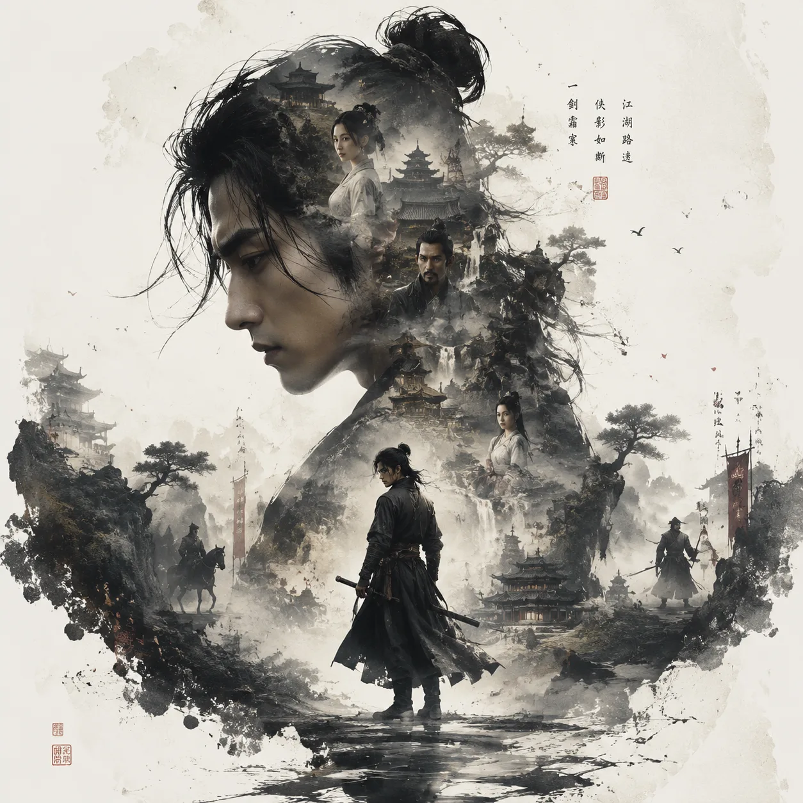

# Poster, Character

[← Back to the collection](../../README.md) · Category: [Poster Design](../../gallery/poster-design.md) · Model: `Vinano Studio` · ID: `vn-01695`

<a href="https://vinano.ai?utm_source=github&utm_medium=readme&utm_campaign=awesome-image-video-prompts-updating&utm_content=prompt-page-image"></a>

<sub>Preview generated with <a href="https://vinano.ai?utm_source=github&utm_medium=readme&utm_campaign=awesome-image-video-prompts-updating&utm_content=prompt-page-caption">vinano.ai</a></sub>

## Prompt

```text
[Main Roles]
the most recognizable head, face outline, mask or outer outline of the figure is the large visual subject, forming a highly recognizable silhouette main shape; the middle and lower part is arranged the complete figure as the second subject, showing a stable standing or slight movement posture, forming the visual core of the picture.Double exposure and collage narrative compositions inside and around the large outline, combining multiple scenes, images, small character relationships, auxiliary elements and environmental layers in clouds, ink, and whitening. The left and right side is equipped an echoing side of the scene, which creates story tension and space changes. Link the main character, internal collage, and large outline above a flow of clues across the screen to enhance integrity and vision guidance.The overall picture retains a large area of whiteness, and the edge is stained ink and virtual broken, creating a real relationship and breath in the Oriental aesthetics. Overall style uniform, advanced and restrained, emphasizing layers, narrative, main visual impact and serialized poster language. Size: 9:16.

Render with rich micro-detail while keeping the layout uncluttered and intentional.
```

## Try it on vinano.ai

1. Copy the prompt above.
2. Open **[vinano.ai](https://vinano.ai?utm_source=github&utm_medium=readme&utm_campaign=awesome-image-video-prompts-updating&utm_content=prompt-page-try)**, paste it into the image generator and pick a model.
3. Swap any placeholders (brand, product, city, person…) for your own details, then generate.

More prompts like this: [Poster Design gallery](../../gallery/poster-design.md) · [all categories](../../README.md#contents)
