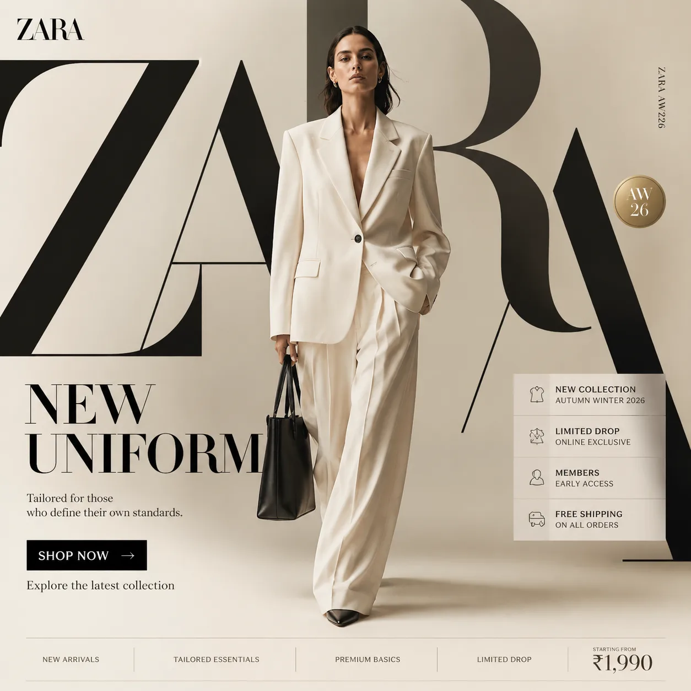

# Realistic, Poster

[← Back to the collection](../../README.md) · Category: [Poster Design](../../gallery/poster-design.md) · Model: `Vinano Studio` · ID: `vn-01698`

<a href="https://vinano.ai?utm_source=github&utm_medium=readme&utm_campaign=awesome-image-video-prompts-updating&utm_content=prompt-page-image"></a>

<sub>Preview generated with <a href="https://vinano.ai?utm_source=github&utm_medium=readme&utm_campaign=awesome-image-video-prompts-updating&utm_content=prompt-page-caption">vinano.ai</a></sub>

## Prompt

```text
"NEW UNIFORM"

FORMAT

Ultra-Premium Fashion SMM Promotional Poster
Vertical 4:5
Instagram Hero Creative
Luxury Fast Fashion Advertising
Commercial Fashion Graphic Design
Agency-Level Art Direction
Behance Front Page Quality
8K UHD
Hyper-Realistic
Fashion × Graphic Design Fusion
Zero AI Slop
Zero Generic Fashion Campaigns
Zero Editorial-Only Aesthetic

CORE STRATEGY

This is not a fashion campaign.

This is a fashion statement disguised as a promotional poster.

The design should feel like Zara's homepage,
a luxury magazine cover,
and a premium billboard campaign
merged into one visual.

The graphic design is equally important as the fashion.

Typography is not decoration.

Typography is architecture.

CAMPAIGN IDEA

"NEW UNIFORM"

Not office uniform.

Not school uniform.

The uniform of modern taste.

The clothes aren't being sold.

The identity is.

MASTER VISUAL

Massive oversized ZARA typography dominates the entire composition.

The word:

ZARA

occupies nearly 75% of the canvas.

Typography is integrated into the design.

Letters extend beyond frame edges.

Some letters cropped.

Some hidden behind the model.

Some functioning as compositional structures.

The typography should feel monumental.

HERO SUBJECT

Female model.

Editorial face.

Strong jawline.

Minimal makeup.

Luxury fashion energy.

No smiling.

No dramatic posing.

Pure confidence.

Wardrobe:

Oversized ivory blazer.

Wide-leg tailored trousers.

Premium monochromatic styling.

Black leather accessories.

Luxury minimalism.

POSE

Model stepping through the giant typography.

One foot slightly forward.

Direct eye contact.

Hands relaxed.

Body partially intersecting typography.

The feeling:

She owns the space.

COMPOSITION

Typography occupies 70%.

Model occupies 20%.

Promotional elements occupy 10%.

Visual hierarchy:

ZARA
↓
Model
↓
Promotion
↓
CTA

Everything feels intentional.

COLOR SYSTEM

Primary:
Ivory

Cream

Off White

Soft Beige

Black

Accent:
Muted Gold

No bright colors.

No fashion-week color chaos.

Luxury restraint.

BACKGROUND

Clean luxury backdrop.

Large soft gradient.

Editorial studio environment.

Subtle texture.

No architecture.

No scenery.

No distractions.

The design itself creates the environment.

GRAPHIC DESIGN SYSTEM

Floating collection cards.

Luxury editorial labels.

Minimal grid system.

Thin lines.

Micro typography.

Magazine-inspired information hierarchy.

Fashion-week poster energy.

PROMOTIONAL ELEMENTS

NEW COLLECTION

AUTUMN WINTER 2026

LIMITED DROP

ONLINE EXCLUSIVE

MEMBERS EARLY ACCESS

FREE SHIPPING

Integrated naturally into layout.

Not banner spam.

TYPOGRAPHY HIERARCHY

Top Left

ZARA

small luxury wordmark

Center Massive Typography

Z
A
R
A

occupying most of composition

luxury serif typography

extremely large scale

partially cropped

Campaign Title

NEW
UNIFORM

bold elegant typography

Supporting Copy

Tailored for those who define their own standards.

PROMOTIONAL CTA BLOCK

SHOP NOW →

Explore the latest collection

BOTTOM FEATURE STRIP

NEW ARRIVALS

TAILORED ESSENTIALS

PREMIUM BASICS

LIMITED DROP

Bottom Right

Starting From ₹1,990

Bottom Center

Vertical Edge Text

ZARA AW26

LIGHTING

Luxury studio lighting.

Large soft source.

Editorial contrast.

Natural skin rendering.

Premium fabric highlights.

Subtle shadows.

Luxury magazine quality.

CAMERA

ARRI Alexa Mini LF

85mm Lens

Editorial fashion photography

Shallow depth of field

Extremely sharp fabric rendering

Ultra-premium commercial quality

POST-PRODUCTION

Luxury European fashion campaign grading.

Rich blacks.

Cream highlights.

Visible textile texture.

Natural skin detail.

No excessive retouching.

No artificial HDR.

No fake luxury effects.

FINAL FEEL

If Zara,
Vogue,
and a premium graphic design studio

created a promotional social media poster together.

Not a fashion photograph.

Not a catalogue.

A modern luxury fashion advertisement

Shot on ARRI Alexa Mini LF, 35mm lens, dynamic commercial perspective, street-fashion energy, magazine-cover quality detail, natural movement capture, authentic contemporary fashion realism, premium advertising production standards.

Modern fashion campaign color grading, strong reds, clean whites, visible fabric textures, realistic skin detail, subtle grain, commercial social-media polish, no artificial luxury grading, no fashion-house minimalism, no generic fast-fashion campaign aesthetics, no AI slop, no sterile studio appearance.

A fusion of Spotify Wrapped energy, Nike youth-culture storytelling, Pinterest trend aesthetics and world-class graphic design agency execution. Bold, energetic, expressive, commercial, social-first and highly shareable. A true promotional SMM poster communicating that every personality, every mood and every version of yourself can exist within one H&M collection. Behance Front Page quality, award-winning youth-fashion advertising, graphic-design-first commercial masterpiece.

Aim for an editorial, design-driven look with deliberate negative space.
```

## Try it on vinano.ai

1. Copy the prompt above.
2. Open **[vinano.ai](https://vinano.ai?utm_source=github&utm_medium=readme&utm_campaign=awesome-image-video-prompts-updating&utm_content=prompt-page-try)**, paste it into the image generator and pick a model.
3. Swap any placeholders (brand, product, city, person…) for your own details, then generate.

More prompts like this: [Poster Design gallery](../../gallery/poster-design.md) · [all categories](../../README.md#contents)
