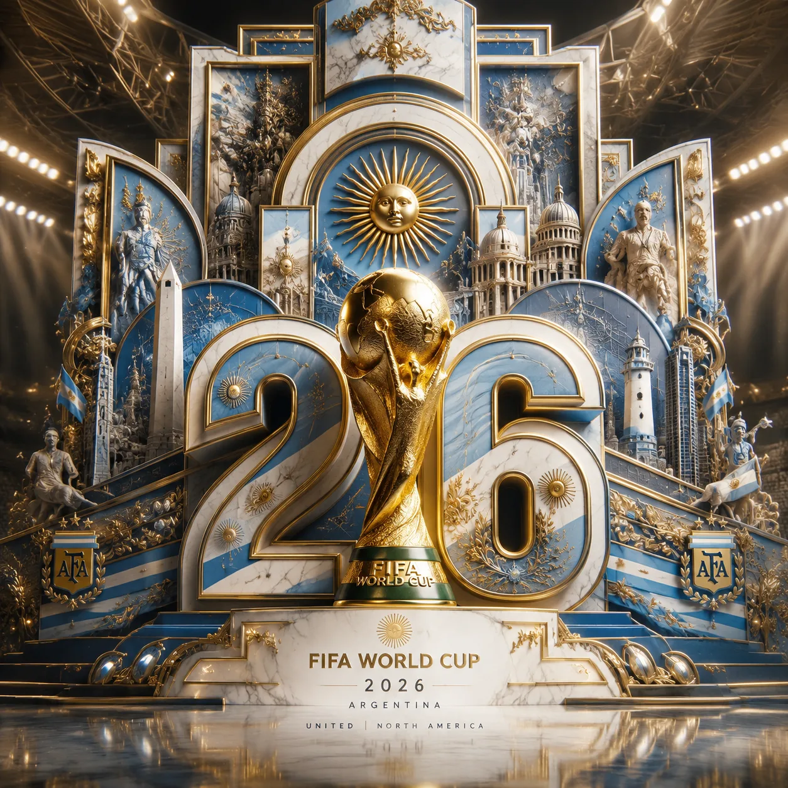

# Anime, Realistic

[← Back to the collection](../../README.md) · Category: [Poster Design](../../gallery/poster-design.md) · Model: `Vinano Studio` · ID: `vn-01705`

<a href="https://vinano.ai?utm_source=github&utm_medium=readme&utm_campaign=awesome-image-video-prompts-updating&utm_content=prompt-page-image"></a>

<sub>Preview generated with <a href="https://vinano.ai?utm_source=github&utm_medium=readme&utm_campaign=awesome-image-video-prompts-updating&utm_content=prompt-page-caption">vinano.ai</a></sub>

## Prompt

```text
Ultra-luxury FIFA World Cup 2026 poster, monumental layered Art Deco architecture made from interlocking curved panels and geometric frames, centered FIFA World Cup trophy mounted on a large sculpted “26”, premium blue-and-white marble and gold metallic finish, intricate gilded filigree, embossed national symbols, cultural landmarks, historic monuments, cathedral domes, statues, city skylines, ornamental engravings, celestial sun motifs, decorative patterns, museum-quality craftsmanship, highly detailed relief sculpture, layered depth composition, elegant architectural storytelling, championship atmosphere inside a grand illuminated stadium, dramatic filmic, cinematic lighting, reflective gold accents, ultra-realistic materials, depth of field, volumetric light rays, luxury editorial design, hyper-detailed 3D render, octane render, ray tracing, masterpiece, 8K, sharp focus, symmetrical composition, premium sports branding, collectible poster aesthetic, intricate textures, true-to-life photorealistic metallic surfaces, award-winning design.

Color Variations:
•Argentina Edition: sky blue, white marble, gold trim, Argentine cultural landmarks, sun emblem, AFA-inspired details.
•Portugal Edition: deep emerald green, royal red, white marble, gold trim, Portuguese tiles (azulejos), maritime exploration elements, historic towers, national crest-inspired details.

Negative Prompt:

blurry, low quality, low detail, flat design, cartoon, anime, distorted trophy, extra objects, watermark, text errors, cropped composition, noisy textures, dull lighting, oversaturated colors, unrealistic proportions, duplicate elements, messy layout, low-poly render.

Aim for an editorial, design-driven look with deliberate negative space.
```

## Try it on vinano.ai

1. Copy the prompt above.
2. Open **[vinano.ai](https://vinano.ai?utm_source=github&utm_medium=readme&utm_campaign=awesome-image-video-prompts-updating&utm_content=prompt-page-try)**, paste it into the image generator and pick a model.
3. Swap any placeholders (brand, product, city, person…) for your own details, then generate.

More prompts like this: [Poster Design gallery](../../gallery/poster-design.md) · [all categories](../../README.md#contents)
