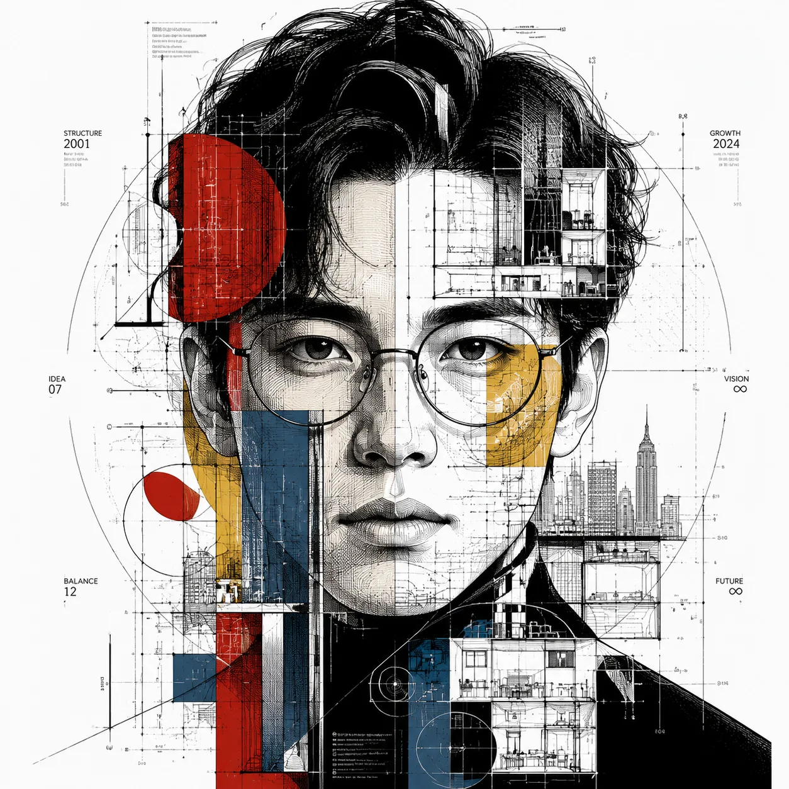

# Realistic, Portrait

[← Back to the collection](../../README.md) · Category: [Poster Design](../../gallery/poster-design.md) · Model: `Vinano Studio` · ID: `vn-01712`

<a href="https://vinano.ai?utm_source=github&utm_medium=readme&utm_campaign=awesome-image-video-prompts-updating&utm_content=prompt-page-image"></a>

<sub>Preview generated with <a href="https://vinano.ai?utm_source=github&utm_medium=readme&utm_campaign=awesome-image-video-prompts-updating&utm_content=prompt-page-caption">vinano.ai</a></sub>

## Prompt

```text
{
 "prompt": "Ultra-detailed stylized portrait my face as reference. Intellectual, modernist illustration style inspired by architectural blueprints and editorial line art. Face split into layered geometric sections visible technical diagrams, city interiors, structural grids, and abstract architectural elements embedded within the facial planes. Fine ink linework, cross-hatching, and engraving-style shading. Clean white background dense black line drawings.\n\nBold accent colors only in selected regions: deep red, muted blue, and warm yellow, applied as flat graphic blocks and translucent overlays. Sharp, thoughtful eyes realistic highlights, wearing thin round glasses. refined minimalist yet complex composition, high contrast, crisp edges, poster-grade clarity.\n\nEditorial illustration aesthetic, conceptual portrait, futuristic intellect vibe, data visualization meets human identity. Extremely sharp, ultra-high resolution, professional magazine cover quality, no blur, no distortion, balanced symmetry.",
 "negative_prompt": "photorealism, soft blur, painterly strokes, oil painting, low detail, messy colors, cartoonish style, exaggerated proportions",
 "style": ["modernist illustration",
 "architectural blueprint",
 "editorial line art",
 "engraving",
 "conceptual portrait",
 "futuristic intellect"],
 "color_palette": {
 "accent_colors": ["deep red",
 "muted blue",
 "warm yellow"],
 "base_colors": ["black",
 "white"]
 },
 "composition": {
 "background": "clean white",
 "symmetry": "balanced",
 "contrast": "high",
 "detail_level": "ultra-detailed",
 "resolution": "ultra-high"
 },
 "quality": ["poster-grade clarity",
 "professional magazine cover",
 "extremely sharp",
 "no blur",
 "no distortion"]
}

Emphasise material texture and natural light so the final frame feels tactile and premium.
```

## Try it on vinano.ai

1. Copy the prompt above.
2. Open **[vinano.ai](https://vinano.ai?utm_source=github&utm_medium=readme&utm_campaign=awesome-image-video-prompts-updating&utm_content=prompt-page-try)**, paste it into the image generator and pick a model.
3. Swap any placeholders (brand, product, city, person…) for your own details, then generate.

More prompts like this: [Poster Design gallery](../../gallery/poster-design.md) · [all categories](../../README.md#contents)
