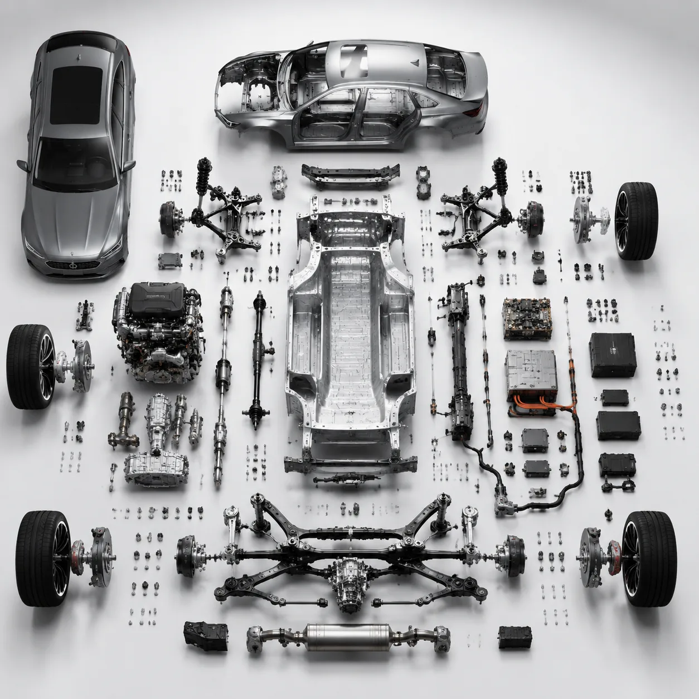

# Realistic, Poster

[← Back to the collection](../../README.md) · Category: [Poster Design](../../gallery/poster-design.md) · Model: `Vinano Studio` · ID: `vn-01728`

<a href="https://vinano.ai?utm_source=github&utm_medium=readme&utm_campaign=awesome-image-video-prompts-updating&utm_content=prompt-page-image"></a>

<sub>Preview generated with <a href="https://vinano.ai?utm_source=github&utm_medium=readme&utm_campaign=awesome-image-video-prompts-updating&utm_content=prompt-page-caption">vinano.ai</a></sub>

## Prompt

```text
Create an ultra-high fidelity exploded technical diagram of a 2026 Audi A6, presented as a premium engineering poster. Audi A6 (2026)Maintain a true orthographic top/front hybrid view zero perspective distortion.CORE COMPOSITION RULE
Place the primary chassis or structural platform perfectly centered as the core spine. Position the main body shell separately (left or top), aligned parallel as a reference form while preserving accurate proportions, stance, and real-world geometry of the 2026 Audi A6.EXPLODED ENGINEERING SYSTEM (MULTI-LAYER DEPTH STRUCTURE)
Design a multi-layered exploded system components separated across depth (Z-axis) and planar spacing:Micro hardware (bolts, screws, washers): tightly grouped in precision clusters
Functional assemblies: moderately spaced clear mechanical relationships
Major systems: widely separated for structural clarity and engineering hierarchy
SUBSYSTEM BREAKDOWN (MODERN AUDI ARCHITECTURE)
Organize parts into realistic automotive engineering subsystems:Front Assemblyadaptive suspension system (Audi drive select calibrated damping)
precision steering rack electronic assist
advanced braking system (ventilated discs + regenerative integration if hybrid)
sensor suite (front radar, LiDAR-ready modules, camera array)
Rear Assemblyrear multi-link suspension system
drivetrain assembly (quattro AWD torque distribution unit)
rear differential system (or integrated e-axle for hybrid/EV variant)
stability and traction control modules
Chassis / Structurelightweight MLB Evo / next-gen Audi modular platform architecture
reinforced aluminum and high-strength steel hybrid frame
vibration isolation subframes
crash-optimized energy absorption zones
Powertrainturbocharged inline-4 / V6 hybrid-compatible engine architecture
transmission system (dual-clutch S tronic representation)
intake, exhaust, and thermal management routing
optional mild-hybrid or plug-in hybrid battery integration
partial internal exposure showing combustion or electric assist layering
Electronics SystemECU and domain control architecture (centralized compute unit)
wiring harness ultra-clean routed geometry
driver assistance systems (ADAS module cluster)
infotainment + digital cockpit processing unit
sensor fusion computing core
Wheel System4 wheels symmetrically placed
rim, tire, brake disc, hub assembly separated in exploded layers
precise axle alignment and rotational geometry
Audi signature aerodynamic rim design
ENGINEERING REALISM RULE
Maintain strict mechanical connectivity between all systems
Align shafts, axles, and torque paths accurately
Preserve left/right symmetry controlled functional asymmetry only
Group micro-components in structured clusters near their assemblies
Avoid decorative or random placement — everything must reflect real automotive engineering logic
VISUAL STYLE & MATERIAL LANGUAGE
Use modern Audi design precision:brushed aluminum + matte graphite structural materials
carbon-reinforced polymer accents
high-precision machined metal surfaces
glass sensor domes optical realism
subtle soft-touch interior material hints (minimal visibility)
LIGHTING & RENDERING
clean studio-grade white-to-light grey gradient lighting environment
soft top illumination controlled shadow falloff
subtle reflections on metallic and glass surfaces
ambient occlusion emphasizing mechanical separation
ultra-realistic ray-traced rendering
BACKGROUND & COMPOSITION
minimal premium engineering backdrop
museum-grade product isolation aesthetic
balanced negative space structured density zones
strong horizontal symmetry controlled exploded depth layering
OUTPUT SPECIFICATION
ultra-detailed 2K or 4K resolution
4:5 vertical aspect ratio
razor-sharp macro engineering detail across all components
STRICT RESTRICTIONS
no text
no labels
no arrows
no branding overlays
no stylized illustration effects
no perspective distortion
no artistic abstraction
STYLE KEYWORDS
automotive engineering exploded diagram
Audi design precision language
luxury technical breakdown poster
industrial mechanical visualization
Apple-style product engineering layout
museum-grade automotive presentation
high-density precision system design

Aim for an editorial, design-driven look with deliberate negative space.
```

## Try it on vinano.ai

1. Copy the prompt above.
2. Open **[vinano.ai](https://vinano.ai?utm_source=github&utm_medium=readme&utm_campaign=awesome-image-video-prompts-updating&utm_content=prompt-page-try)**, paste it into the image generator and pick a model.
3. Swap any placeholders (brand, product, city, person…) for your own details, then generate.

More prompts like this: [Poster Design gallery](../../gallery/poster-design.md) · [all categories](../../README.md#contents)
