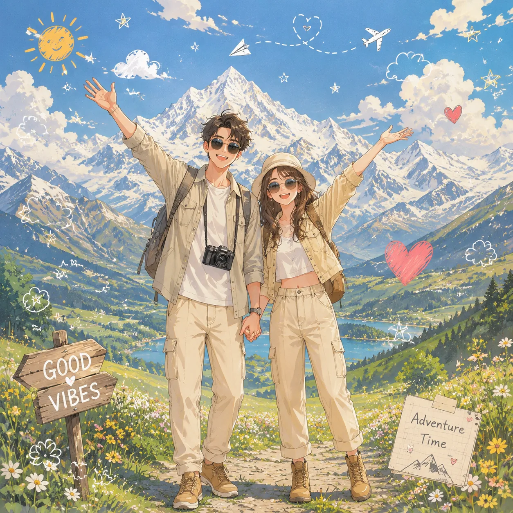

# Anime, Landscape

[← Back to the collection](../../README.md) · Category: [Poster Design](../../gallery/poster-design.md) · Model: `Vinano Studio` · ID: `vn-01729`

<a href="https://vinano.ai?utm_source=github&utm_medium=readme&utm_campaign=awesome-image-video-prompts-updating&utm_content=prompt-page-image"></a>

<sub>Preview generated with <a href="https://vinano.ai?utm_source=github&utm_medium=readme&utm_campaign=awesome-image-video-prompts-updating&utm_content=prompt-page-caption">vinano.ai</a></sub>

## Prompt

```text
Transform the uploaded travel photo into a charming hand-drawn anime illustration while perfectly preserving the original pose, composition, clothing, hand-holding gesture, mountain landscape, and camera angle. Cute couple standing together arms raised, joyful expressions, soft smiles, bright adventure mood.

Background: majestic snow-capped mountains, lush green valley, wildflowers, blue sky, fluffy white clouds. Add whimsical doodle elements including hand-drawn sun, stars, hearts, clouds, airplane trail, sparkles, and playful travel-themed sketches. Wooden signboard handwritten text “GOOD VIBES”, handwritten note “Adventure Time”.

Style: Studio Ghibli-inspired travel postcard, pastel colors, clean line art, soft painterly shading, vibrant yet cozy atmosphere, storybook illustration, kawaii aesthetic, dreamy vacation vibe, high detail, ultra cute characters, warm sunlight, cheerful summer day.

Composition: full-body characters centered in frame, scenic landscape stretching behind them, balanced poster design, social-media-ready artwork, travel diary illustration, whimsical doodles integrated naturally around the scene.

Quality: masterpiece, highly detailed, professional illustration, crisp outlines, soft textures, vibrant colors, 4K, anime travel artwork, magical atmosphere, adorable expressions, perfect character consistency.

Preserve realistic proportions and depth for a confident, professional finish.
```

## Try it on vinano.ai

1. Copy the prompt above.
2. Open **[vinano.ai](https://vinano.ai?utm_source=github&utm_medium=readme&utm_campaign=awesome-image-video-prompts-updating&utm_content=prompt-page-try)**, paste it into the image generator and pick a model.
3. Swap any placeholders (brand, product, city, person…) for your own details, then generate.

More prompts like this: [Poster Design gallery](../../gallery/poster-design.md) · [all categories](../../README.md#contents)
