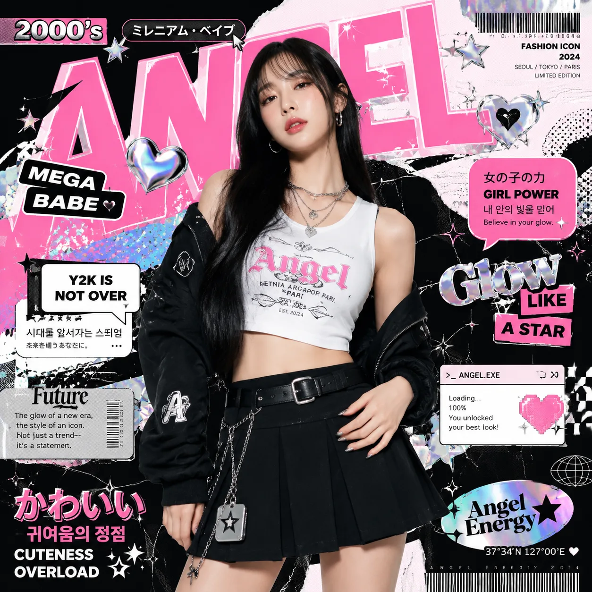

# Poster, Cinematic

[← Back to the collection](../../README.md) · Category: [Poster Design](../../gallery/poster-design.md) · Model: `Vinano Studio` · ID: `vn-01747`

<a href="https://vinano.ai?utm_source=github&utm_medium=readme&utm_campaign=awesome-image-video-prompts-updating&utm_content=prompt-page-image"></a>

<sub>Preview generated with <a href="https://vinano.ai?utm_source=github&utm_medium=readme&utm_campaign=awesome-image-video-prompts-updating&utm_content=prompt-page-caption">vinano.ai</a></sub>

## Prompt

```text
Ultra-stylized high-fashion editorial poster of a confident young Asian female model standing in the center frame, elegant pose, glossy radiant skin, soft dewy makeup, long silky black hair wispy bangs, wearing modern trendy K-fashion streetwear premium styling details. Clean studio lighting high-contrast fashion flash photography, sharp focus, ultra-detailed textures, cinematic composition. Background filled vibrant retro pop-art magazine aesthetics, layered graphic typography, dynamic UI-inspired design elements, holographic chrome effects, stickers (stars, hearts, sparkles), barcode strips, speech bubbles, and futuristic collage layering. Japanese and Korean-inspired typographic accents integrated as visual design elements. Overall mood combines nostalgic 2000s teen fashion magazine energy modern luxury editorial campaign style. Bold color harmony, premium print aesthetic, ultra crisp details, fashion advertising quality, 8K resolution, highly polished commercial poster look, surreal yet stylish, trend-forward global fashion branding vibe. Aim for an editorial, design-driven look with deliberate negative space.
```

## Try it on vinano.ai

1. Copy the prompt above.
2. Open **[vinano.ai](https://vinano.ai?utm_source=github&utm_medium=readme&utm_campaign=awesome-image-video-prompts-updating&utm_content=prompt-page-try)**, paste it into the image generator and pick a model.
3. Swap any placeholders (brand, product, city, person…) for your own details, then generate.

More prompts like this: [Poster Design gallery](../../gallery/poster-design.md) · [all categories](../../README.md#contents)
