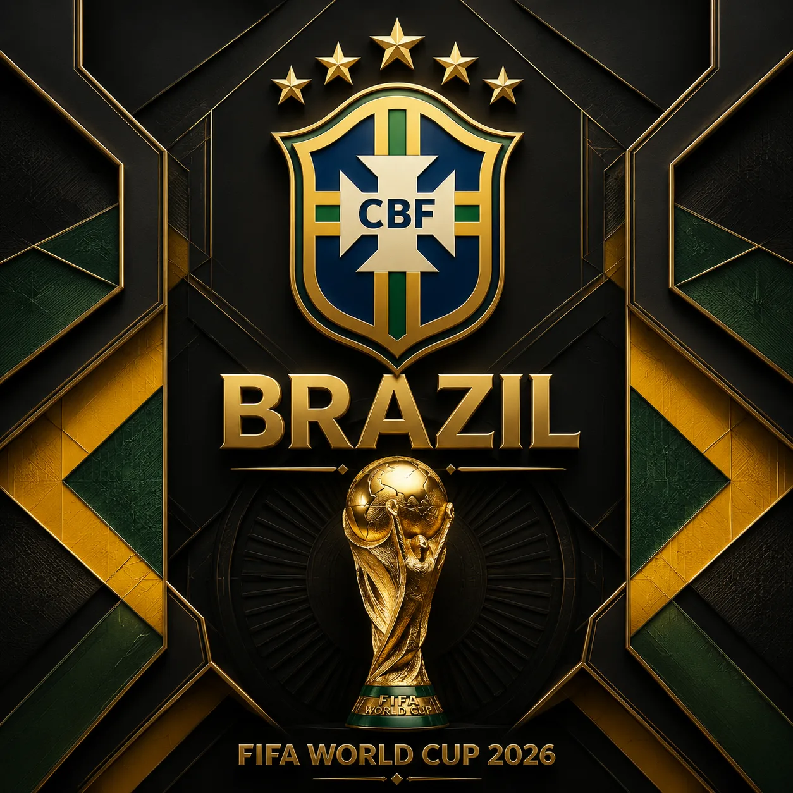

# Realistic, Poster

[← Back to the collection](../../README.md) · Category: [Poster Design](../../gallery/poster-design.md) · Model: `Vinano Studio` · ID: `vn-01760`

<a href="https://vinano.ai?utm_source=github&utm_medium=readme&utm_campaign=awesome-image-video-prompts-updating&utm_content=prompt-page-image"></a>

<sub>Preview generated with <a href="https://vinano.ai?utm_source=github&utm_medium=readme&utm_campaign=awesome-image-video-prompts-updating&utm_content=prompt-page-caption">vinano.ai</a></sub>

## Prompt

```text
Ultra-premium FIFA World Cup 2026 poster in a luxury 3D layered geometric design style. Vertical smartphone wallpaper format (9:16). Deep matte black background elegant gold metallic outlines and beveled abstract geometric panels arranged symmetrically around the composition. The central focus is the official-style national football federation crest of [Country Name], rendered as a high-end embossed 3D emblem realistic metallic gold detailing and national colors. Above the crest, display [Number Of World Cup Titles] gold championship stars. Below the crest, place large premium gold typography displaying [Country Name]. Under the country name, position a highly detailed realistic golden FIFA World Cup trophy cinematic reflections and museum-quality lighting. At the bottom, elegant gold text reading “FIFA WORLD CUP 2026”. Use the national color palette of [Country Name] throughout the geometric elements while maintaining the luxury black-and-gold theme. Ultra-crisp composition, premium sports branding aesthetic, luxury poster design, metallic textures, soft shadows, depth, symmetry, embossed details, cinematic studio lighting, true-to-life photorealistic 3D rendering, high contrast, award-winning graphic design, ultra-sharp focus, 8K, masterpiece, premium collectible poster, modern minimal luxury style Emphasise material texture and natural light so the final frame feels tactile and premium.
```

## Try it on vinano.ai

1. Copy the prompt above.
2. Open **[vinano.ai](https://vinano.ai?utm_source=github&utm_medium=readme&utm_campaign=awesome-image-video-prompts-updating&utm_content=prompt-page-try)**, paste it into the image generator and pick a model.
3. Swap any placeholders (brand, product, city, person…) for your own details, then generate.

More prompts like this: [Poster Design gallery](../../gallery/poster-design.md) · [all categories](../../README.md#contents)
