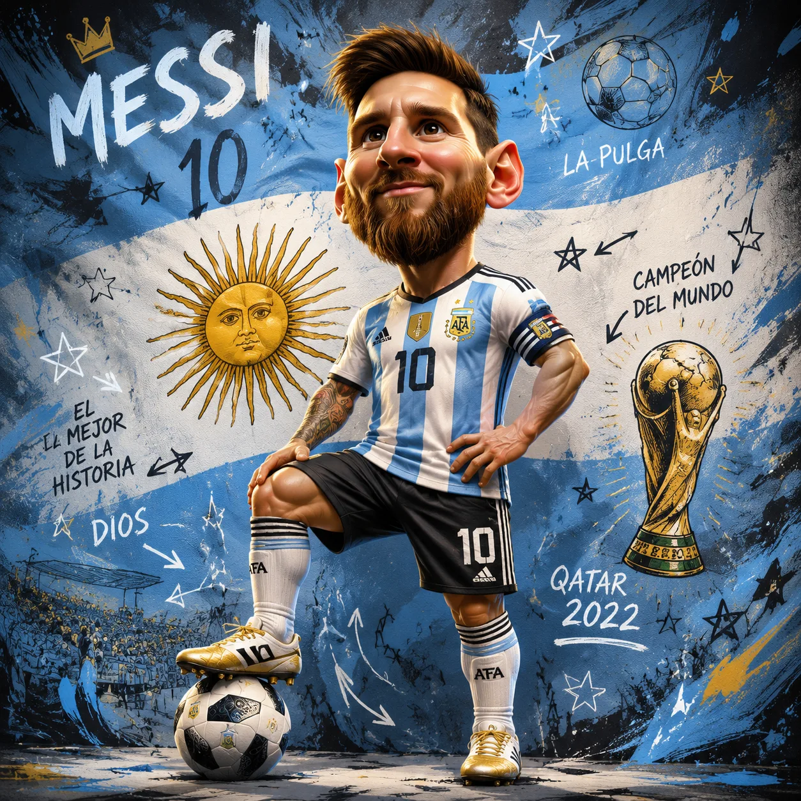

# Poster, Ai Art

[← Back to the collection](../../README.md) · Category: [Poster Design](../../gallery/poster-design.md) · Model: `Vinano Studio` · ID: `vn-01798`

<a href="https://vinano.ai?utm_source=github&utm_medium=readme&utm_campaign=awesome-image-video-prompts-updating&utm_content=prompt-page-image"></a>

<sub>Preview generated with <a href="https://vinano.ai?utm_source=github&utm_medium=readme&utm_campaign=awesome-image-video-prompts-updating&utm_content=prompt-page-caption">vinano.ai</a></sub>

## Prompt

```text
Full body caricature of a famous male football player oversized head, exaggerated facial features, big expressive eyes, prominent nose, well-groomed beard, confident smirk, wearing Argentina national team jersey light blue and white vertical stripes, number 10 on chest and black shorts number 10, one foot resting on a football, other hand on hip, muscular arms tattoos visible, wearing white and gold football boots number 10, dynamic low angle shot, 3D Pixar style render, vibrant digital painting, background Argentina flag colors light blue and white, Sun of May symbol, hand-drawn doodles, stars, arrows, football sketches, World Cup trophy illustration, textured paint effect, dramatic lighting, ultra-detailed, 8K resolution, playful energetic mood, sports poster aesthetic Preserve realistic proportions and depth for a confident, professional finish.
```

## Try it on vinano.ai

1. Copy the prompt above.
2. Open **[vinano.ai](https://vinano.ai?utm_source=github&utm_medium=readme&utm_campaign=awesome-image-video-prompts-updating&utm_content=prompt-page-try)**, paste it into the image generator and pick a model.
3. Swap any placeholders (brand, product, city, person…) for your own details, then generate.

More prompts like this: [Poster Design gallery](../../gallery/poster-design.md) · [all categories](../../README.md#contents)
