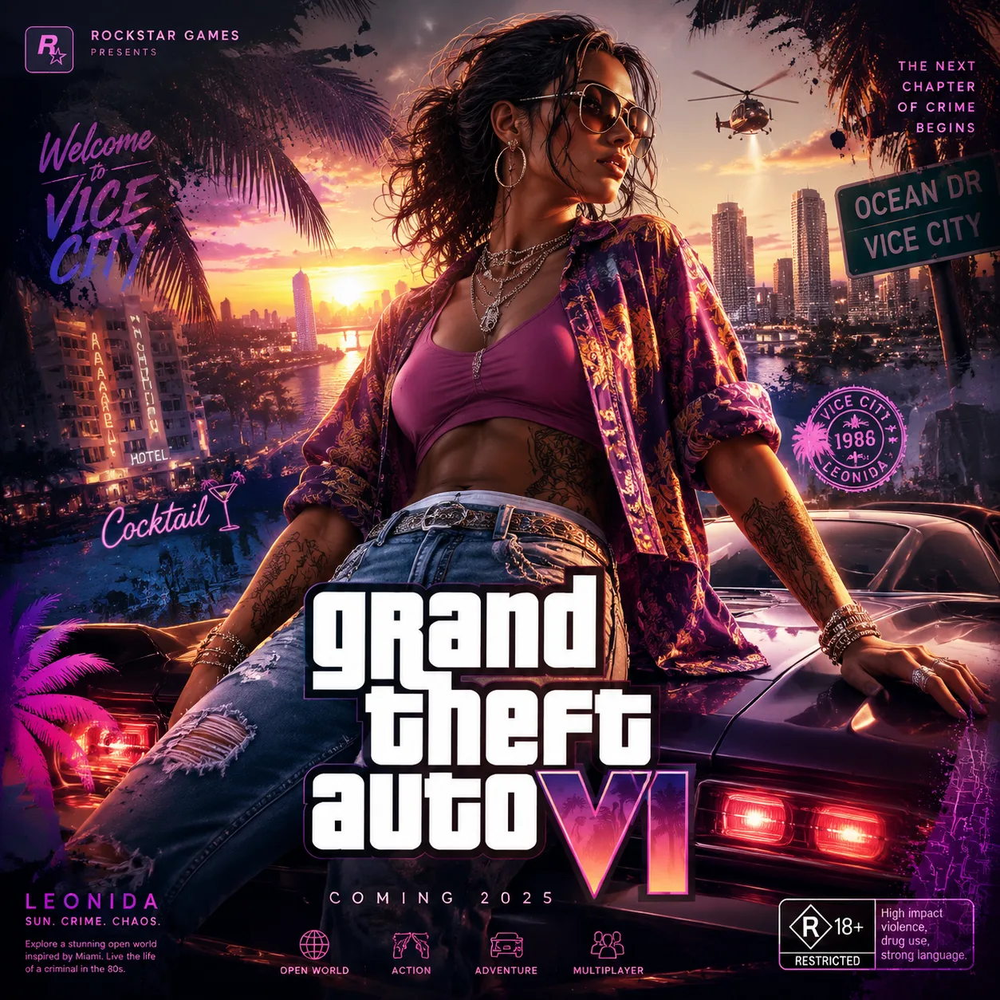

# Realistic, Portrait

[← Back to the collection](../../README.md) · Category: [Poster Design](../../gallery/poster-design.md) · Model: `Vinano Studio` · ID: `vn-01804`

<a href="https://vinano.ai?utm_source=github&utm_medium=readme&utm_campaign=awesome-image-video-prompts-updating&utm_content=prompt-page-image"></a>

<sub>Preview generated with <a href="https://vinano.ai?utm_source=github&utm_medium=readme&utm_campaign=awesome-image-video-prompts-updating&utm_content=prompt-page-caption">vinano.ai</a></sub>

## Prompt

```text
Create a highly detailed 8K portrait poster inspired by the iconic visual style of the modern Grand Theft Auto VI promotional artwork aesthetic, featuring a cinematic urban atmosphere bold composition, vibrant lighting, layered graphic elements, and stylish contemporary street-luxury fashion energy. The overall design must strongly capture the signature mood of GTA VI posters, including dynamic neon color grading, tropical-modern city vibes, dramatic shadows, glossy highlights, stylized textures, decorative ornaments, graphic overlays, urban symbols, luxury lifestyle accents, and immersive environmental storytelling. Add premium poster decorations such as abstract shapes, graffiti-inspired accents, subtle retro-modern textures, luxury vehicle silhouettes, nightlife elements, palm tree shadows, street sign details, glowing reflections, and layered visual effects that enrich the composition without making it feel overcrowded.
Include a large cinematic title text “Grand Theft Auto VI” prominently on the poster typography inspired by official AAA video game promotional posters, the full version of “GTA” clearly written as “Grand Theft Auto.” The typography should feel bold, luxurious, modern, and integrated naturally into the poster design, supported by additional smaller decorative texts, symbols, labels, and graphic UI-style elements to strengthen the authentic game-poster atmosphere.
The subject must not replicate the exact pose from the reference photo. Create a completely fresh and more visually engaging pose stronger body language, natural movement, and expressive emotion. The expression should feel alive, charismatic, confident, and cinematic rather than stiff, awkward, or flat. The pose must resemble the elegance and attitude of an international fashion model, combining stylish confidence relaxed realism. Avoid static standing poses. Instead, use dynamic posture, subtle movement, fashionable gestures, asymmetrical body positioning, realistic interaction the environment, and strong eye expression to create a premium editorial look.
The outfit should feature trendy modern casual fashion a luxurious streetwear influence. The clothing must feel fashionable, youthful, and visually rich, avoiding plain or monotonous styling. Combine varied colors, layered clothing pieces, modern fabric textures, unique motifs, stylish accessories, and contemporary fashion details that complement the GTA VI-inspired atmosphere. The styling should feel premium, photogenic, and believable, similar to high-end editorial fashion mixed modern open-world video game aesthetics.
Use filmic, cinematic lighting realistic skin texture, detailed fabric rendering, atmospheric reflections, depth-rich environment composition, balanced contrast, and ultra-sharp visual clarity. The poster should feel like an official next-generation AAA game promotional artwork highly polished rendering quality, immersive visual storytelling, and professional graphic design execution. Ultra-detailed, highly aesthetic, cinematic composition, realistic proportions, premium poster layout, vibrant modern color palette, visually powerful, and rendered in ultra high-definition 8K quality. Ratio 4:5

Keep edges clean and the overall composition balanced for a polished, gallery-ready result.
```

## Try it on vinano.ai

1. Copy the prompt above.
2. Open **[vinano.ai](https://vinano.ai?utm_source=github&utm_medium=readme&utm_campaign=awesome-image-video-prompts-updating&utm_content=prompt-page-try)**, paste it into the image generator and pick a model.
3. Swap any placeholders (brand, product, city, person…) for your own details, then generate.

More prompts like this: [Poster Design gallery](../../gallery/poster-design.md) · [all categories](../../README.md#contents)
